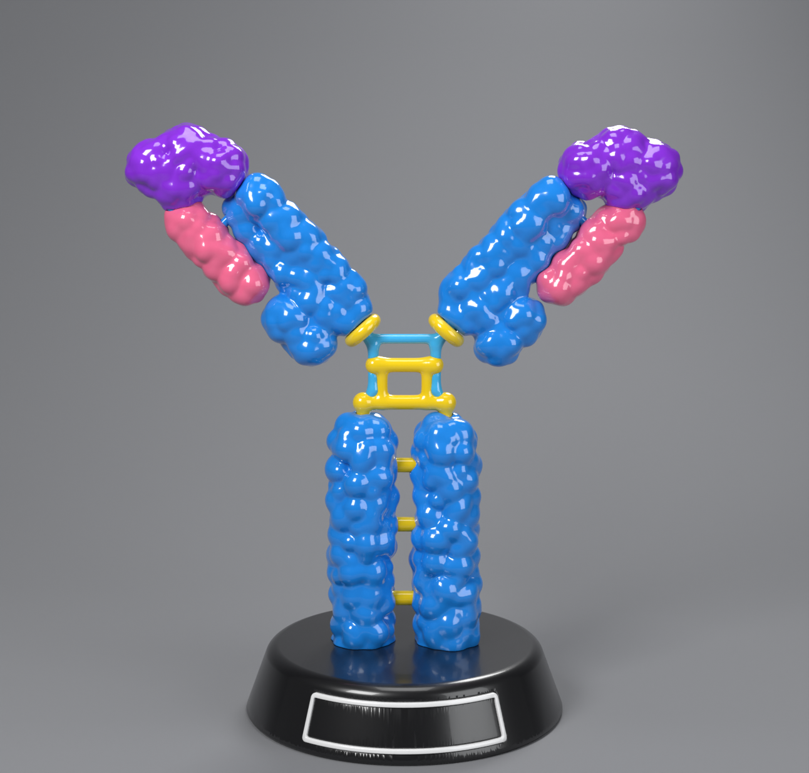
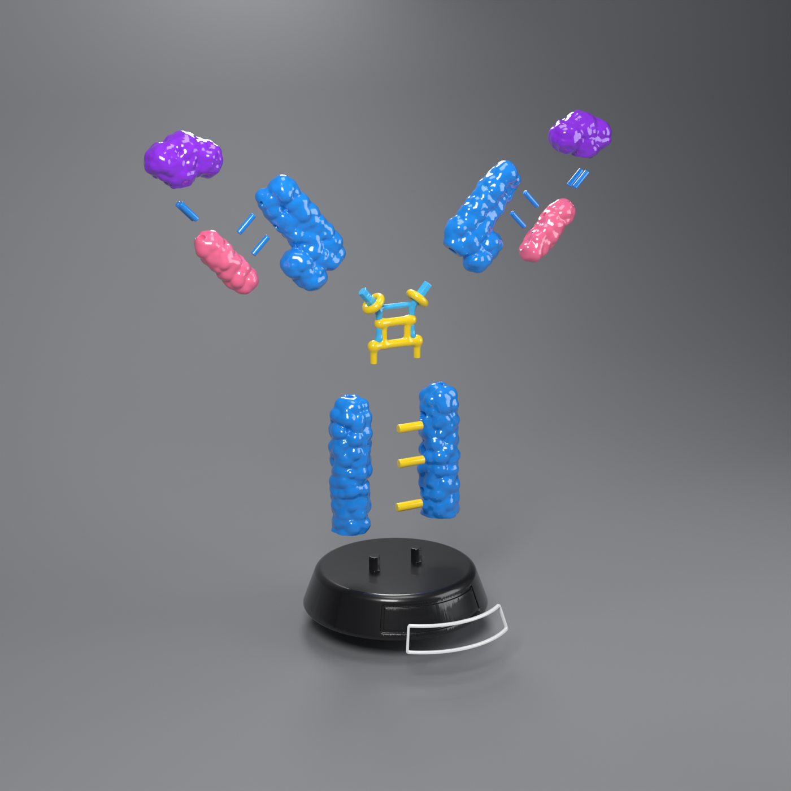

# نموذج الجسم المضاد IgG – مجزّأ وجاهز للطباعة ثلاثية الأبعاد

<p align="center">
  
  
</p>

نموذج ثلاثي الأبعاد للجسم المضاد **IgG (Immunoglobulin G)** على حامل، منسوخ من الصورة المرجعية.
كل جزء مقاس بالبكسل من الصورة ثم حُوّل إلى مليمتر (0.3 مم لكل بكسل)، فالمواضع والأحجام والزوايا مطابقة لها:
عمودا Fc، والمفصل (المربّع الأصفر والخيوط الزرقاء الفاتحة)، والحلقات الصفراء، والسلسلة الثقيلة المزدوجة،
والسلسلة الخفيفة الوردية، وموقع ارتباط المستضد البنفسجي، والقاعدة المخروطية مع إطار اللوحة.
النموذج **بدون أي كتابة**؛ إطار اللوحة الأمامية فارغ واختياري.

مقارنة مع الصورة: `renders/compare_reference.png`.

المقاسات بعد التركيب: **174 × 103 × 189 مم تقريباً** (العرض × العمق × الارتفاع)، والوحدة في كل الملفات هي **المليمتر**.

---

## الملفات

| المسار | المحتوى |
|---|---|
| `IgG_Antibody.blend` | ملف Blender (الإصدار 5.0): كل القطع منفصلة وملوّنة، مع إضاءة استوديو وكاميرا |
| `stl/` | ملف STL لكل قطعة، بإحداثيات التركيب (إذا استوردتها كلها تظهر مركّبة) |
| `renders/` | صور المعاينة: أمامية، ثلاثة أرباع، ومفكّكة |
| `parts_report.txt` | عدد المثلثات والحجم والأبعاد لكل قطعة |
| `scripts/` | السكربتات التي تولّد النموذج بالكامل |

كل القطع **مغلقة (watertight / manifold)** وتم فحصها: لا توجد حواف مفتوحة، ولا تتداخل القطع مع بعضها بعد التركيب.

---

## قائمة القطع واللون المقترح

| # | الملف | القطعة | اللون | العدد |
|---|---|---|---|---|
| 01 | `01_base_black.stl` | القاعدة (مع وتدين سداسيين) | أسود | 1 |
| 02 | `02_plaque_white_optional.stl` | إطار اللوحة الأمامية، فارغ بدون كتابة (اختياري) | أبيض | 1 |
| 03 | `03_fc_left_blue.stl` | منطقة Fc – العمود الأيسر | أزرق | 1 |
| 04 | `04_fc_right_blue.stl` | منطقة Fc – العمود الأيمن | أزرق | 1 |
| 05–07 | `05/06/07_fc_bond_*.stl` | روابط ثنائية الكبريتيد بين عمودي Fc (سفلي / أوسط / علوي) | أصفر | 1 لكل واحد |
| 08 | `08_hinge_one_piece.stl` | منطقة المفصل كقطعة واحدة (لطابعة بلون واحد) | أصفر | 1 |
| 08a + 08b | `08a_hinge_part_yellow.stl` + `08b_hinge_part_cyan.stl` | نفس المفصل مقسوم حسب اللون (لطابعة متعددة الألوان): المربّع والحلقات أصفر، والخيوط أزرق فاتح | أصفر + أزرق فاتح | بدلاً من 08 |
| 09 | `09_fab_heavy_left_blue.stl` | السلسلة الثقيلة – ذراع Fab اليسرى | أزرق | 1 |
| 10 | `10_fab_heavy_right_blue.stl` | السلسلة الثقيلة – ذراع Fab اليمنى | أزرق | 1 |
| 11 | `11_light_chain_left_pink.stl` | السلسلة الخفيفة اليسرى | وردي | 1 |
| 12 | `12_light_chain_right_pink.stl` | السلسلة الخفيفة اليمنى | وردي | 1 |
| 13 | `13_antigen_site_left_purple.stl` | موقع ارتباط المستضد الأيسر | بنفسجي | 1 |
| 14 | `14_antigen_site_right_purple.stl` | موقع ارتباط المستضد الأيمن | بنفسجي | 1 |
| 15 | `15_pin_3x12mm_print_x8.stl` | مسمار تثبيت 3 × 12 مم | أي لون (مخفي) | **8** |

**المفصل بلونين:** في Bambu Studio أو PrusaSlicer استورد 08a و 08b معاً، واختر "كائن واحد متعدد الأجزاء"
(Load as single object with multiple parts)، ثم أعطِ كل جزء لونه. إذا كانت طابعتك بلون واحد، اطبع 08 فقط ولوّن الخيوط بالفرشاة.

الثقوب مصمّمة لمسامير بقطر **3 مم**. اطبع المسامير، أو استخدم قضيباً معدنياً أو خشبياً بقطر 3 مم مقصوصاً بطول 12 مم.

---

## إعدادات الطباعة المقترحة

**FDM (PLA / PETG):**
- ارتفاع الطبقة: 0.12–0.16 مم للقطع العضوية (لإظهار الكرات الصغيرة على السطح)، و 0.2 مم للقاعدة.
- الحشو: 10–15% (جيرويد).
- الجدران: 3.
- **الدعامات:** القاعدة وعمودا Fc لها قاعدة مسطّحة، تُطبع واقفة بدون دعامات تقريباً.
  قطع Fab (الأزرق والوردي والبنفسجي) والمفصل تحتاج **دعامات شجرية (Tree / Organic)**.
- المسامير والروابط الصفراء: اطبعها أفقياً مستلقية، أو عمودية مع Brim.

**Resin:** كل القطع مناسبة. أفرغها (Hollow) بسماكة 2 مم مع ثقوب تصريف إذا أردت توفير الريزن.

**التسامح (Clearance):** كل الثقوب أكبر من القطعة الداخلة بـ 0.15 مم في نصف القطر (0.3 مم في القطر).
إذا كانت ضيقة على طابعتك، صنفرة خفيفة تكفي. إذا كانت واسعة، الغراء يملأ الفراغ.

**تكبير / تصغير:** يمكنك تغيير الحجم في السلايسر بنفس النسبة لكل القطع (مثلاً 80% أو 120%)،
لكن لاحظ أن التسامح يتغيّر معها. لأي حجم آخر، الأفضل إعادة التوليد من السكربتات.

---

## التركيب (بالترتيب)

1. **عمودا Fc:** ضع الروابط الصفراء الثلاث (05، 06، 07) في ثقوب العمود الأيسر، ثم أدخل العمود الأيمن عليها جانبياً. ثبّت بالغراء (CA / سوبر غلو).
2. **القاعدة:** أنزل العمودين معاً على الوتدين السداسيين في القاعدة (السداسي يمنع الدوران). ألصق الإطار الأبيض في المجرى الأمامي إن أردته.
3. **المفصل:** ضع قطعة المفصل فوق العمودين؛ الوتدان تحت الدرجة الصفراء السفلى يدخلان في أعلى العمودين.
4. **السلسلة الثقيلة لـ Fab:** أدخل كل قطعة (09 و 10) على الوتد السداسي المائل الخارج من الحلقة الصفراء.
5. **السلسلة الخفيفة الوردية:** ضع مسمارين في الثقوب على جانب السلسلة الثقيلة، ثم ركّب القطعة الوردية عليهما.
6. **موقع ارتباط المستضد البنفسجي:** ضع مسمارين في رأس القطعة الوردية، ثم ركّب القطعة البنفسجية فوقها.
   سطحها السفلي منحوت ليجلس على رأس السلسلة الوردية ورأس السلسلة الزرقاء معاً.

كل الأسطح المتلامسة منحوتة بشكل يطابق القطعة المجاورة، وبدون أي تداخلات سفلية (undercuts)، فكل قطعة تدخل مكانها في اتجاه مستقيم واحد.

---

## العمل في Blender

- افتح `IgG_Antibody.blend`: مجموعة `IgG_Antibody_Parts` فيها كل القطع، ومجموعة `Pins_Assembled` فيها المسامير في أماكنها.
- وحدة المشهد مليمتر (Unit Scale = 0.001)، فالقياسات في Blender هي نفسها في الطابعة.
- للتصدير بعد أي تعديل: حدّد القطعة ثم `File > Export > STL` (اختر Selection Only).
- إذا عدّلت قطعة، شغّل *3D Print Toolbox > Check All* للتأكد أنها ما زالت مغلقة.

---

## إعادة توليد النموذج من الصفر

السكربتات في `scripts/` تبني كل الأشكال كحقول مسافة (SDF)، وبعدها تحوّلها إلى شبكات مغلقة بخوارزمية marching cubes.
طريقة البناء هذه تضمن ملفات سليمة للطباعة، وتنحت كل ثقب من شكل القطعة التي تدخل فيه بالضبط.

```bash
pip install bpy==5.0.1 scipy scikit-image   # يحتاج Python 3.11
```

```bash
cd antibody-igg-3d/scripts
```

```bash
python build_geometry.py parts.npz
```

```bash
python build_blend.py parts.npz .. --render
```

الإعدادات المهمة موجودة في أعلى `build_geometry.py`: دقة الشبكة `H`، والتسامح `CLR`، ومقاس المسامير، ومواضع الأجزاء.
لتغيير شكل الكرات على السطح، عدّل `layers` في `LumpyDomain`، وكل طبقة معرّفة بـ (التباعد، أصغر نصف قطر، أكبر نصف قطر، البروز).
