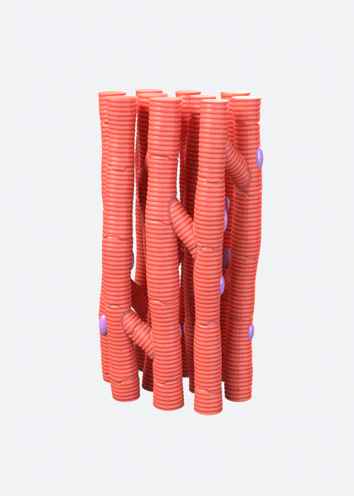
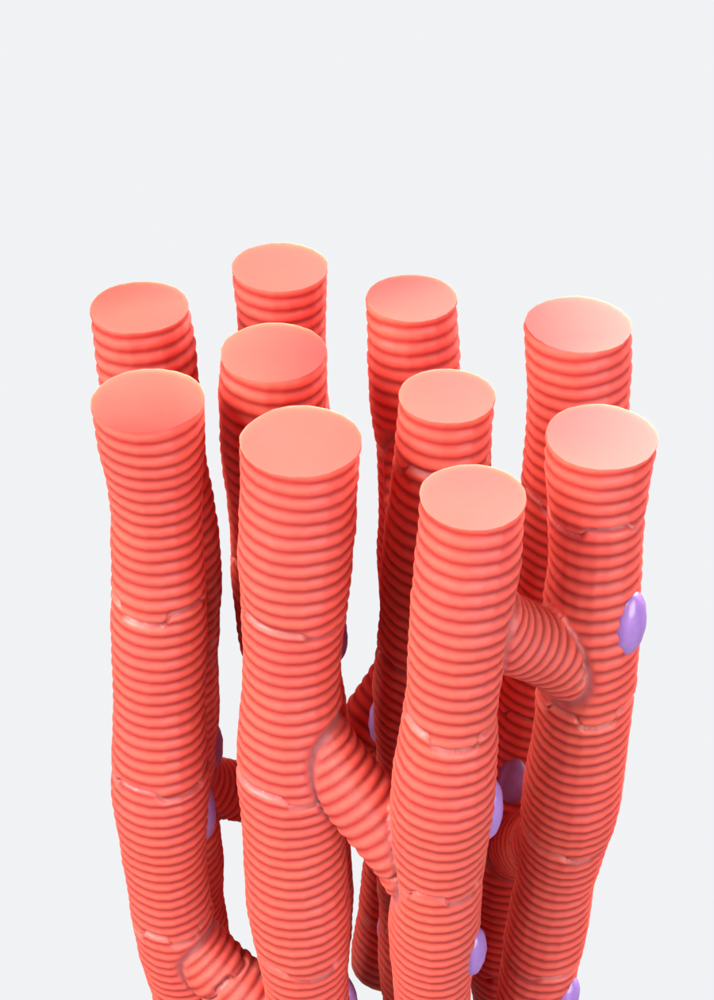
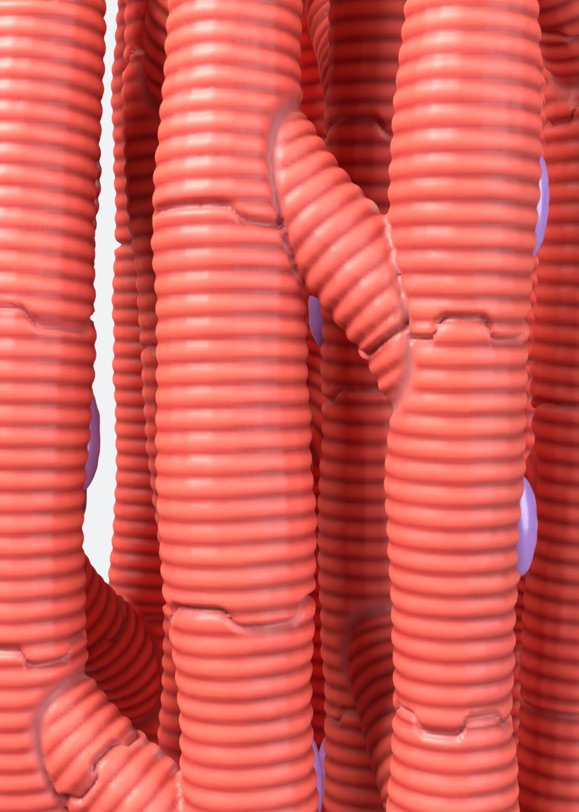

# نموذج نسيج عضلة القلب – Cardiac Muscle Tissue (Blender)

نموذج ثلاثي الأبعاد عالي الدقة، مثل الصورة المرجعية:

- ألياف متفرعة على شكل حرف Y، كلها مدموجة في مجسم واحد ناعم
- تخطيطات عرضية حقيقية محفورة في المجسم (وليست مجرد texture)
- أقراص بينية متعرجة بين الخلايا (Intercalated discs)
- عند كل تفرع، تخطيطات الفرع المائل منفصلة عن تخطيطات الليفة المستقيمة بحد (أخدود) واضح
- أنوية بنفسجية بيضاوية (Nuclei) كمجسم منفصل
- خامات Cycles جاهزة، مع إضاءة وكاميرا
- الألياف **واقفة عمودياً ومقصوصة بشكل مستوٍ ومتساوٍ من فوق وتحت**، فيقف النموذج ثابتاً على سرير الطابعة
- **الارتفاع = 20 سم بالضبط** (العرض تقريباً 11.2 سم، والعمق 7.8 سم)
- المجسم مغلق (Watertight) وجاهز للطباعة ثلاثية الأبعاد

## الملفات
| الملف | الوصف |
|---|---|
| `cardiac_muscle.blend` | الملف الجاهز، افتحه مباشرة في Blender 4.2 أو أحدث |
| `generate_cardiac_muscle.py` | السكربت الذي يبني النموذج من الصفر |
| `cardiac_muscle_20cm_stl.zip` | ملف STL للطباعة (بالمليمتر، ارتفاعه 200 مم) |
| `render_*.png` | صور الرندر |

## إعادة البناء أو التعديل
افتح Blender، ثم تبويب **Scripting**، ثم **Open** واختر `generate_cardiac_muscle.py`، ثم **Run Script**.

الإعدادات في أعلى السكربت:
- `TARGET_HEIGHT_M`: الارتفاع النهائي (0.20 = 20 سم)
- `VOXEL`: الدقة (كلما صغر الرقم زادت التفاصيل وزاد عدد النقاط)
- `STRIATION_PITCH` و `STRIATION_DEPTH`: المسافة بين التخطيطات وعمقها
- `SEED`: غيّره لتحصل على توزيع مختلف للألياف والتفرعات
