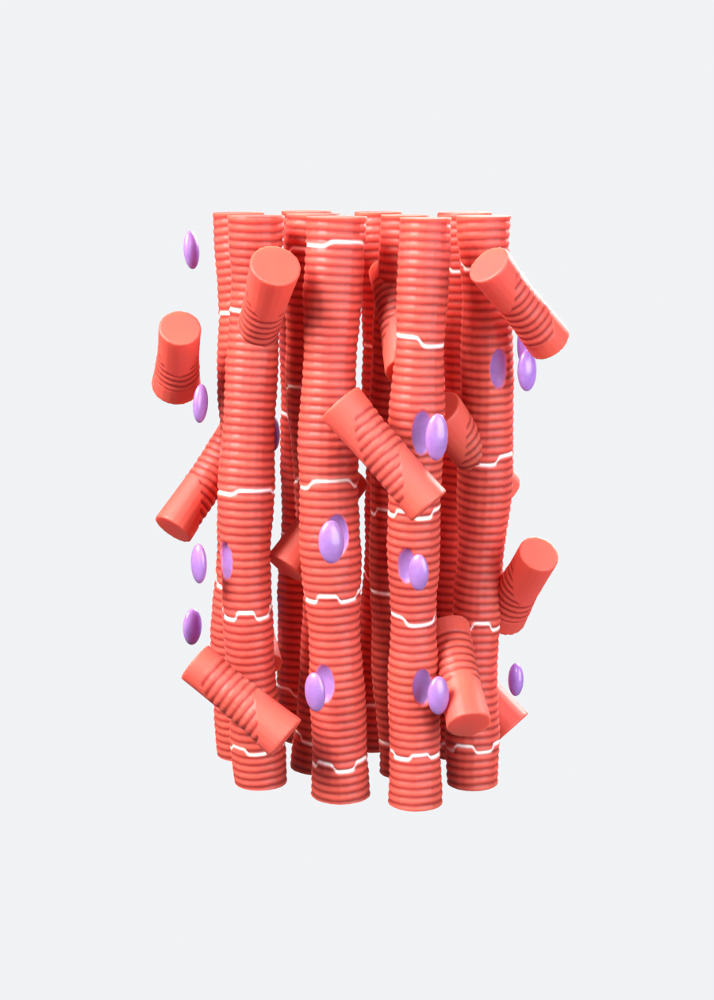

# نموذج نسيج عضلة القلب – Cardiac Muscle Tissue (Blender)

نموذج ثلاثي الأبعاد عالي الدقة، مثل الصورة المرجعية، وجاهز للطباعة بثلاثة ألوان:

- **أحمر:** الألياف المستقيمة والفروع المائلة.
- **أبيض:** خطوط الأقراص البينية المتعرجة (Intercalated discs).
- **بنفسجي:** الأنوية (Nuclei).

## المواصفات
- **الفروع المائلة** قطع قصيرة منفصلة (Branch_01 … Branch_13). كل فرع يقطع المسافة بين ليفتين بشكل مائل، وطرفاه مقصوصان بشكل نظيف على سطح الليفة.
- **التخطيطات العرضية** محفورة في المجسم نفسه، وليست texture.
- **خطوط الأقراص البيضاء:** شريط أبيض متعرج عرضه حوالي 1.3 مم، ويدخل في الليفة حوالي 2 مم. لا يقترب من أماكن التفرع.
- **الأنوية:** حبيبات منفصلة، نواة لكل خلية.
- **الشكل العام:** الألياف واقفة عمودياً، ومقصوصة بشكل مستوٍ ومتساوٍ من فوق وتحت.
- **المقاس:** الارتفاع 20 سم بالضبط (العرض حوالي 11.2 سم، والعمق 7.8 سم).

## الملفات
| الملف | الوصف |
|---|---|
| `cardiac_muscle_3colors.3mf` | **ملف الطباعة.** كائن واحد من 3 أجزاء: `1_Red_muscle` و`2_White_discs` و`3_Purple_nuclei`. الأجزاء تتلامس ولا تتداخل، وكل جزء مغلق (Watertight). الوحدة مليمتر |
| `cardiac_muscle.blend` | ملف التصميم. افتحه في Blender 4.2 أو أحدث |
| `generate_cardiac_muscle.py` | السكربت الذي يبني النموذج من الصفر ويصدّر ملف 3MF |
| `render_*.png` | صور الرندر |

## الطباعة (Bambu Studio / OrcaSlicer)
1. حمّل الخيوط في الـ AMS: **1 = أحمر**، **2 = أبيض**، **3 = بنفسجي**.
2. افتح `cardiac_muscle_3colors.3mf`.
3. في قائمة الكائنات تأكد أن كل جزء على الخيط الصحيح، وإذا لم يكن كذلك فاختره يدوياً: `1_Red_muscle` على 1، و`2_White_discs` على 2، و`3_Purple_nuclei` على 3.
4. فعّل **Supports** (يناسبها Tree)، لأن الفروع المائلة والأنوية الجانبية فيها أجزاء معلقة. وفعّل **Brim**.

## إعادة البناء أو التعديل
افتح Blender، ثم تبويب **Scripting**، ثم **Open** واختر `generate_cardiac_muscle.py`، ثم **Run Script**.

الإعدادات في أعلى السكربت:
- `TARGET_HEIGHT_M`: الارتفاع النهائي (0.20 = 20 سم).
- `VOXEL`: الدقة. كلما صغر الرقم زادت التفاصيل.
- `STRIATION_PITCH` و`STRIATION_DEPTH`: المسافة بين التخطيطات وعمقها.
- `BRANCH_SPAN`: طول الفروع المائلة على امتداد الليفة. كلما صغر الرقم صار الفرع أقصر وأكثر ميلاً.
- `BAND_HALF` و`BAND_DEPTH`: عرض الخط الأبيض وعمقه.
- `NUCLEUS_HEIGHT`: مقدار بروز الأنوية.
- `COLOR_RED` و`COLOR_WHITE` و`COLOR_PURPLE`: ألوان الأجزاء في ملف 3MF.
- `EXPORT_3MF`: ضع مساراً مثل `"//cardiac_muscle_3colors.3mf"` ليصدّر السكربت ملف الطباعة تلقائياً.
- `SEED`: غيّره لتحصل على توزيع مختلف للألياف والتفرعات.
