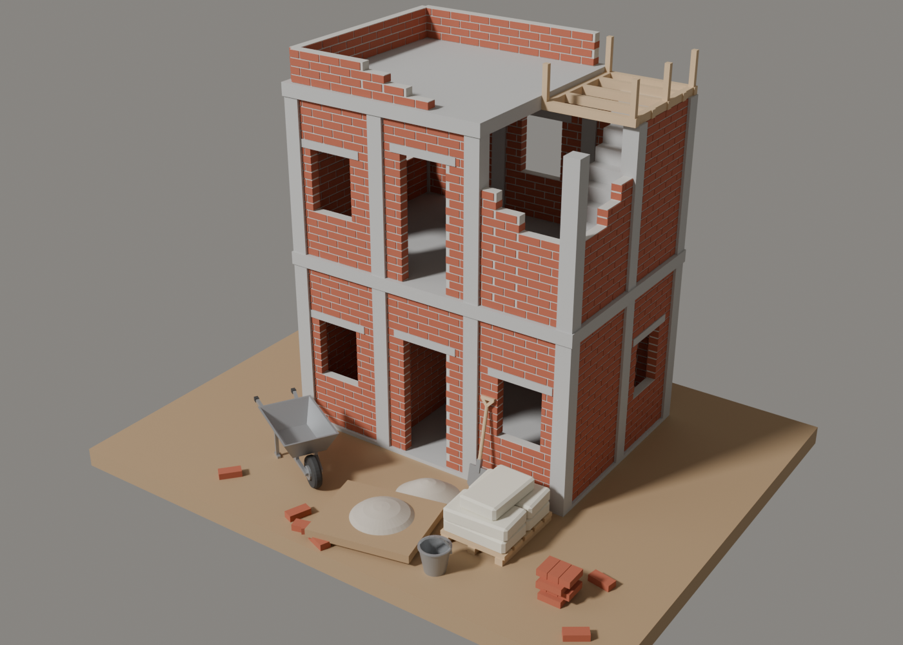

# مجسّم بيت طابقين قيد الإنشاء — Blender + طباعة 3D

## الملفات
| الملف | الوصف |
|---|---|
| `construction_house.py` | سكربت بلندر يبني المجسّم كاملاً (كل الأرقام قابلة للتعديل أعلى الملف) |
| `output/construction_house.blend` | ملف بلندر جاهز (مع المواد) |
| `output/stl/*.stl` | ملفات الطباعة — كل قطعة جسم واحد مغلق (Manifold)، الوحدة **مليمتر** |
| `output/preview.png` | صورة معاينة (Cycles) |

## التشغيل
- **داخل بلندر:** Scripting ← Open ← `construction_house.py` ← Run Script
- **من الطرفية مع تصدير STL:**
  `blender --background --python construction_house.py -- --out ./output --render preview.png`

## القياسات المستخدمة (مم)
| العنصر | القياس |
|---|---|
| الطابوقة | 17 × 8 × 5 + ملاط 1 |
| البيت | 240 × 170، الارتفاع الكلي ≈ 299 (أرضي 135 + سقف 10 + ثاني 120 + سقف 10 + ستارة 24) |
| العمود | 12 × 12 |
| القاعدة | 450 × 350 × 15 (مقسّمة 4 قطع 225 × 175) |
| العربانة | طول 95، عرض 42، ارتفاع 40، قطر العجلة 25 |
| كيس السمنت | 50 × 30 × 10 (5 أكياس على بالِت) |
| طبلية السمنت | 78 × 65 × 10 |
| الكرك | طول 78، النصل 24 × 15 |
| السطل | ارتفاع 20، الفوهة 22، القاعدة 15 |

## الطباعة
- كل طابق يُطبع لوحده بالوضع الطبيعي (الأرضية/السقف على السرير) — **بدون دعامات** تقريباً للبيت.
- البيت 240 × 170 يدخل طابعات 250 × 210 فما فوق.
- العربانة والسطل يحتاجون دعامات، أو اطبعهم ريزن. الكرك والمقابض رفيعة (2.2–2.8 مم) — ريزن أفضل.
- القاعدة: الأفضل لوح خشب حقيقي (مثل الصورة)، أو اطبع القطع الأربع.
- الألوان: طابوق أحمر، أعمدة وسقوف رمادي، خشب القالب بني.
