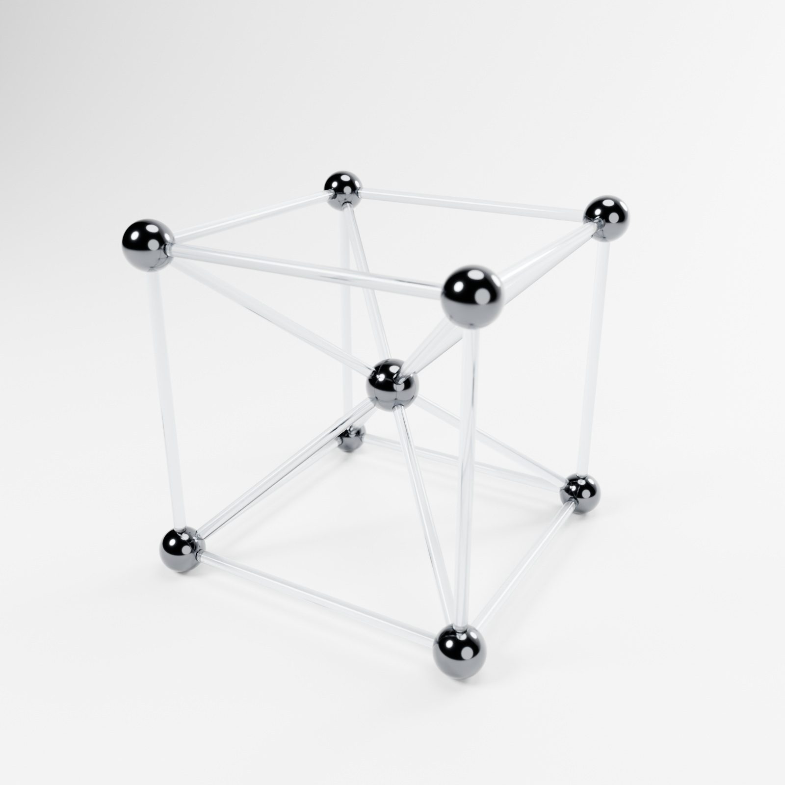
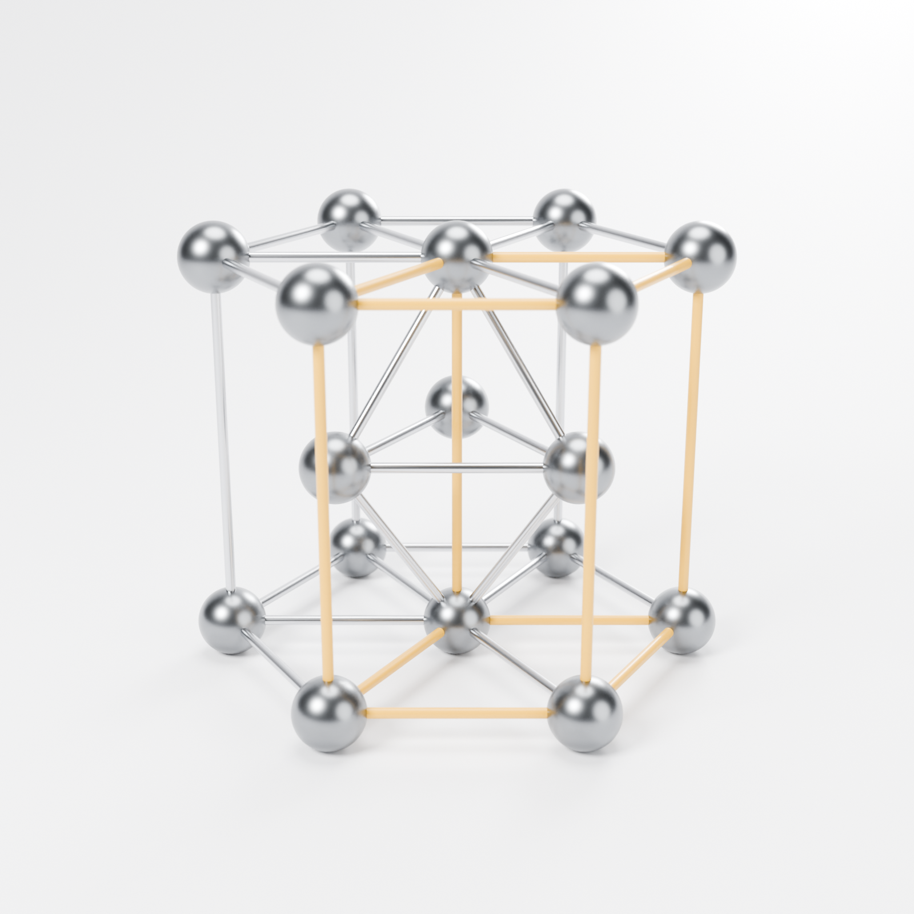

# نموذجا البلورتين — Blender

| BCC — مكعب مركزي الجسم | HCP — سداسي متراص |
|---|---|
|  |  |

## الملفات
- `BCC_Cube.blend` — المكعب جاهز للفتح (Cycles، إضاءة استوديو، كاميرا).
- `HCP_Hexagonal.blend` — السداسي جاهز للفتح.
- `crystal_models.py` — السكربت الذي يبني النموذجين؛ غيّر أي مقاس في أعلاه وأعد التشغيل.

## مقاسات BCC (من جدول المقاسات)
| الجزء | القياس |
|---|---|
| ضلع المكعب (طول × عرض × ارتفاع) | 20 × 20 × 20 سم |
| قطر ذرة الزاوية | 3 سم (8 ذرات) |
| قطر الذرة المركزية | 3.5 سم (ذرة واحدة) |
| قطر قضبان الربط | 0.8 سم — 12 ضلعًا + 8 قضبان مركزية |
| القطر الفراغي | 34.64 سم |
| من المركز إلى ذرة الزاوية | 17.32 سم |

المواد: ذرات كروم داكن لامع، وقضبان زجاج شفاف — مثل الصورة المرجعية.

## مقاسات HCP
| الجزء | القياس |
|---|---|
| ضلع السداسي a | 10 سم |
| الارتفاع c | 16.33 سم (c/a = 1.633) |
| قطر الذرة | 3 سم — 17 ذرة (7 علوية + 7 سفلية + 3 وسطى) |
| قطر القضبان | 0.45 سم |

القضبان الصفراء تحدد خلية الوحدة (المعيّن) كما في المجسم الحقيقي، والباقي فولاذ.

## الترتيب داخل Blender
كل مشهد مقسّم إلى Collections: `Atoms` و`Bonds` (و`Bonds_UnitCell_Yellow` في HCP)
و`Studio` (خلفية منحنية، 4 أضواء Area، كاميرا تتبع هدفًا).
الوحدات مترية وتظهر بالسنتيمتر، وكل جسم مسمّى (مثل `Atom_Corner_+-+`, `Bond_Diagonal_03`).

## إعادة البناء
داخل Blender: Scripting → Open → `crystal_models.py` → Run Script
(ينشئ المشهدين `BCC_Cube` و`HCP_Hexagonal` في الملف الحالي).

من الطرفية:
```
blender -b -P crystal_models.py -- --out ./output --render
```

## طقم الطباعة ثلاثية الأبعاد (15 سم)
القطع المجزّأة الجاهزة للطباعة والتركيب، مع صفّها على السرير وخطوات التركيب، في المجلد [`print/`](print/README.md).
