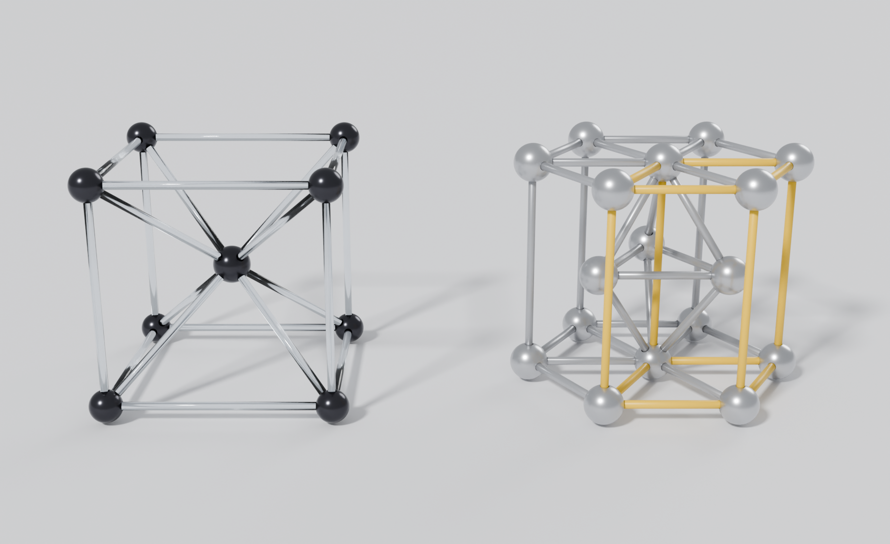
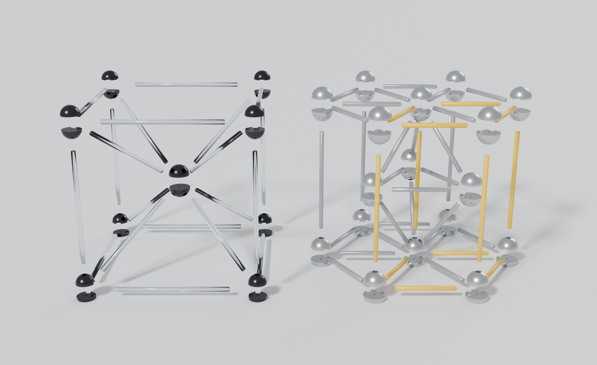
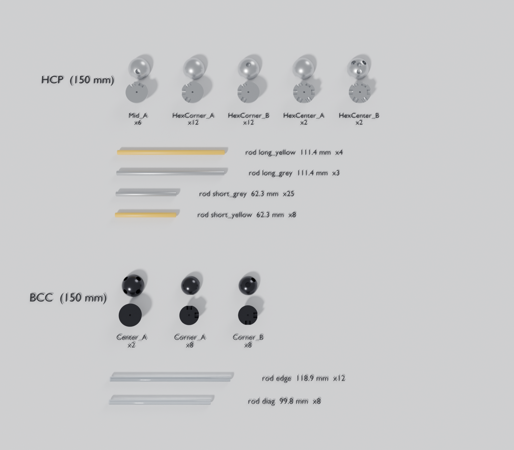
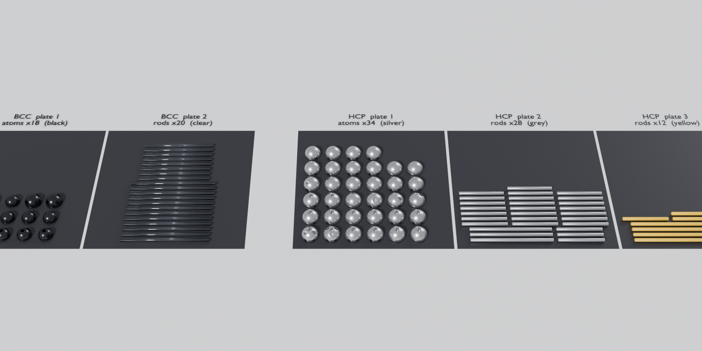

# طقم طباعة BCC و HCP — ارتفاع 15 سم

كل ذرة تُطبع **نصفين** بوجه مسطح على السرير، فلا تحتاج دعامات. القضبان تُطبع
ممددة على السرير وأسفلها مستوٍ. بعد الطباعة يُلصق كل نصفين معًا، ثم تُركّب القضبان
في الثقوب.

## المقاسات (مم)

| | BCC | HCP |
|---|---|---|
| الارتفاع الكلي | **150** | **150** |
| المسافة بين مراكز الذرات | ضلع 130.4، ومن المركز للزاوية 112.9 | a = 77.6 ، c = 126.7 |
| قطر الذرة | زاوية 19.6، ومركزية 22.8 | 23.3 |
| قطر القضيب / الثقب | 5.0 / 5.3 | 5.0 / 5.3 |
| عمق دخول القضيب | 4 + 0.4 للغراء | 4 + 0.4 للغراء |

مقاسات BCC هي نفس نِسب جدولك (20 / 3 / 3.5 سم) مصغّرة حتى يصبح الارتفاع 15 سم.
القضيب 5 مم بدل 5.2 حتى تبقى جدران كافية داخل الذرة الصغيرة.

## القطع

### BCC — المجموع 38 قطعة
| الملف | العدد | الوصف |
|---|---|---|
| `BCC_Corner_A.stl` | 8 | نصف ذرة زاوية: نصفا مجرى فقط |
| `BCC_Corner_B.stl` | 8 | نصف ذرة زاوية: نصفا مجرى + ثقب عمودي + ثقب مائل نحو المركز |
| `BCC_Center_A.stl` | 2 | نصف الذرة المركزية: 4 ثقوب مائلة (النصفان متطابقان) |
| `BCC_Rod_edge_119mm.stl` | 12 | قضيب ضلع 118.9 مم |
| `BCC_Rod_diag_100mm.stl` | 8 | قضيب مركزي 99.8 مم |

### HCP — المجموع 74 قطعة
| الملف | العدد | الوصف |
|---|---|---|
| `HCP_HexCorner_A.stl` | 12 | نصف ذرة رأس السداسي: 3 أنصاف مجارٍ |
| `HCP_HexCorner_B.stl` | 12 | مثل A + ثقب عمودي |
| `HCP_HexCenter_A.stl` | 2 | نصف ذرة مركز السداسي: 6 أنصاف مجارٍ |
| `HCP_HexCenter_B.stl` | 2 | مثل A + ثقب عمودي + 3 ثقوب مائلة نحو الطبقة الوسطى |
| `HCP_Mid_A.stl` | 6 | نصف ذرة وسطى: نصفا مجرى + ثقب مائل (النصفان متطابقان) |
| `HCP_Rod_short_grey_62mm.stl` | 25 | قضيب قصير رمادي 62.3 مم |
| `HCP_Rod_short_yellow_62mm.stl` | 8 | قضيب قصير أصفر (خلية الوحدة) |
| `HCP_Rod_long_grey_111mm.stl` | 3 | قضيب عمودي رمادي 111.4 مم |
| `HCP_Rod_long_yellow_111mm.stl` | 4 | قضيب عمودي أصفر (خلية الوحدة) |

تحتاج أيضًا **دبابيس محاذاة** من خيط طباعة 1.75 مم، كل دبوس بطول 5.5 مم:
9 لـ BCC و17 لـ HCP (دبوس واحد لكل ذرة).

## صفّ القطع على السرير (جاهزة للطباعة)

كل لوح يدخل في مساحة 200×200 مم، فيناسب أي طابعة سريرها 220×220 أو أكبر.

| الملف (`stl/plates/`) | المحتوى | اللون المقترح |
|---|---|---|
| `BCC_Plate1_Atoms_Black.stl` | 18 نصف ذرة | PLA أسود لامع (Silk) |
| `BCC_Plate2_Rods_Clear.stl` | 20 قضيبًا | PETG شفاف (يعطي شكل الزجاج) |
| `HCP_Plate1_Atoms_Silver.stl` | 34 نصف ذرة | PLA فضي (Silk) |
| `HCP_Plate2_Rods_Grey.stl` | 28 قضيبًا | PLA رمادي |
| `HCP_Plate3_Rods_Yellow.stl` | 12 قضيبًا | PLA أصفر |

القطع المفردة موجودة في `stl/parts/`، إذا أردت أن تصفّها بنفسك في برنامج التقطيع.

## إعدادات الطباعة المقترحة
- **الذرات:** طبقة 0.12–0.16 مم لسطح كروي ناعم، 3 جدران، تعبئة 15%، **بدون دعامات**.
- **القضبان:** طبقة 0.2 مم، 4 جدران (القضيب يصبح شبه مصمت)، وBrim بعرض 3 مم إذا
  كان السرير لا يمسك القضبان جيدًا.
- الثقوب مصممة بخلوص 0.3 مم. إذا كان الإدخال ضيقًا، مرّر مثقاب 5.5 مم أو صنفرة على
  طرف القضيب. لتغيير الخلوص للطابعة كلها، عدّل `HOLE_CLEAR` في السكربت وأعد التوليد.

## التركيب

**1. لصق الذرات**
- ركّب كل نصفين معًا:
  - BCC: زاوية = `Corner_A` + `Corner_B`، والمركز = `Center_A` + `Center_A`.
  - HCP: رأس = `HexCorner_A` + `HexCorner_B`، ومركز = `HexCenter_A` + `HexCenter_B`، ووسطى = `Mid_A` + `Mid_A`.
- ضع دبوس الخيط في الثقب الصغير وسط الوجه المسطح.
- طابِق أنصاف المجاري حتى تكوّن ثقوبًا كاملة. يساعدك أن تضع قضيبًا مؤقتًا في المجرى
  أثناء اللصق، ثم تخرجه.
- استعمل غراء CA (سوبر غلو).

**2. تركيب BCC**
1. المربع السفلي: 4 ذرات زاوية (الثقب العمودي للأعلى) + 4 قضبان ضلع.
2. 4 قضبان مركزية من الزوايا السفلية إلى الذرة المركزية.
3. 4 قضبان عمودية في الزوايا السفلية.
4. ركّب المربع العلوي وحده (4 زوايا + 4 أضلاع، والثقوب العمودية للأسفل)، ثم ثبّت 4 قضبان
   مركزية في الذرة المركزية.
5. أنزل المربع العلوي على القضبان الثمانية معًا، ثم ثبّت كل الوصلات بنقطة غراء.

**3. تركيب HCP**
1. السداسي السفلي: 7 ذرات + 6 أضلاع + 6 قضبان من المركز.
   - ذرة المركز `HexCenter` يكون نصفها B للأعلى.
   - القضبان الصفراء: ضلعان وقضيبا مركز يشكّلان المعيّن الأمامي.
2. 3 قضبان مائلة من المركز السفلي إلى الذرات الوسطى، ثم مثلث الوسط (3 قضبان).
3. 7 قضبان عمودية: 4 صفراء (المركز + رؤوس المعيّن) و3 رمادية.
4. ركّب السداسي العلوي بنفس الطريقة (نصفه B للأسفل)، وأضف 3 قضبان مائلة في ذراته المركزية.
5. أنزل السداسي العلوي على القضبان العمودية والمائلة معًا، ثم ثبّت بالغراء.

## الملفات
- `crystal_print_kit.py`: يبني كل القطع ويتحقق من التركيب (لا تداخل بين أي قضيب وذرة)،
  ثم يصدّر ملفات STL. غيّر `TOTAL_HEIGHT` أو `ROD_D` أو `HOLE_CLEAR` وأعد التشغيل:
  `blender -b -P crystal_print_kit.py -- --out .`
- `render_kit.py`: يولّد صور المعاينة.
- `Crystal_Print_Kit.blend`: المشهد كاملًا (المجسمان مركّبان، والألواح، وكتالوج القطع).
  الوحدة 1 = 1 مم.
- `kit_report.json`: الأعداد والأطوال والمقاسات.
