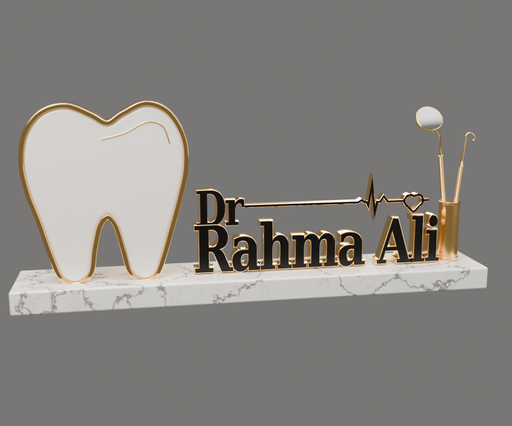
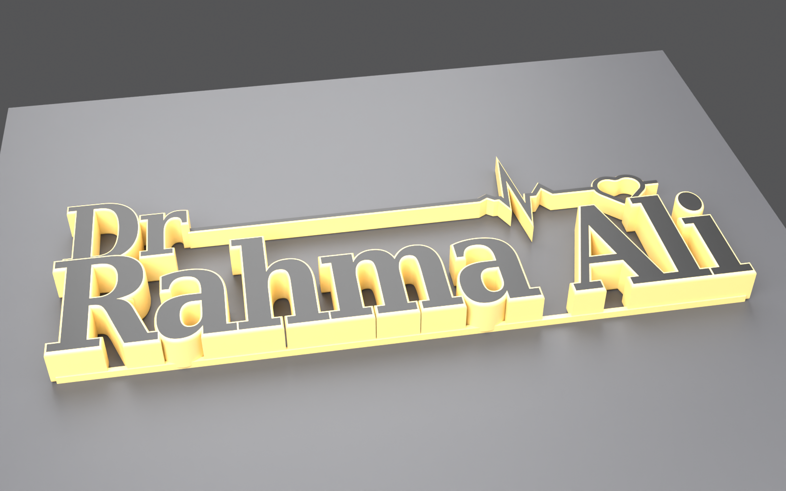

# مجسم اسم طبيب الأسنان — Blender

مجسم يُبنى بسكربت Python داخل بلندر: سن أبيض بإطار ذهبي لامع، حروف ذهبية
بوجه أسود، خط نبض ينتهي بقلب، حامل ذهبي فيه مرآة ومسبار أسنان، كلها على
قاعدة رخام أبيض. النموذج وحده بدون غرفة، مع إضاءة استوديو وكاميرا للرندر.



## طريقة الاستخدام

1. افتح بلندر (الإصدار 4.2 أو أحدث).
2. افتح تبويب **Scripting**، ثم **Open** واختر `dental_nameplate.py`.
3. اضغط **Run Script** (أو `Alt+P`). يُمسح المشهد الحالي ويُبنى المجسم كاملاً.
4. اضغط `F12` للرندر. المحرك هو Cycles، ويُفعَّل كرت الشاشة تلقائياً إن وُجد.

أو من سطر الأوامر مباشرة:

```bash
blender -b -P dental_nameplate.py -- --render out.png --samples 256
```

الملف `dental_nameplate.blend` جاهز للفتح مباشرة، لكنه محفوظ من **Blender 5.0**.
إذا كان إصدارك أقدم فشغّل السكربت بدلاً منه.

## التعديل

أول السكربت فيه الإعدادات:

| المتغير | الوظيفة |
|---|---|
| `TITLE` / `NAME` | النص: `"Dr"` و `"Rahma Ali"` — غيّره لأي اسم |
| `FONT_PATH` | مسار خط مخصص (`.ttf`). إذا تُرك فارغاً يُختار Georgia Bold على ويندوز |
| `NAME_WIDTH` / `NAME_CAP_HEIGHT` | عرض سطر الاسم وارتفاع الحرف الكبير |
| `TOOTH_HEIGHT` / `TOOTH_DEPTH` | حجم السن وسماكته |
| `SAMPLES` / `RESOLUTION` | جودة الرندر ودقة الصورة |

من سطر الأوامر: `--name "Ahmed Ali" --title "Dr" --font path/to/font.ttf`.

## المقاسات الحقيقية

- القاعدة: حوالي 49.5 × 7.8 × 2.4 سم، رخام بحواف مشطوفة.
- السن: ارتفاع 17.5 سم، سماكة 3.7 سم، إطار ذهبي بعرض 4 مم.
- الحروف: سماكة 1.5 سم، ارتفاع الحرف الكبير 5.2 سم.

## المواد (كلها إجرائية، بدون صور خارجية)

- **Gold Polished / Satin / Knurled**: ذهب معدني لامع، ونصف لامع للحامل، ومحزّز لمقابض الأدوات.
- **Enamel White**: أبيض لامع بطبقة Coat مثل الريزن.
- **Black Satin**: وجه الحروف وخط النبض.
- **Marble**: عروق الرخام من Voronoi (Distance to Edge) على إحداثيات مشوّهة بـ Noise.

## ملاحظات التنظيم

- كل قطع المجسم في Collection اسمها **Nameplate**، والكاميرا والإضاءة في
  **Camera & Lights**.
- كل القطع Mesh عادية (تم تحويل النصوص والمنحنيات) فتقدر تعدّلها أو تصدّرها
  بصيغة STL/OBJ/FBX مباشرة.
- وجه الحروف الأسود هو Material slot ثانٍ على نفس الـ mesh، وجوانبها ذهبية.

## الطباعة ثلاثية الأبعاد بالألوان (3MF)

الملف `letters.3mf` فيه النص وحده ("Dr" و "Rahma Ali" وخط النبض مع القلب)،
جاهز لطابعة متعددة الألوان (Bambu AMS أو Prusa MMU أو غيرها).



- **قطعة واحدة بلونين:** جزء **Gold** (جسم الحروف وحوافها) وجزء **Black**
  (وجه الحروف، سماكته 1 مم). الجزءان مغلقان (watertight) ولا يتداخلان.
- **الاتجاه:** القطعة نايمة على ظهرها والوجه الأسود للأعلى، فيتغير اللون في
  آخر طبقات فقط. ما تحتاج دعامات (supports).
- **المقاس:** 240 × 89.6 × 13.3 مم، يناسب سرير 256 مم. الحجم الأصلي
  في الموديل حوالي 270 مم.
- **وصلات خلفية:** فيه شريط ذهبي رفيع (3 مم) على ظهر الحروف عند خط القاعدة،
  يربط "Rahma" مع "Ali"، ويثبّت نقطة حرف i. ما يبان من الأمام إلا بالفراغ
  اللي بين الكلمتين.

**في Bambu Studio أو Orca Slicer:** افتح الملف، ويظهر كقطعة وحدة فيها جزءان.
من قائمة الأجزاء اختر لكل جزء الفلامنت المناسب: Gold للذهبي و Black للأسود.

**في PrusaSlicer أو أي سلايسر ما يقرأ الأجزاء:** استخدم
`letters_gold.stl` و `letters_black.stl` وافتحهم مع بعض، ولما يسألك
"Load as a single object with multiple parts" اختر **Yes**.

**تغيير الاسم أو المقاس:**

```bash
blender -b -P export_letters_3mf.py -- --name "Ahmed Ali" --width 200 --face 1.2
```

`--width 0` يخلي المقاس الحقيقي، و `--face` سماكة الوجه الأسود بالمليمتر.
يحتاج Blender 4.5 أو أحدث عشان يستخدم Manifold solver. على الإصدارات الأقدم
يشتغل بـ Exact solver، لكن تأكد من النتيجة في السلايسر.
