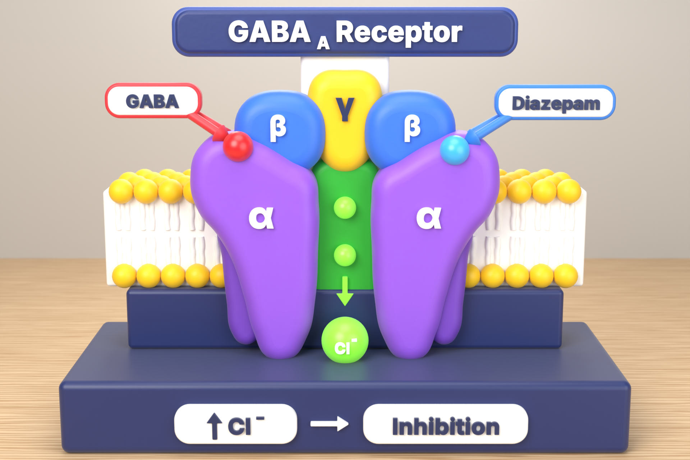
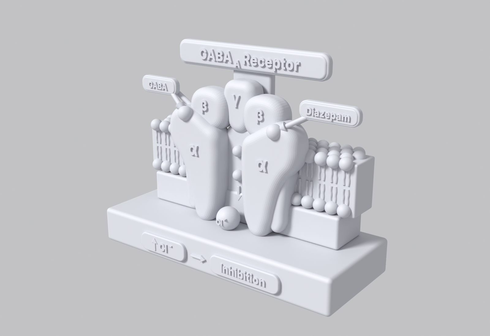

# نموذج مستقبل GABA-A في Blender

## الملفات
| الملف | الوصف |
|---|---|
| `gaba_a_receptor.py` | سكربت بايثون يبني المشهد كاملاً (Blender 4.2 أو أحدث، ويدعم 5.x) |
| `gaba_a_receptor.blend` | ملف جاهز للفتح مباشرة (محفوظ بـ Blender 5.3 والخط مدمج فيه) |
| `preview.png` | صورة الريندر النهائية 1920×1280 (Cycles) |
| `compare_reference.png` | مقارنة جنبًا إلى جنب: الصورة المرجعية (يسار) والريندر (يمين) |

## 🖨️ نسخة الطباعة ثلاثية الأبعاد (جاهزة)

| الملف | الاستخدام |
|---|---|
| `print/GABA_A_receptor_300mm_SINGLE_SOLID.stl` | **قطعة واحدة مغلقة (Watertight)** بالمليمتر: 300 × 125.6 × 231.2 مم. تم التحقق: جسم واحد متصل، **لا توجد أي قطعة طائرة** |
| **`print_kit/`** | **طقم تركيب ملوّن: 29 قطعة مرتبة على 4 ألواح 256×256 مم، كل لوح ≤ 4 ألوان، مع صور ودليل تركيب ← [print_kit/README.md](print_kit/README.md)** |

**ما الذي تغيّر ليصبح قابلاً للطباعة:**
- ذيول الدهون البيضاء الرفيعة (كانت معلقة في الهواء) استُبدلت بـ **بلوك أبيض مصمت** داخل الغشاء،
  الرؤوس الصفراء مغروسة فيه من الأعلى والأسفل، والذيول صارت **نقشاً بارزاً** على وجهه الأمامي.
- عمود اللوحة العلوية يمتد للأسفل حتى المنصة.
- بطاقتا GABA و Diazepam: الأسهم أسمك (5 مم) ومغروسة في الكرات، مع **دعامة مخفية خلف كل سهم** تثبت البطاقة في α.
- أقدام α تدخل في القاعدة، وكل النصوص والحروف مغروسة في الأسطح (لا شيء ملتصق على حافة صفرية).

**إعدادات الطباعة المقترحة:**
- اطبعه واقفاً (القاعدة على السرير)، دعامات **Tree supports** (للبطاقات واللوحة وطرف الغشاء).
- Infill حوالي 10–15%، جدران 3، ارتفاع طبقة 0.16–0.2 مم.
- العرض 300 مم يحتاج طابعة سريرها ≥ 300 مم (أو قصّ القاعدة لنصفين في السلايسر مع Dowels).

## المقاسات (حقيقية بالسنتيمتر)
- **العرض: 30 سم** (عرض القاعدة)
- العمق ≈ 12.5 سم، الارتفاع ≈ 23 سم
- وحدات المشهد: Metric / Centimeters

## طريقة التشغيل
1. افتح Blender ← مساحة **Scripting**.
2. Text Editor ← **Open** ← اختر `gaba_a_receptor.py` ← **Run Script** (Alt+P).
3. اضغط **F12** للريندر.

> السكربت يمسح المشهد الحالي قبل البناء.

## تنظيم المشهد (Collections)
- `01_Base` القاعدة الكحلية + منصة الغشاء
- `02_Membrane` رؤوس الدهون الصفراء + الذيول البيضاء
- `03_Receptor` الوحدات α ×2 و β ×2 و γ والقناة الخضراء وأيونات Cl⁻ و GABA و Diazepam
- `04_Labels` اللوحة العلوية، البطاقات، الأسهم، الحروف اليونانية، لوحات القاعدة
- `05_Studio` الطاولة الخشبية، الحائط، الإضاءة، الكاميرا

## ملاحظات للتعديل
- الألوان كلها في قاموس `COL` أعلى السكربت.
- الوحدات α و β و γ والقناة والبطاقات مبنية كـ **Curves ثنائية الأبعاد** (Extrude + Bevel)
  بشكل "قطع صلصال" مثل الصورة المرجعية بالضبط: وجه أمامي مسطح وحواف دائرية.
  - لتعديل الشكل: ادخل Edit Mode على أي وحدة وحرّك نقاط المنحنى.
  - إحداثيات الأشكال موجودة في `ALPHA_FRONT` و `ALPHA_BACK` و `GAMMA` داخل السكربت.
  - للـ Sculpt أو الطباعة: Object ← Convert ← Mesh.
- النصوص بقيت كائنات Text قابلة للتعديل (حوّلها إلى Mesh قبل الطباعة ثلاثية الأبعاد).
- لإعادة توليد ملفات الطباعة بعد أي تعديل:
  `blender -b -P gaba_a_receptor.py -- --stl print` ثم `python make_single_solid.py print/GABA_A_receptor_300mm.stl print/GABA_A_receptor_300mm_SINGLE_SOLID.stl`
