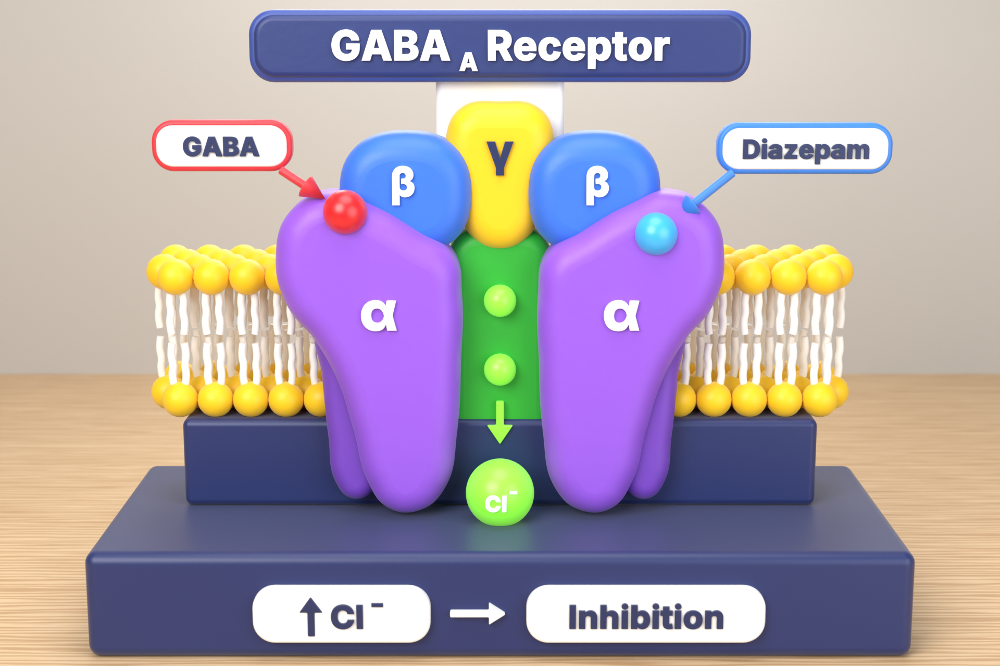

# نموذج مستقبل GABA-A في Blender

## الملفات
| الملف | الوصف |
|---|---|
| `gaba_a_receptor.py` | سكربت بايثون يبني المشهد كاملاً (Blender 4.2 أو أحدث، ويدعم 5.x) |
| `gaba_a_receptor.blend` | ملف جاهز للفتح مباشرة (محفوظ بـ Blender 5.3 والخط مدمج فيه) |
| `preview.png` | صورة الريندر النهائية 1920×1280 (Cycles) |
| `compare_reference.png` | مقارنة جنبًا إلى جنب: الصورة المرجعية (يسار) والريندر (يمين) |

## المقاسات (حقيقية بالسنتيمتر)
- **العرض: 30 سم** (عرض القاعدة)
- العمق ≈ 12.5 سم، الارتفاع ≈ 23 سم
- وحدات المشهد: Metric / Centimeters

## طريقة التشغيل
1. افتح Blender ← مساحة **Scripting**.
2. Text Editor ← **Open** ← اختر `gaba_a_receptor.py` ← **Run Script** (Alt+P).
3. اضغط **F12** للريندر.

> السكربت يمسح المشهد الحالي قبل البناء.

## تنظيم المشهد (Collections)
- `01_Base` القاعدة الكحلية + منصة الغشاء
- `02_Membrane` رؤوس الدهون الصفراء + الذيول البيضاء
- `03_Receptor` الوحدات α ×2 و β ×2 و γ والقناة الخضراء وأيونات Cl⁻ و GABA و Diazepam
- `04_Labels` اللوحة العلوية، البطاقات، الأسهم، الحروف اليونانية، لوحات القاعدة
- `05_Studio` الطاولة الخشبية، الحائط، الإضاءة، الكاميرا

## ملاحظات للتعديل
- الألوان كلها في قاموس `COL` أعلى السكربت.
- الوحدات α و β و γ والقناة والبطاقات مبنية كـ **Curves ثنائية الأبعاد** (Extrude + Bevel)
  بشكل "قطع صلصال" مثل الصورة المرجعية بالضبط: وجه أمامي مسطح وحواف دائرية.
  - لتعديل الشكل: ادخل Edit Mode على أي وحدة وحرّك نقاط المنحنى.
  - إحداثيات الأشكال موجودة في `ALPHA_FRONT` و `ALPHA_BACK` و `GAMMA` داخل السكربت.
  - للـ Sculpt أو الطباعة: Object ← Convert ← Mesh.
- النصوص بقيت كائنات Text قابلة للتعديل (حوّلها إلى Mesh قبل الطباعة ثلاثية الأبعاد).
- للطباعة ثلاثية الأبعاد: صدّر كـ STL بالمقياس 1000 ليكون بالمليمتر (300 مم عرض).
