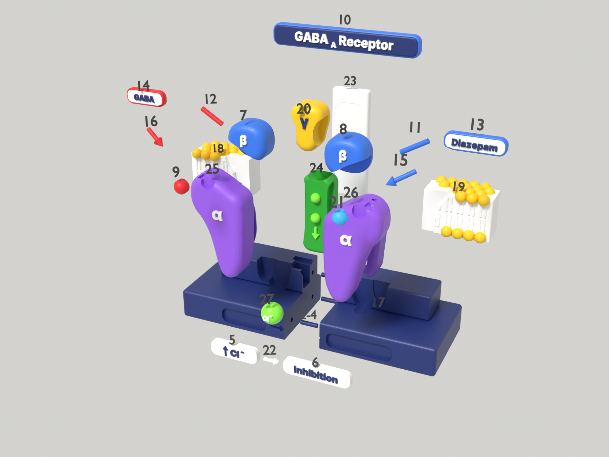
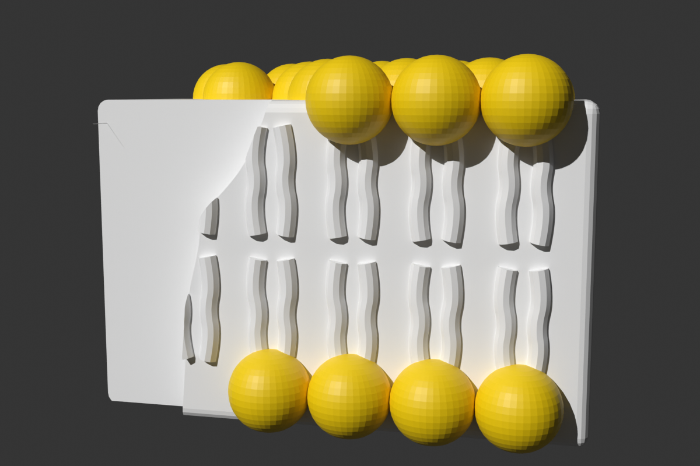
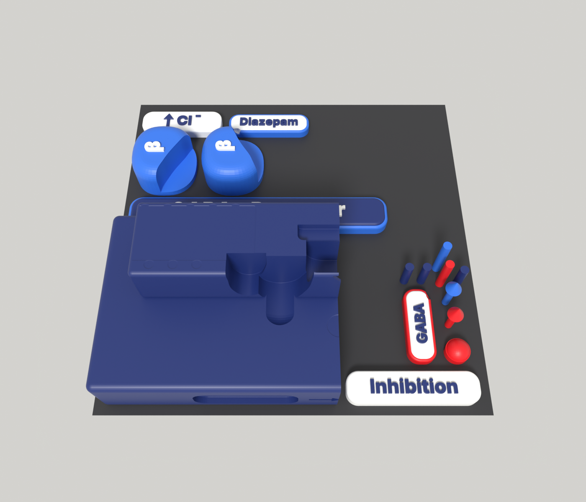
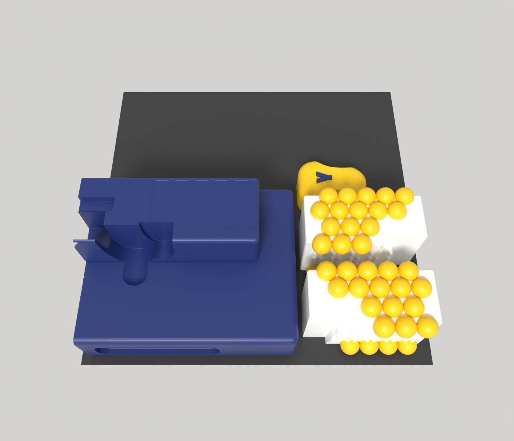
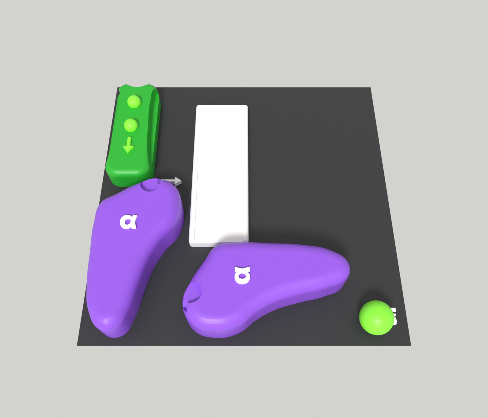
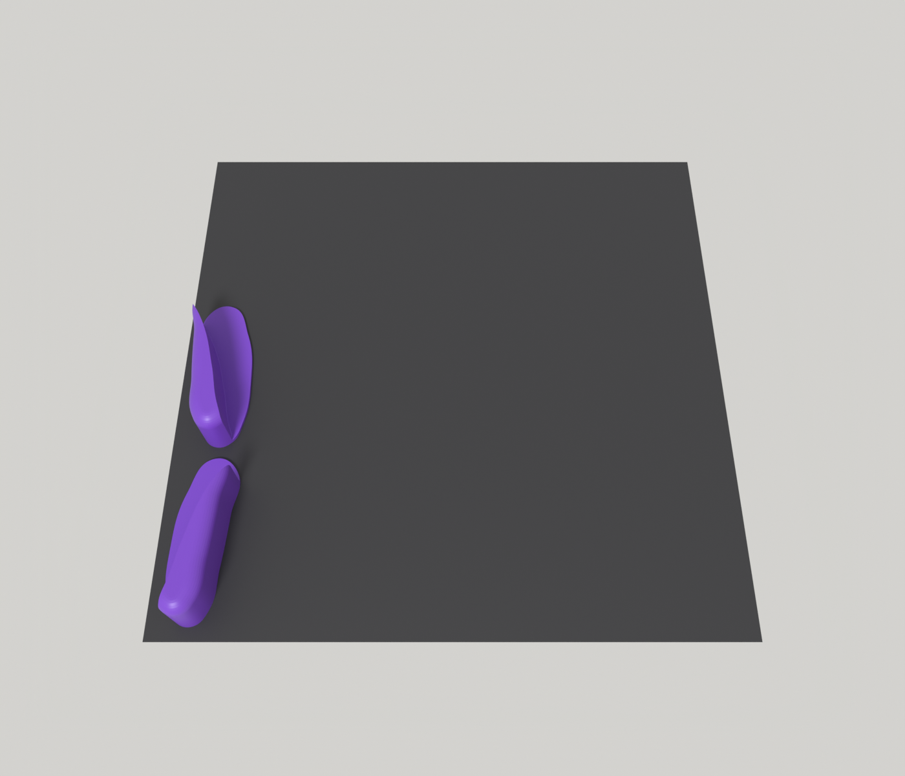

# 🧩 طقم التركيب — مستقبل GABA-A (عرض 30 سم)



الأرقام في الصورة = رقم القطعة في الجدول بالأسفل.

## الفكرة
- النموذج مقسّم إلى **29 قطعة** تُطبع منفصلة وتُركّب بالغراء (Super Glue أو غراء PLA).
- كل قطعة تجلس في **جيب/ثقب/مجرى** مقصوص في القطعة التي خلفها بخلوص 0.25 مم ← تركيب في مكان واحد فقط ولا يحتاج قياس.
- القاعدة (300 مم) مقسومة نصفين تُربط بـ **3 مسامير** مطبوعة (DOWEL) لأنها أكبر من السرير.
- كل لوح فيه **4 ألوان كحد أقصى** (يناسب AMS بـ4 خانات).
- السرير المفترض: 256 × 256 مم (Bambu X1 / P1 / A1، Creality K1 ...). لسرير آخر أعد التوليد بـ `--bed W H`.

## الألواح

> **الغشاء (MEMBRANE_L / MEMBRANE_R):** الرؤوس الصفراء **كرات كاملة** مثل التصميم (حذفنا المخاريط التي كانت تحتها).
> ملف **أصفر = الرؤوس فقط** وملف **أبيض = البلوك والذيول**. الرؤوس البارزة تحتاج **Tree supports** تحتها.
>
> 

### اللوح 1 — الخيوط: أزرق (Blue) ، كحلي (Navy) ، أحمر (Red) ، أبيض (White)



| # | القطعة | الألوان (من الأسفل للأعلى) | المقاس مم | تغيير اللون (طابعة بفوهة واحدة) |
|---|---|---|---|---|
| 1 | `BASE_L` | كحلي | 150 × 120 × 75 | لون واحد |
| 2 | `DOWEL_1` | كحلي | 6 × 6 × 23 | لون واحد |
| 3 | `DOWEL_2` | كحلي | 6 × 6 × 23 | لون واحد |
| 4 | `DOWEL_3` | كحلي | 6 × 6 × 23 | لون واحد |
| 5 | `PLAQUE_CL` | أبيض ← كحلي | 64 × 21 × 9.6 | ابدأ أبيض، عند Z=8.0 ← كحلي |
| 6 | `PLAQUE_INHIBITION` | أبيض ← كحلي | 86 × 21 × 9.6 | ابدأ أبيض، عند Z=8.0 ← كحلي |
| 7 | `BETA_L` | أزرق ← أبيض | 50 × 46.6 × 30.1 | ابدأ أزرق، عند Z=28.0 ← أبيض |
| 8 | `BETA_R` | أزرق ← أبيض | 50 × 46.6 × 30.1 | ابدأ أزرق، عند Z=28.0 ← أبيض |
| 9 | `GABA_BALL` | أحمر | 16.4 × 16.4 × 11.7 | لون واحد |
| 10 | `TITLE` | أزرق ← كحلي ← أبيض | 192 × 27.5 × 12.6 | ابدأ أزرق، عند Z=9.0 ← كحلي، عند Z=10.5 ← أبيض |
| 11 | `STRUT_DIAZEPAM` | أزرق | 6 × 6 × 35.2 | لون واحد |
| 12 | `STRUT_GABA` | أحمر | 6 × 6 × 31.6 | لون واحد |
| 13 | `CALLOUT_DIAZEPAM` | أزرق ← أبيض ← كحلي | 65 × 19 × 9.4 | ابدأ أزرق، عند Z=7.0 ← أبيض، عند Z=7.8 ← كحلي |
| 14 | `CALLOUT_GABA` | أحمر ← أبيض ← كحلي | 52 × 19 × 9.4 | ابدأ أحمر، عند Z=7.0 ← أبيض، عند Z=7.8 ← كحلي |
| 15 | `ARROW_DIAZEPAM` | أزرق | 10.7 × 10.7 × 33.5 | لون واحد |
| 16 | `ARROW_GABA` | أحمر | 10.7 × 10.7 × 30.1 | لون واحد |

### اللوح 2 — الخيوط: أزرق فاتح (LightBlue) ، كحلي (Navy) ، أبيض (White) ، أصفر (Yellow)



| # | القطعة | الألوان (من الأسفل للأعلى) | المقاس مم | تغيير اللون (طابعة بفوهة واحدة) |
|---|---|---|---|---|
| 17 | `BASE_R` | كحلي | 150 × 120 × 75 | لون واحد |
| 18 | `MEMBRANE_L` | أبيض ← أصفر | 86 × 52 × 62 | يحتاج AMS أو تلوين يدوي |
| 19 | `MEMBRANE_R` | أبيض ← أصفر | 86 × 52 × 62 | يحتاج AMS أو تلوين يدوي |
| 20 | `GAMMA` | أصفر ← كحلي | 41.8 × 56.1 × 28.1 | ابدأ أصفر، عند Z=26.0 ← كحلي |
| 21 | `DIAZEPAM_BALL` | أزرق فاتح | 16 × 16 × 11.5 | لون واحد |

### اللوح 3 — الخيوط: أخضر (Green) ، أخضر ليموني (Lime) ، بنفسجي (Purple) ، أبيض (White)



| # | القطعة | الألوان (من الأسفل للأعلى) | المقاس مم | تغيير اللون (طابعة بفوهة واحدة) |
|---|---|---|---|---|
| 22 | `ARROW_RIGHT` | أبيض | 19.7 × 7.6 × 5 | لون واحد |
| 23 | `TITLE_STAND` | أبيض | 50 × 145 × 10 | لون واحد |
| 24 | `CHANNEL` | أخضر ← أخضر ليموني | 40 × 104 × 30.2 | ابدأ أخضر، عند Z=22.0 ← أخضر ليموني |
| 25 | `ALPHA_L` | بنفسجي ← أبيض | 69.9 × 128.2 × 34.2 | ابدأ بنفسجي، عند Z=32.0 ← أبيض |
| 26 | `ALPHA_R` | بنفسجي ← أبيض | 69.9 × 128.2 × 34.2 | ابدأ بنفسجي، عند Z=32.0 ← أبيض |
| 27 | `EXIT_ION` | أخضر ليموني ← أبيض | 26 × 27.2 × 24 | يحتاج AMS أو تلوين يدوي |

### اللوح 4 — الخيوط: بنفسجي غامق (DarkPurple)



| # | القطعة | الألوان (من الأسفل للأعلى) | المقاس مم | تغيير اللون (طابعة بفوهة واحدة) |
|---|---|---|---|---|
| 28 | `ALPHA_BACK_L` | بنفسجي غامق | 26.8 × 75.1 × 26 | لون واحد |
| 29 | `ALPHA_BACK_R` | بنفسجي غامق | 26.8 × 75.1 × 26 | لون واحد |

## طريقة الاستيراد في السلايسر

1. افتح مجلد اللوح `plate_N` واسحب **كل ملفات STL معاً** إلى Bambu Studio / OrcaSlicer / PrusaSlicer.
2. عندما يسأل *Load as a single object with multiple parts?* اختر **Yes / نعم** ← تبقى القطع في أماكنها على السرير.
3. اسم كل ملف ينتهي باللون: `..._ALPHA_L__Purple.stl` ← عيّن له الخيط بنفس اللون.
4. **بدون AMS:** اطبع القطعة بلون البداية واستعمل *Add pause / Color change* عند الارتفاعات في عمود "تغيير اللون".

## إعدادات الطباعة
- PLA، طبقة 0.16–0.2 مم، جدران 3، Infill 10–15%.
- القطع مطبوعة **ووجهها للأعلى** وظهرها مسطح على السرير ← النصوص والحروف بارزة في الأعلى.
- دعامات Tree: لنصفي القاعدة (الجيوب) وتحت الرؤوس الصفراء البارزة في الغشاء MEMBRANE، *On build plate only* يكفي غالباً.
- الأسهم والدعامات الرفيعة (STRUT / ARROW) مطبوعة واقفة ← فعّل Brim.

## خطوات التركيب

> قطعة `EXIT_ION` (كرة Cl⁻) نصها الأبيض على جانبها: اطبعها بالـ AMS أو لوّن النص بقلم أبيض.

1. ركّب نصفي القاعدة BASE_L و BASE_R بالمسامير الثلاثة DOWEL + غراء  — القطع: 1, 2, 3, 4, 17
2. ادخل اللوحتين PLAQUE_CL و PLAQUE_INHIBITION والسهم ARROW_RIGHT في جيوبها بواجهة القاعدة  — القطع: 5, 6, 22
3. ادخل عمود اللوحة TITLE_STAND في الفتحة خلف المنصة  — القطع: 23
4. ضع الغشاء MEMBRANE_L و MEMBRANE_R على المنصة (العلامة الخفيفة تحدد مكانهما)  — القطع: 18, 19
5. ادخل القناة الخضراء CHANNEL في جيبها في الوسط  — القطع: 24
6. ضع القطع البنفسجية الغامقة ALPHA_BACK_L/R  — القطع: 28, 29
7. ضع ALPHA_L و ALPHA_R أمامها (أقدامها تدخل في جيوب القاعدة)  — القطع: 25, 26
8. ضع GAMMA ثم BETA_L و BETA_R  — القطع: 7, 8, 20
9. ضع كرة الأيون EXIT_ION على القاعدة تحت القناة  — القطع: 27
10. ادخل كرة GABA الحمراء وكرة Diazepam الزرقاء في جيوبها أعلى α  — القطع: 9, 21
11. ركّب اللوحة العلوية TITLE على رأس العمود  — القطع: 10
12. ادخل الدعامتين STRUT في الثقوب المائلة (تمر عبر β إلى α)  — القطع: 11, 12
13. ركّب البطاقتين CALLOUT على طرف الدعامة  — القطع: 13, 14
14. ادخل السهمين ARROW من ثقب البطاقة إلى جيب الكرة  — القطع: 15, 16

## إعادة التوليد (بعد أي تعديل في التصميم)
```bash
blender -b -P gaba_a_receptor.py -- --raw raw
```
```bash
python make_print_parts.py raw print_kit --bed 256 256 --max-colours 4 --assembled asm
```
```bash
blender -b -P render_kit.py -- print_kit asm print_kit/images
```
