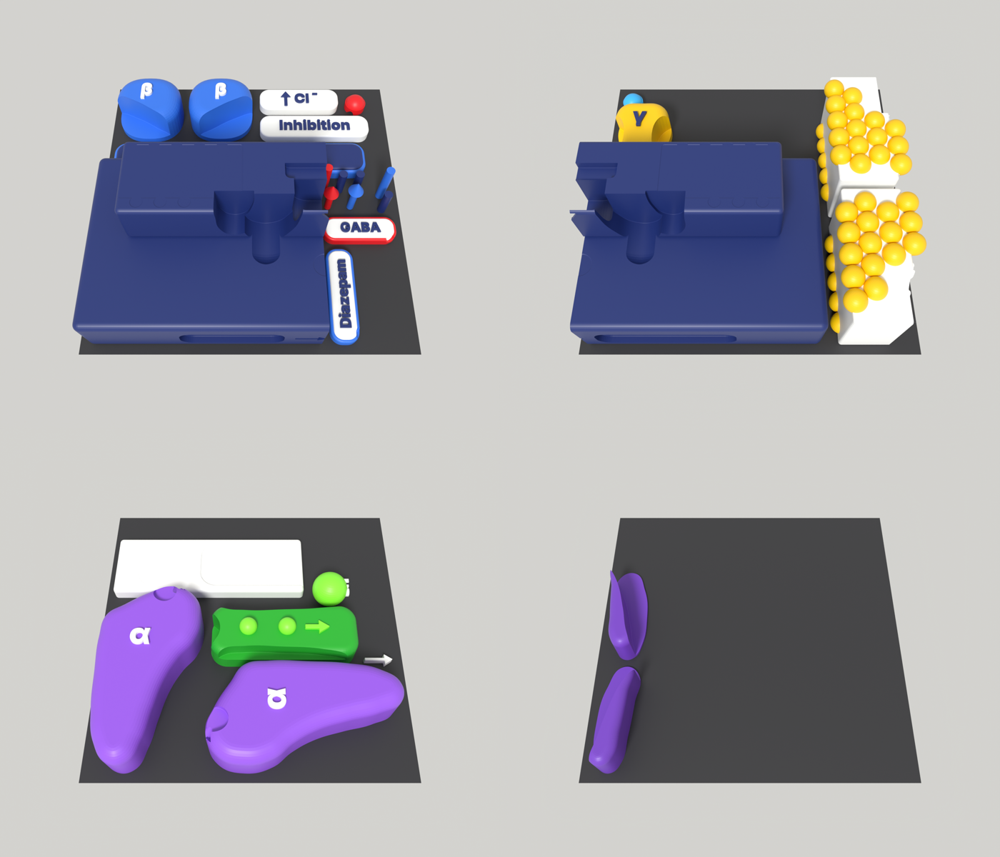

# 🖨️ طقم GABA-A لطابعة Flashforge AD5X (3MF ملوّن)



- سرير 220 × 220 مم، **4 ألوان كحد أقصى لكل لوح** (IFS بأربع خانات).
- كل قطعة = **object واحد** في الـ3MF، والكتابة والخلفية **أجزاء (parts) داخل نفس القطعة** بألوانها ← تُطبع قطعة واحدة.
- افتح الملف في **Orca-Flashforge** (أو OrcaSlicer) ← الألوان معيّنة مسبقاً لكل جزء على رقم الخانة.

## الألواح وخانات الخيوط

| الملف | خانة 1 | خانة 2 | خانة 3 | خانة 4 | القطع |
|---|---|---|---|---|---|
| `GABA_A_plate_1.3mf` | كحلي (Navy) | أبيض (White) | أزرق (Blue) | أحمر (Red) | 1 BASE_L, 2 DOWEL_1, 3 DOWEL_2, 4 DOWEL_3, 5 PLAQUE_CL, 6 PLAQUE_INHIBITION, 7 BETA_L, 8 BETA_R, 9 GABA_BALL, 10 TITLE, 11 STRUT_DIAZEPAM, 12 STRUT_GABA, 13 CALLOUT_DIAZEPAM, 14 CALLOUT_GABA, 15 ARROW_DIAZEPAM, 16 ARROW_GABA |
| `GABA_A_plate_2.3mf` | كحلي (Navy) | أبيض (White) | أصفر (Yellow) | أزرق فاتح (LightBlue) | 17 BASE_R, 18 MEMBRANE_L, 19 MEMBRANE_R, 20 GAMMA, 21 DIAZEPAM_BALL |
| `GABA_A_plate_3.3mf` | أبيض (White) | بنفسجي (Purple) | أخضر (Green) | أخضر ليموني (Lime) | 22 ARROW_RIGHT, 23 TITLE_STAND, 24 CHANNEL, 25 ALPHA_L, 26 ALPHA_R, 27 EXIT_ION |
| `GABA_A_plate_4.3mf` | بنفسجي غامق (DarkPurple) | — | — | — | 28 ALPHA_BACK_L, 29 ALPHA_BACK_R |

## مهم قبل الطباعة
1. حمّل الخيوط في الـ IFS بنفس ترتيب الخانات في الجدول **لكل لوح** (يتغير من لوح لآخر).
2. في السلايسر تأكد أن ألوان الخيوط 1–4 مطابقة (اللون المعروض يأتي من إعدادات الخيوط عندك).
3. PLA، طبقة 0.2 مم، جدران 3، Infill 10–15%، Tree supports للقاعدة فقط، Brim للأسهم والدعامات الرفيعة.
4. نصفا القاعدة يُربطان بالمسامير الثلاثة DOWEL. خطوات التركيب والصورة المفككة في [../print_kit/README.md](../print_kit/README.md).

إعادة التوليد:
```bash
python make_print_parts.py raw print_kit_AD5X --bed 220 220 --max-colours 4 --3mf
```
