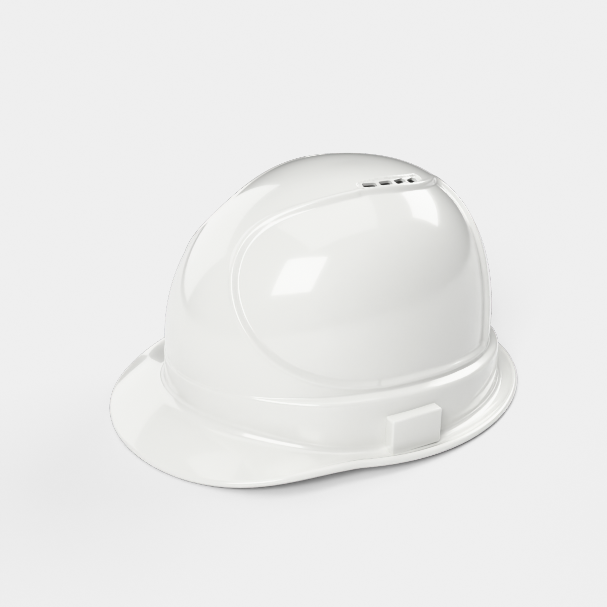
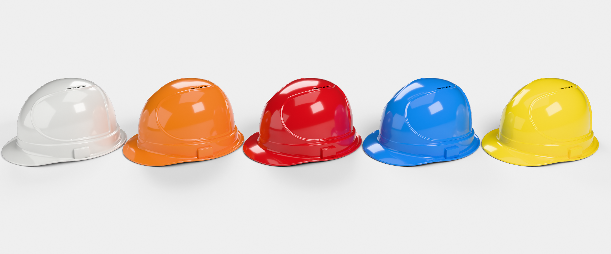
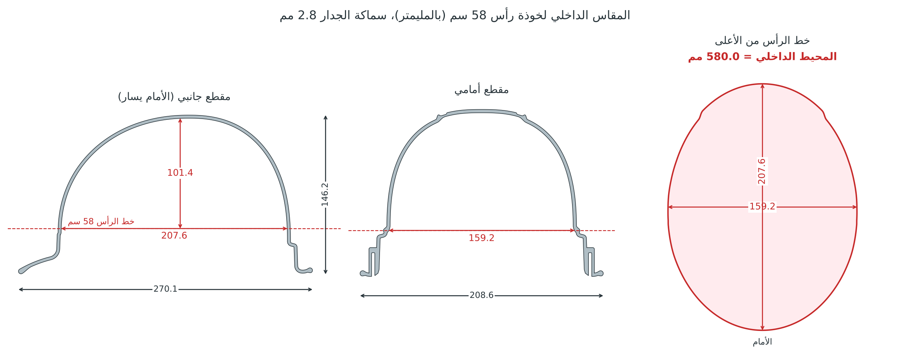

# خوذة سلامة (Hard Hat): موديل Blender عالي الدقة، مقاس رأس 58 سم

خوذة سلامة بتصميم القبعة (Cap-style) مع فتحات تهوية، مأخوذة من الصورة المرجعية:
لوح جانبي كبير على شكل حرف C، وشريط تهوية بأربع فتحات على كل جانب، وحزام بارز حول
الخوذة مع مجرى للماء، ومظلة أمامية، وعلبة إكسسوار على كل جانب.

**الموديل هو القشرة البلاستيكية فقط.** لا يوجد فيه شريط ولا حزام ذقن ولا قماش ولا
بطانة ولا نظام تعليق. الخوذة تُلبس على الرأس مباشرة، لذلك ليس في داخلها أي قطعة.

## المقاس: رأس 58 سم بدون أي زيادة

| البند | القيمة (مم) |
|---|---|
| **المحيط الداخلي عند خط الرأس** | **580.0 بالضبط (58 سم)** |
| العرض الداخلي عند خط الرأس | 159.2 |
| الطول الداخلي عند خط الرأس | 207.6 |
| العمق الداخلي من خط الرأس إلى سقف الخوذة | 101.4 |
| ارتفاع خط الرأس فوق جذر المظلة | 25.9 |

- **خط الرأس** هو المكان الذي تلمس فيه الخوذة الرأس، أي بداية القبة من الداخل فوق
  درجة الحزام مباشرة. عنده يكون محيط الجدار الداخلي 580.0 مم بالضبط، والفراغ بين
  الرأس والخوذة صفر.
- فوق هذا الخط يضيق الداخل تدريجيًا مع شكل الرأس حتى السقف. تحته يتسع الحزام ومجرى
  الماء إلى الخارج، فلا يلمسان الرأس.
- كبّرت الخوذة كلها أو صغّرتها بنسبة واحدة للوصول إلى هذا المقاس، فتعدّل الارتفاع مع
  المحيط وبقي الشكل مطابقًا للصورة. سماكة الجدار بقيت 2.8 مم كما هي.
- داخل الملف حلقة اسمها `Head_58cm_fit_line` في مجموعة `Reference_Head_58cm`. طولها
  580 مم، وهي مرسومة على الجدار الداخلي عند خط الرأس بالضبط لتراه بعينك. هذه الحلقة
  لا تظهر في الرندر، ويمكنك حذفها.
- القيم نفسها محفوظة في خصائص الكائن `HardHat`، في `Object Properties ▸ Custom Properties`.

## الملفات

| الملف | الوصف |
|---|---|
| `hard_hat.blend` | الملف الأساسي، ويحتوي على الموديل والمواد الخمس والإضاءة والكاميرا. افتحه واضغط F12 للرندر |
| `exports/hard_hat.glb` | glTF مع المادة (للمحركات والويب) |
| `exports/hard_hat.fbx` | FBX (Unity / Unreal / 3ds Max / Maya) |
| `exports/hard_hat.obj.zip` | OBJ + MTL مضغوط |
| `hard_hat_generator.py` | السكربت الذي يبني الموديل كاملًا، والمقاسات كلها فيه قابلة للتعديل |
| `render_previews.py` | سكربت الإضاءة والكاميرات وصور المعاينة |
| `renders/` | صور المعاينة من كل الزوايا، و`fit_58cm.png` رسم المقاس الداخلي |

## المقاسات الخارجية (بالمليمتر وبالحجم الحقيقي)

| البند | القيمة |
|---|---|
| الطول الكلي (من طرف المظلة إلى الخلف) | 270.1 |
| العرض الكلي (مع مجرى الماء) | 208.6 |
| الارتفاع الكلي | 146.2 |
| سماكة الجدار | 2.8 |
| سماكة حافة المظلة والمجرى | 4.6 (حافة مدوّرة) |
| الحجم | ‏290 سم³، أي نحو 305 غرام لو صُنعت من ABS |

## الشبكة (Mesh)

- 474,985 رأسًا (vertex) و474,398 وجهًا، وأغلبها رباعية (quads) والخطوط فيها تتبع شكل الخوذة.
- الشبكة مغلقة بالكامل (manifold / watertight) بلا أي حافة مفتوحة، لذلك يمكن طباعتها مباشرة
  بعد التصدير إلى STL من `File ▸ Export ▸ STL`.
- الحجم حقيقي (1 وحدة = 1 متر) والمشهد يعرض المقاسات بالمليمتر.
- نقطة الأصل (Origin) في منتصف مستوى جذر المظلة، والوجه الأمامي باتجاه ‎-Y.
- الوجوه ناعمة (Smooth)، والحواف الحادة معلَّمة Sharp عند فتحات التهوية والعلب.

## الألوان

في الملف خمس مواد، كلها بلاستيك لامع مع طبقة Coat:
`HardHat_White` و`HardHat_Orange` و`HardHat_Red` و`HardHat_Blue` و`HardHat_Yellow`.
لتغيير اللون اختر مادة أخرى من Material Properties.

## تعديل التصميم

افتح `hard_hat_generator.py` (موجود أيضًا داخل الـ blend في Text Editor).

- **مقاس الرأس:** غيّر `HEAD_CIRC` في أعلى الملف، فهو المحيط بالمليمتر وقيمته الآن 580.
  السكربت يحسب نسبة التكبير بنفسه حتى يصبح المحيط الداخلي عند خط الرأس مساويًا له
  بالضبط، ويعدّل الارتفاع معه، ويبقي الجدار `TH_REAL` = 2.8 مم.
- **الشكل:** بقية المقاسات تحت ذلك، مثل طول المظلة وعمق اللوح الجانبي ومكان فتحات
  التهوية وحجم علب الإكسسوار، وهي بمليمترات التصميم قبل التكبير.

بعد التعديل اضغط Run Script، فتُبنى الخوذة في مشهد جديد اسمه `HardHat` خلال دقيقة
تقريبًا دون أن يتأثر ملفك الحالي. السكربت يطبع المقاسات الداخلية في نافذة System Console.

---

### English summary

Vented cap-style hard hat built from the reference photo: shell only, with no
suspension, straps or fabric. It is sized for a **58 cm head** and sits directly on
the head with no extra room. Where the shell touches the head, the inner wall is
exactly **580.0 mm** around, measuring 159.2 × 207.6 mm. That line is just above the
band step, and below it the band flares outwards. The inner depth from that line to
the crown is 101.4 mm.

- **Sizing.** The whole helmet is scaled uniformly to hit that size, so the height
  follows the size and the shape stays the same as the photo; the wall stays 2.8 mm.
  To change the size, edit `HEAD_CIRC` in `hard_hat_generator.py`; the scale is solved
  automatically.
- **Size and mesh.** Overall size is 270 × 209 × 146 mm. The mesh has 474k faces,
  mostly quads, and is watertight.
- **What's in the `.blend`.** Five colour materials, a studio light rig, a camera, and
  a hidden 580 mm ring that marks the fit line.
