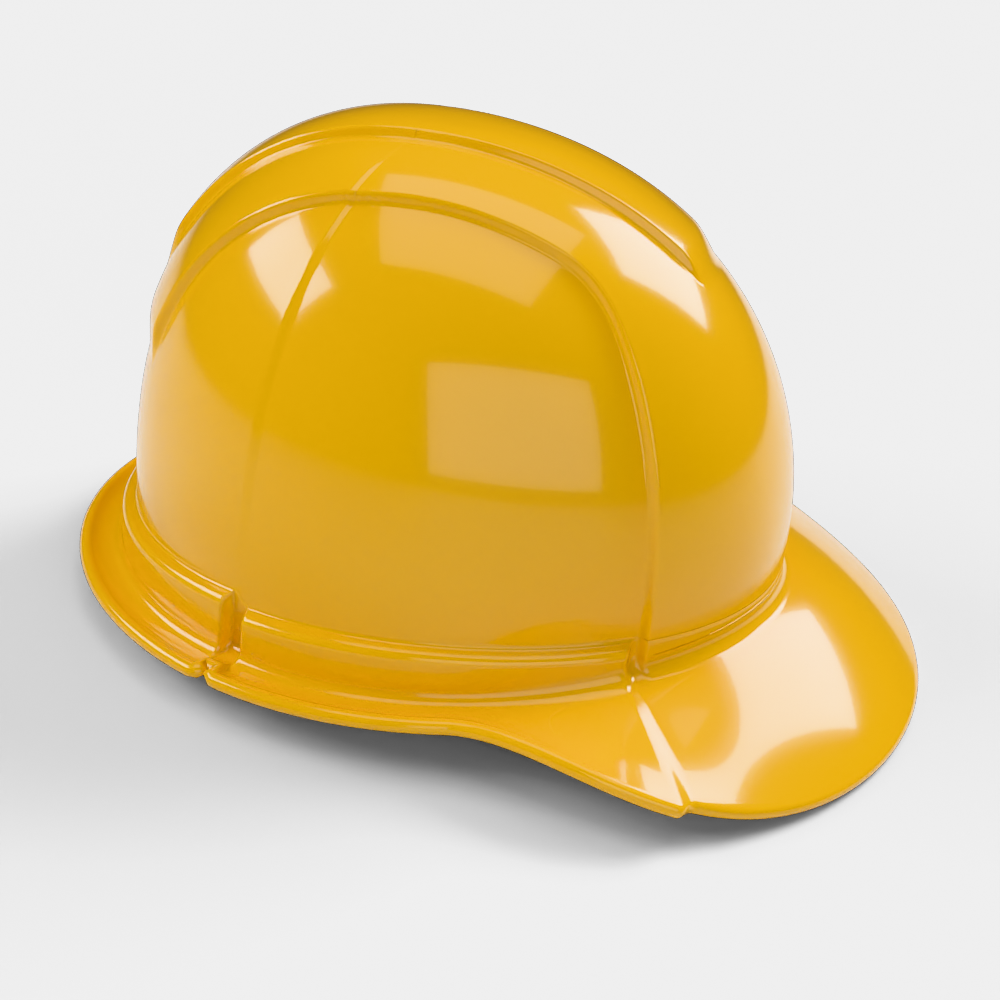
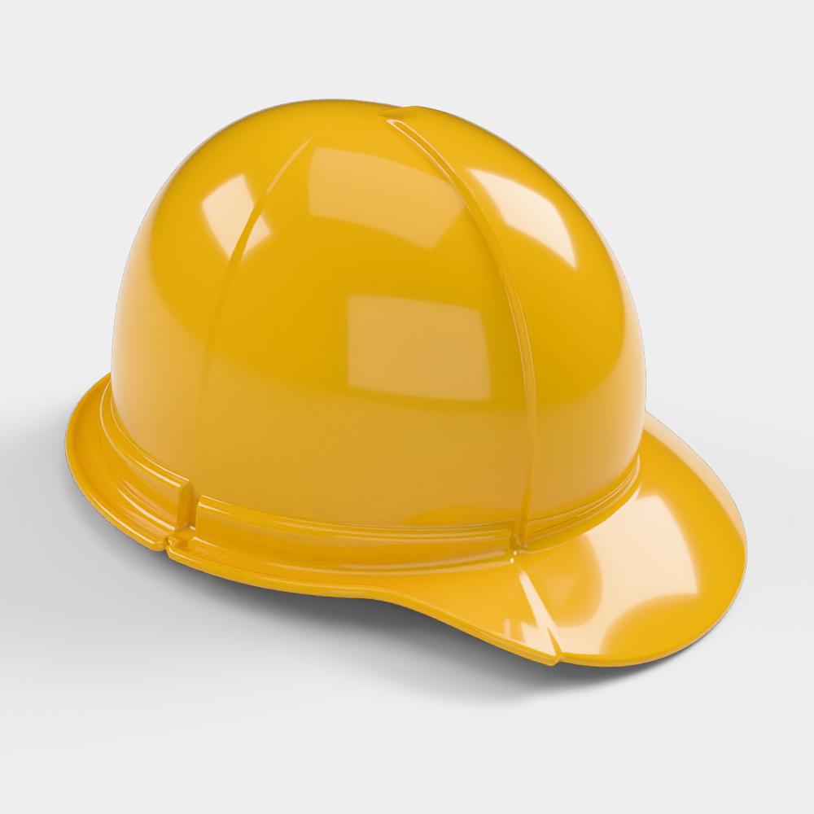
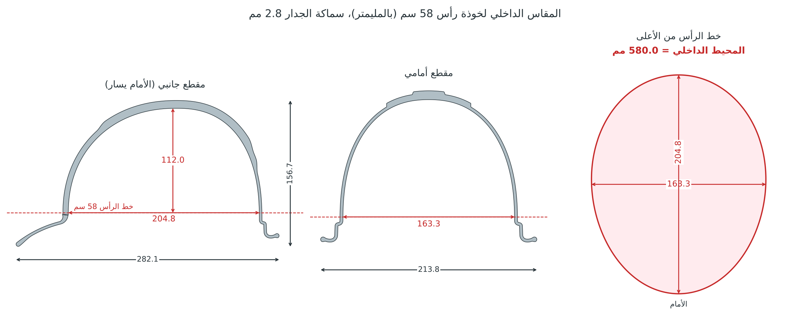

# خوذة سلامة كلاسيكية: موديل Blender، مقاس رأس 58 سم

هذا الموديل مأخوذ من صورة الخوذة الصفراء. ضبطت شكله على حدود الخوذة في الصورة، وصورت
المعاينة بكاميرا مضبوطة على زاوية الصورة نفسها.

- قبة طويلة من الأمام إلى الخلف، مرتفعة من الأمام وتنزل نحو الخلف.
- لوح أمامي بارز يحدّه خط على كل جانب، ينزل من الأعلى إلى نهاية الحزام.
- يستمر الخطان فوق السقف وينزلان من الخلف، وفي وسط السقف حافة بارزة (Crest).
- حزام بارز رفيع حول الجانبين والخلف ينتهي بشكل مربع عند خط اللوح الأمامي، وفيه شق
  يقسمه إلى كتلتين.
- مظلة أمامية عريضة منحنية إلى الأسفل، ومجرى للماء حول الحافة.

**الموديل هو القشرة البلاستيكية فقط.** لا يوجد فيه شريط ولا حزام ذقن ولا قماش ولا
بطانة ولا نظام تعليق. الخوذة تُلبس على الرأس مباشرة.

## النسختان

| الملف | السقف |
|---|---|
| `hard_hat_classic.blend` | مثل الصورة تمامًا، مع الخطوط والحافة البارزة فوق السقف |
| `hard_hat_classic_smooth.blend` | بدون الخطوط فوق السقف وفي أعلى الخلف، وباقي الشكل نفسه |

للتبديل بينهما في السكربت، غيّر `CROWN_LINES` إلى `True` أو `False`.

## المقاس: رأس 58 سم بدون أي زيادة

| البند | القيمة (مم) |
|---|---|
| **المحيط الداخلي عند خط الرأس** | **580.0 بالضبط (58 سم)** |
| العرض الداخلي عند خط الرأس | 163.3 |
| الطول الداخلي عند خط الرأس | 204.8 |
| العمق الداخلي من خط الرأس إلى سقف الخوذة | 112.0 |
| ارتفاع خط الرأس فوق جذر المظلة | 9.4 |

- **خط الرأس** هو المكان الذي تلمس فيه الخوذة الرأس، أي أعلى الحزام من الداخل. عنده
  يكون محيط الجدار الداخلي 580.0 مم بالضبط، والفراغ بين الرأس والخوذة صفر.
- كبّرت الخوذة كلها أو صغّرتها بنسبة واحدة للوصول إلى هذا المقاس، فتعدّل الارتفاع مع
  المحيط وبقي الشكل مطابقًا للصورة. سماكة الجدار 2.8 مم.
- داخل الملف حلقة اسمها `Head_58cm_fit_line`، طولها 580 مم، وهي مرسومة على خط الرأس
  بالضبط. هذه الحلقة لا تظهر في الرندر.

## الملفات

| الملف | الوصف |
|---|---|
| `hard_hat_classic.blend` | الموديل مثل الصورة مع الإضاءة والكاميرا والمواد الخمس، واللون أصفر |
| `hard_hat_classic_smooth.blend` | النسخة بدون خطوط السقف |
| `exports/hard_hat_classic.glb` / `.fbx` / `.obj.zip` | تصدير النسخة الأساسية |
| `hard_hat_classic_generator.py` | السكربت الذي يبني الموديل، والمقاسات كلها فيه قابلة للتعديل |
| `render_previews.py` | الإضاءة والكاميرات، ومنها كاميرا `photo_angle` بزاوية الصورة |
| `renders/` | صور المعاينة ورسم المقاس الداخلي |

## المقاسات الخارجية (بالمليمتر وبالحجم الحقيقي)

| البند | القيمة |
|---|---|
| الطول الكلي (من طرف المظلة إلى الخلف) | 282.1 |
| العرض الكلي | 213.8 |
| الارتفاع الكلي | 156.7 |
| سماكة الجدار | 2.8 |
| الحجم | ‏389 سم³، أي نحو 408 غرامات لو صُنعت من ABS |

الشبكة مغلقة بالكامل (watertight)، وفيها 489,600 وجه وأغلبها رباعية. الحجم حقيقي
بالمليمتر، والوجه الأمامي باتجاه ‎-Y.

## تعديل التصميم

افتح `hard_hat_classic_generator.py` (موجود أيضًا داخل الـ blend في Text Editor):

- **المقاس:** `HEAD_CIRC` هو محيط الرأس بالمليمتر، وقيمته الآن 580.
- **خطوط السقف:** `CROWN_LINES` لإظهارها أو إخفائها.
- **أماكن الخطوط:** `PANEL_PSI` لمكان خط اللوح الأمامي، و`SLOT_PHI` لمكان الشق.
- **الحزام والمظلة:** `BAND_H` و`BAND_STEP` للحزام، و`PEAK` و`PEAK_DROOP` للمظلة.

بعد التعديل اضغط Run Script، فتُبنى الخوذة في ثوانٍ في مشهد جديد.

---

### English summary

Classic cap-style hard hat matched to the yellow reference photo. The shape and the
camera were fitted to the photo's outline, and the `photo_angle` render uses that
camera.

- **Fit.** Shell only, sized to sit directly on a **58 cm head**: the inner wall is
  exactly **580.0 mm** around at the head line, measuring 163.3 × 204.8 mm. The inner
  depth from that line to the crown is 112 mm, and the wall is 2.8 mm.
- **Two versions.** `hard_hat_classic.blend` matches the photo, with the crown strip and
  crest. `hard_hat_classic_smooth.blend` leaves out the crown lines, as marked earlier.
  The switch between them is `CROWN_LINES` in the generator.
- **Size and mesh.** Overall size is 282 × 214 × 157 mm, and the mesh is watertight.
