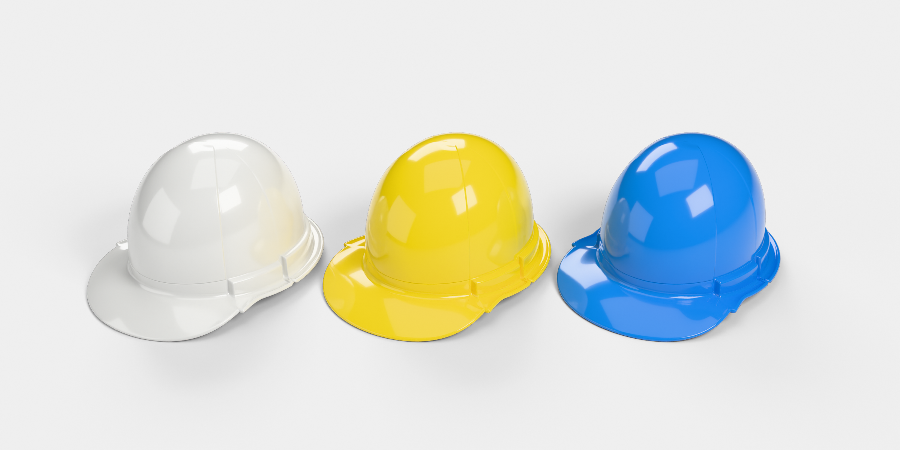

# خوذة سلامة كلاسيكية: موديل Blender، مقاس رأس 58 سم

هذا التصميم مأخوذ من صورة الخوذة الصفراء، **بدون الحافة البارزة في منتصف السقف وبدون
الخطوط في أعلى الخلف** كما طلبت. الشكل:

- قبة ناعمة مرتفعة بلا فتحات تهوية.
- **خط منحنٍ على كل جانب** ينزل من أعلى الخوذة إلى الحزام، فتصير مقدمة القبة لوحًا
  بارزًا قليلًا.
- **حزام بارز** حول الجانبين والخلف، ينتهي بشكل مربع عند الخط الجانبي، وفيه **شق
  إكسسوار** على كل جانب يقسمه إلى كتلتين. الكتلة الأمامية أخفض قليلًا من الخلفية.
- مظلة أمامية عريضة منحنية إلى الأسفل، ومجرى للماء حول الحافة.

**الموديل هو القشرة البلاستيكية فقط.** لا يوجد فيه شريط ولا حزام ذقن ولا قماش ولا
بطانة ولا نظام تعليق. الخوذة تُلبس على الرأس مباشرة.

## المقاس: رأس 58 سم بدون أي زيادة

| البند | القيمة (مم) |
|---|---|
| **المحيط الداخلي عند خط الرأس** | **580.0 بالضبط (58 سم)** |
| العرض الداخلي عند خط الرأس | 161.9 |
| الطول الداخلي عند خط الرأس | 206.0 |
| العمق الداخلي من خط الرأس إلى سقف الخوذة | 111.8 |
| ارتفاع خط الرأس فوق جذر المظلة | 17.3 |

- **خط الرأس** هو المكان الذي تلمس فيه الخوذة الرأس، أي بداية القبة من الداخل فوق
  الحزام مباشرة. عنده يكون محيط الجدار الداخلي 580.0 مم بالضبط، والفراغ بين الرأس
  والخوذة صفر.
- الجدار الداخلي شبه عمودي حول هذا الخط، فتجلس الخوذة على الرأس بثبات. فوقه يضيق
  الداخل تدريجيًا حتى السقف، وتحته يتسع الحزام والمجرى إلى الخارج فلا يلمسان الرأس.
- كبّرت الخوذة كلها أو صغّرتها بنسبة واحدة للوصول إلى هذا المقاس، فتعدّل الارتفاع مع
  المحيط. سماكة الجدار 2.8 مم.
- داخل الملف حلقة اسمها `Head_58cm_fit_line` في مجموعة `Reference_Head_58cm`. طولها
  580 مم، وهي مرسومة على خط الرأس بالضبط. هذه الحلقة لا تظهر في الرندر.
- القيم نفسها محفوظة في خصائص الكائن `HardHat`، في `Object Properties ▸ Custom Properties`.

## الملفات

| الملف | الوصف |
|---|---|
| `hard_hat_classic.blend` | الملف الأساسي، ويحتوي على الموديل والمواد الخمس والإضاءة والكاميرا. افتحه واضغط F12 للرندر |
| `exports/hard_hat_classic.glb` | glTF مع المادة (للمحركات والويب) |
| `exports/hard_hat_classic.fbx` | FBX (Unity / Unreal / 3ds Max / Maya) |
| `exports/hard_hat_classic.obj.zip` | OBJ + MTL مضغوط |
| `hard_hat_classic_generator.py` | السكربت الذي يبني الموديل كاملًا، والمقاسات كلها فيه قابلة للتعديل |
| `render_previews.py` | سكربت الإضاءة والكاميرات وصور المعاينة |
| `renders/` | صور المعاينة من كل الزوايا (`photo_angle.png` من زاوية صورتك)، و`fit_58cm.png` رسم المقاس الداخلي |

## المقاسات الخارجية (بالمليمتر وبالحجم الحقيقي)

| البند | القيمة |
|---|---|
| الطول الكلي (من طرف المظلة إلى الخلف) | 284.9 |
| العرض الكلي (مع مجرى الماء) | 213.4 |
| الارتفاع الكلي | 158.6 |
| سماكة الجدار | 2.8 |
| طول المظلة الأمامية | 50 تقريبًا |
| بروز الحزام عن القبة | 6.9 |
| بروز اللوح الأمامي | 1.7 |
| الحجم | ‏338 سم³، أي نحو 355 غرامًا لو صُنعت من ABS |

## الشبكة (Mesh)

- 488,642 رأسًا (vertex) و489,600 وجهًا، وأغلبها رباعية (quads) والخطوط فيها تتبع شكل الخوذة.
- الشبكة مغلقة بالكامل (manifold / watertight) بلا أي حافة مفتوحة، لذلك يمكن طباعتها مباشرة
  بعد التصدير إلى STL من `File ▸ Export ▸ STL`.
- الحجم حقيقي (1 وحدة = 1 متر) والمشهد يعرض المقاسات بالمليمتر.
- نقطة الأصل (Origin) في منتصف مستوى جذر المظلة، والوجه الأمامي باتجاه ‎-Y.

## الألوان

في الملف خمس مواد، كلها بلاستيك لامع مع طبقة Coat. اللون الافتراضي أصفر مثل صورتك:
`HardHat_Yellow` و`HardHat_White` و`HardHat_Blue` و`HardHat_Orange` و`HardHat_Red`.
لتغيير اللون اختر مادة أخرى من Material Properties.

## تعديل التصميم

افتح `hard_hat_classic_generator.py` (موجود أيضًا داخل الـ blend في Text Editor).

- **مقاس الرأس:** غيّر `HEAD_CIRC` في أعلى الملف، فهو المحيط بالمليمتر وقيمته الآن 580.
  السكربت يحسب نسبة التكبير بنفسه حتى يصبح المحيط الداخلي عند خط الرأس مساويًا له
  بالضبط، ويعدّل الارتفاع معه.
- **الخط الجانبي واللوح الأمامي:** `PANEL_PSI` لمكان الخط، و`PANEL_H` لبروز اللوح.
  إذا أردت إزالة الخط الجانبي أيضًا فاجعل `PANEL_H = 0`.
- **الحزام والشق:** `BAND_STEP` لبروز الحزام، و`SLOT_PHI` و`SLOT_GAP` لمكان الشق وعرضه،
  و`FRONT_BLOCK_DROP` لفرق الارتفاع بين الكتلتين.
- **الشكل:** `PEAK` لطول المظلة، و`GUTTER` لعرض المجرى، و`Z_TOP` و`N_SUPER` لارتفاع
  القبة واستدارتها.

بعد التعديل اضغط Run Script، فتُبنى الخوذة في ثوانٍ في مشهد جديد اسمه `HardHat` دون أن
يتأثر ملفك الحالي.

---

### English summary

Classic cap-style hard hat from the yellow reference photo, **without the crown ridge
and the lines at the upper back**, which the user marked for removal. The shape has:

- a smooth tall dome;
- a curved line down each side from the crown to the band, making the front a
  slightly raised panel;
- a raised band around the sides and back that ends square at that line, split
  by an accessory slot on each side;
- a wide drooping peak and a rain gutter.

**Fit.** Shell only, sized to sit directly on a **58 cm head** with no extra room.
Where the shell touches the head, the inner wall is exactly **580.0 mm** around,
measuring 161.9 × 206.0 mm. The inner depth from that line to the crown is 111.8 mm.

**Size and mesh.** The helmet is scaled uniformly, so the height follows the size, and
the wall is 2.8 mm. Overall size is 285 × 213 × 159 mm. The mesh has 490k faces, mostly
quads, and is watertight.

**In the .blend.** Five colour materials (yellow by default), a studio light rig, a
camera, and a hidden 580 mm ring that marks the fit line. Edit `HEAD_CIRC` and the
shape parameters in `hard_hat_classic_generator.py` to change it.
