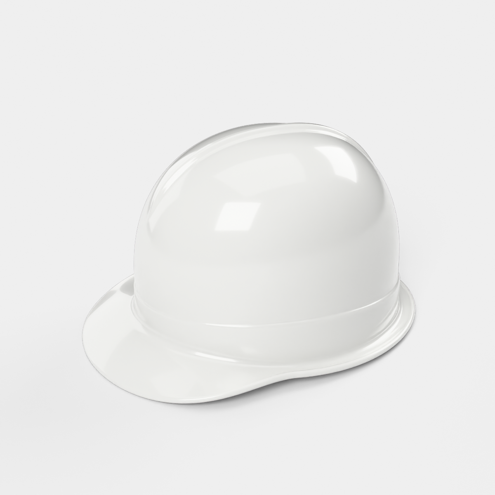
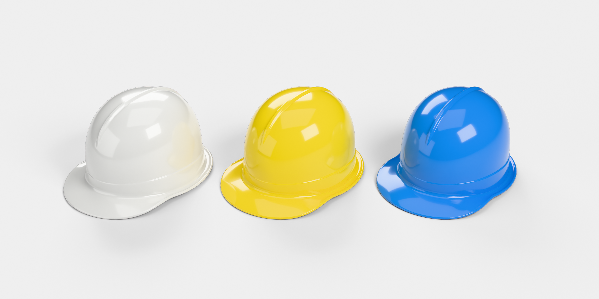
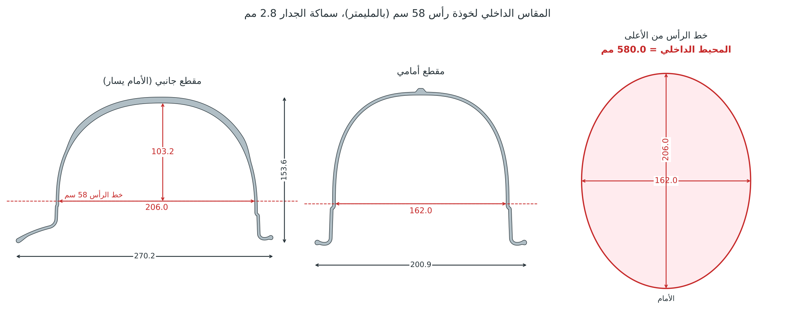

# خوذة سلامة كلاسيكية بحافة علوية: موديل Blender، مقاس رأس 58 سم

هذا هو التصميم الثاني، مأخوذ من صورة الخوذ الثلاث (الأبيض والأصفر والأزرق):

- قبة ناعمة مرتفعة بلا فتحات تهوية وبلا لوح جانبي.
- حافة بارزة (Ridge) في منتصف القبة، تمتد من الخلف فوق السقف إلى الجبهة وتختفي تدريجيًا في منتصفها.
- خط رفيع حول أسفل القبة.
- مظلة أمامية قصيرة ومجرى للماء حول الحافة.

**الموديل هو القشرة البلاستيكية فقط.** لا يوجد فيه شريط ولا حزام ذقن ولا قماش ولا
بطانة ولا نظام تعليق. الخوذة تُلبس على الرأس مباشرة.

## المقاس: رأس 58 سم بدون أي زيادة

| البند | القيمة (مم) |
|---|---|
| **المحيط الداخلي عند خط الرأس** | **580.0 بالضبط (58 سم)** |
| العرض الداخلي عند خط الرأس | 162.0 |
| الطول الداخلي عند خط الرأس | 206.0 |
| العمق الداخلي من خط الرأس إلى سقف الخوذة | 103.2 |
| ارتفاع خط الرأس فوق جذر المظلة | 26.0 |

- **خط الرأس** هو المكان الذي تلمس فيه الخوذة الرأس، أي بداية القبة من الداخل فوق
  الخط الرفيع مباشرة. عنده يكون محيط الجدار الداخلي 580.0 مم بالضبط، والفراغ بين
  الرأس والخوذة صفر.
- الجدار الداخلي شبه عمودي حول هذا الخط، فيبقى المحيط 580 مم تقريبًا لمسافة سنتيمتر
  فوقه وتحته، ولذلك تجلس الخوذة على الرأس بثبات. فوق ذلك يضيق الداخل حتى السقف،
  وتحته يتسع المجرى إلى الخارج.
- كبّرت الخوذة كلها أو صغّرتها بنسبة واحدة للوصول إلى هذا المقاس، فتعدّل الارتفاع مع
  المحيط. سماكة الجدار 2.8 مم، والحافة العلوية مصمتة فوقها.
- داخل الملف حلقة اسمها `Head_58cm_fit_line` في مجموعة `Reference_Head_58cm`. طولها
  580 مم، وهي مرسومة على خط الرأس بالضبط. هذه الحلقة لا تظهر في الرندر.
- القيم نفسها محفوظة في خصائص الكائن `HardHat`، في `Object Properties ▸ Custom Properties`.

## الملفات

| الملف | الوصف |
|---|---|
| `hard_hat_ridge.blend` | الملف الأساسي، ويحتوي على الموديل والمواد الخمس والإضاءة والكاميرا. افتحه واضغط F12 للرندر |
| `exports/hard_hat_ridge.glb` | glTF مع المادة (للمحركات والويب) |
| `exports/hard_hat_ridge.fbx` | FBX (Unity / Unreal / 3ds Max / Maya) |
| `exports/hard_hat_ridge.obj.zip` | OBJ + MTL مضغوط |
| `hard_hat_ridge_generator.py` | السكربت الذي يبني الموديل كاملًا، والمقاسات كلها فيه قابلة للتعديل |
| `render_previews.py` | سكربت الإضاءة والكاميرات وصور المعاينة |
| `renders/` | صور المعاينة من كل الزوايا، و`fit_58cm.png` رسم المقاس الداخلي |

## المقاسات الخارجية (بالمليمتر وبالحجم الحقيقي)

| البند | القيمة |
|---|---|
| الطول الكلي (من طرف المظلة إلى الخلف) | 270.2 |
| العرض الكلي (مع مجرى الماء) | 200.9 |
| الارتفاع الكلي | 153.6 |
| سماكة الجدار | 2.8 |
| ارتفاع الحافة العلوية فوق القبة | 3.5 |
| سماكة حافة المظلة والمجرى | 4.6 (حافة مدوّرة) |
| الحجم | ‏292 سم³، أي نحو 307 غرامات لو صُنعت من ABS |

## الشبكة (Mesh)

- 488,642 رأسًا (vertex) و489,600 وجهًا، وأغلبها رباعية (quads) والخطوط فيها تتبع شكل الخوذة.
- الشبكة مغلقة بالكامل (manifold / watertight) بلا أي حافة مفتوحة، لذلك يمكن طباعتها مباشرة
  بعد التصدير إلى STL من `File ▸ Export ▸ STL`.
- الحجم حقيقي (1 وحدة = 1 متر) والمشهد يعرض المقاسات بالمليمتر.
- نقطة الأصل (Origin) في منتصف مستوى جذر المظلة، والوجه الأمامي باتجاه ‎-Y.

## الألوان

في الملف خمس مواد، كلها بلاستيك لامع مع طبقة Coat:
`HardHat_White` و`HardHat_Yellow` و`HardHat_Blue` و`HardHat_Orange` و`HardHat_Red`.
لتغيير اللون اختر مادة أخرى من Material Properties.

## تعديل التصميم

افتح `hard_hat_ridge_generator.py` (موجود أيضًا داخل الـ blend في Text Editor).

- **مقاس الرأس:** غيّر `HEAD_CIRC` في أعلى الملف، فهو المحيط بالمليمتر وقيمته الآن 580.
  السكربت يحسب نسبة التكبير بنفسه حتى يصبح المحيط الداخلي عند خط الرأس مساويًا له
  بالضبط، ويعدّل الارتفاع معه.
- **الحافة العلوية:** `RIDGE_H` للارتفاع، و`RIDGE_TOP` و`RIDGE_BASE` للعرض، و
  `RIDGE_END_FRONT` و`RIDGE_END_BACK` لمكان نهايتها في الأمام والخلف.
- **الشكل:** `PEAK` لطول المظلة، و`GUTTER` لعرض المجرى، و`Z_TOP` و`N_SUPER` لارتفاع
  القبة واستدارتها.

بعد التعديل اضغط Run Script، فتُبنى الخوذة في ثوانٍ في مشهد جديد اسمه `HardHat` دون أن
يتأثر ملفك الحالي.

---

### English summary

Classic cap-style hard hat from the second reference photo: a smooth tall dome with a
raised centre ridge running from the back of the crown down to mid-forehead, a thin
crease around the lower dome, a short front peak and a rain gutter. It has no vents,
side panels or accessory slots.

- **Fit.** Shell only, sized to sit directly on a **58 cm head** with no extra room.
  Where the shell touches the head, the inner wall is exactly **580.0 mm** around,
  measuring 162.0 × 206.0 mm. The inner depth from that line to the crown is 103.2 mm.
- **Size and mesh.** The helmet is scaled uniformly, so the height follows the size;
  the wall is 2.8 mm. Overall size is 270 × 201 × 154 mm, and the mesh has 490k faces,
  mostly quads, and is watertight.
- **What's in the `.blend`.** Five colour materials, a studio light rig, a camera, and
  a hidden 580 mm ring that marks the fit line.
- **Changing it.** Edit `HEAD_CIRC` and the shape parameters in
  `hard_hat_ridge_generator.py`; the scale is solved automatically.
