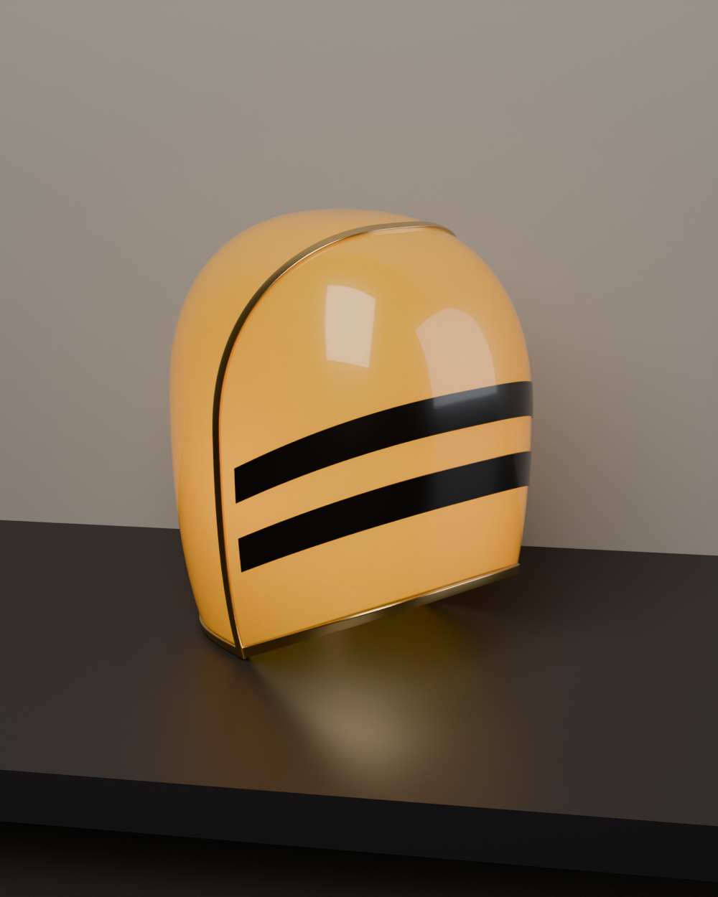

# Helmet Lamp – Blender model (20 cm)



| File | What it is |
|------|------------|
| `helmet_lamp.blend` | Ready-to-open Blender scene (Blender 4.2+ / 5.x), Cycles materials, camera and lights |
| `helmet_lamp.glb` | The helmet only, with materials (for other software / web viewers) |
| `helmet_lamp_mm.stl` | The helmet only, in **millimetres**, for 3D printing |
| `build_helmet.py` | The script that generates everything. Change the numbers at the top and rerun |
| `renders/` | Hero, front and side renders |

## Size
- Height: **20.00 cm** (exact)
- Width: ~14.0 cm, Depth: ~16.2 cm
- Shell wall: 3 mm, open at the bottom (for a lamp base / bulb)

## Objects (collection `Helmet`, parented to the empty `Helmet_Lamp`)
- `Helmet_Shell` – orange translucent shell (Subsurface + Coat material `Orange_Glass`)
- `Helmet_Trim_Seam` – brass band outlining the face plate
- `Helmet_Trim_Rim` – brass U-cap round the bottom edge and the raised chin
- `Helmet_Stripe_Upper`, `Helmet_Stripe_Lower` – black visor stripes

The `Studio` collection (shelf, wall, inner bulb light, camera) is only for the renders,
so you can delete it.

## Regenerating
In Blender: open `build_helmet.py` in the **Scripting** tab and press **Run Script**.
Headless:
```
blender -b -P build_helmet.py -- --out . --render hero,front,side --samples 128
```

---

## بالعربي
- افتح `helmet_lamp.blend` في بلندر، الخوذة جاهزة بارتفاع **20 سم بالضبط**.
- الأجزاء: الغلاف البرتقالي (سماكة 3 مم)، الإطار النحاسي/الذهبي، الحافة السفلية، والخطين الأسودين.
- مجموعة `Studio` (الرف، الجدار، الإضاءة، الكاميرا) للعرض فقط، احذفها إذا تريد الخوذة لوحدها.
- `helmet_lamp_mm.stl` جاهز للطباعة ثلاثية الأبعاد بالمليمتر.
- لتعديل الشكل: غيّر الأرقام أعلى ملف `build_helmet.py` (العرض، العمق، ميلان الذقن، مكان الخطوط) وشغّله من تبويب Scripting.
