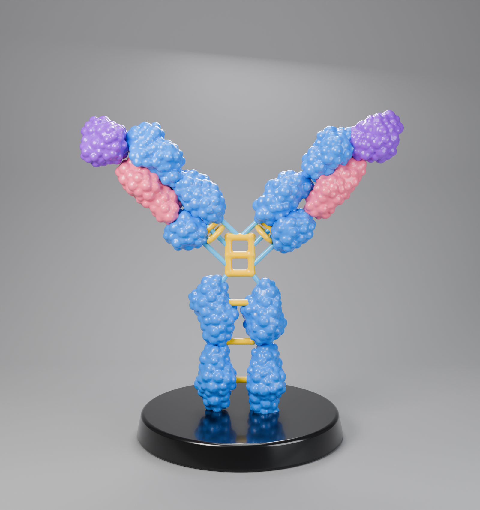
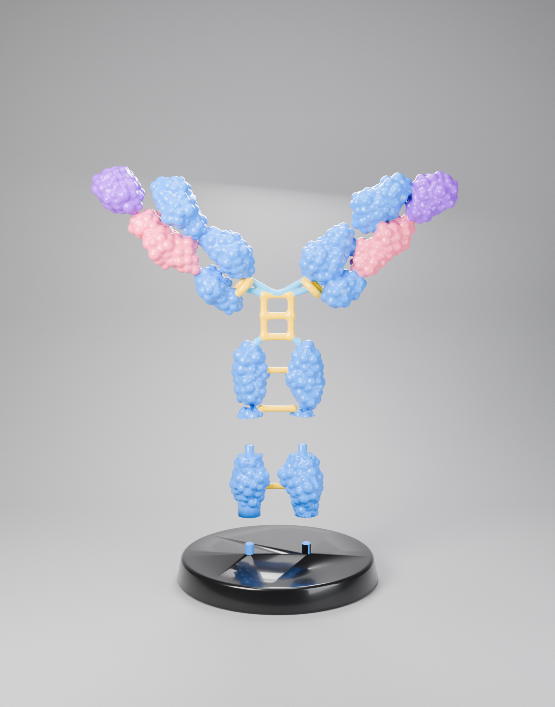
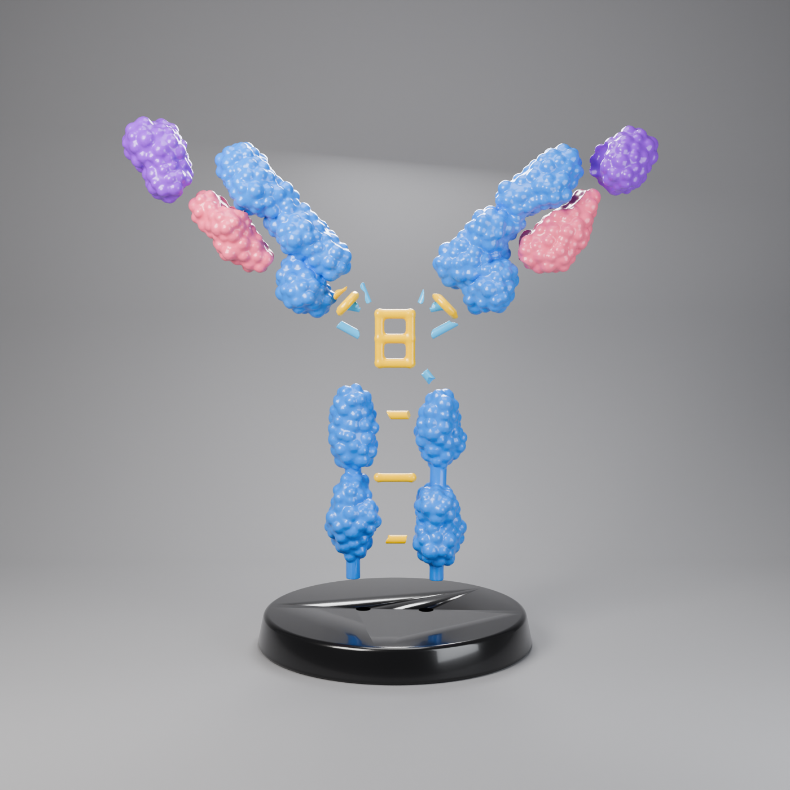

# نموذج الجسم المضاد IgG — Blender



نموذج ثلاثي الأبعاد عالي التفاصيل للجسم المضاد IgG (بدون أي كتابة)، ومعه قاعدة سوداء وإضاءة استوديو وكاميرا.

| الملف | الوصف |
|---|---|
| `igg_antibody.blend` | ملف Blender جاهز (المشهد كامل: النموذج + القاعدة + الإضاءة + الكاميرا) |
| `igg_antibody.glb` | النموذج فقط للتصدير إلى برامج أخرى |
| `igg_antibody.py` | سكربت Python يبني النموذج من الصفر |
| `igg_antibody_render.png` | صورة الرندر النهائية (Cycles) |

## الاستخدام
- افتح `igg_antibody.blend` واضغط **F12** للرندر.
- أو من تبويب **Scripting** افتح `igg_antibody.py` واضغط **Run Script** لإعادة بناء المشهد.
  - `QUALITY` في أعلى السكربت: كلما زادت زادت التفاصيل وعدد المضلعات (الافتراضي 1.0 ≈ 190 ألف وجه).
  - `SEED`: غيّره للحصول على توزيع مختلف للنتوءات.
  - `COLORS`: ألوان كل جزء.

## الأجزاء والألوان
- **أزرق**: السلسلة الثقيلة (CH1, VH, CH2, CH3) + CL
- **وردي**: السلسلة الخفيفة (VL)
- **بنفسجي**: موقع ارتباط المستضد
- **أصفر**: روابط ثنائية الكبريتيد (المفصل والجسور بين السلاسل)

كل جزء كائن منفصل بمادته الخاصة، وكلها مربوطة بـ Empty اسمه `IgG_Root` لتحريك النموذج كاملاً.

---

# نسخة الطباعة ثلاثية الأبعاد (3 أجزاء)



الملفات في مجلد `print/` (الوحدة: **مليمتر**، الارتفاع الكلي بعد التركيب **180 مم**):

| الجزء | الملف | المقاس (مم) | التركيب |
|---|---|---|---|
| 1 — القاعدة | `IgG_part1_base.stl` | 115 × 115 × 20 | وتدان للأعلى |
| 2 — ساق Fc السفلية | `IgG_part2_fc.stl` | 51 × 29 × 41 | ثقبان من الأسفل + وتدان للأعلى |
| 3 — الجزء العلوي (Fc العلوي + المفصل + الذراعان) | `IgG_part3_top.stl` | 171 × 29 × 131 | ثقبان من الأسفل |

- كل جزء **مغلق (Watertight / Manifold)** وجسم واحد. تم التحقق بـ Blender و trimesh.
- الأوتاد: قطر 5 مم وطول 6 مم مع شطفة. الثقوب أوسع بـ 0.2 مم من كل جهة.
- أقل سماكة للأنابيب الرفيعة (الروابط الصفراء والزرقاء) هي 3.2 مم.
- ملفات `.obj + .mtl` هي نفس الأجزاء **بالألوان**، للطابعات متعددة الألوان (Bambu Studio / OrcaSlicer).
- `IgG_print_parts.blend` يحتوي الأجزاء الثلاثة جاهزة.

## نصائح الطباعة
- **القاعدة والجزء 2**: اطبعهما على الوجه المسطح السفلي. لا تحتاج دعامات تقريباً.
- **الجزء 3**: اطبعه واقفاً على وجه القطع السفلي مع **Tree Supports** و **Brim**. الذراعان المائلتان تحتاجان دعامات.
- الإعدادات المقترحة: طبقة 0.12–0.16 مم، Infill بنسبة 10–15%، PLA.
- التركيب: ركّب الأجزاء على الأوتاد مع قطرة غراء (Super Glue).

## تغيير الحجم
```bash
blender -b -P igg_antibody_print.py -- --height 150
```
أو غيّر `PRINT_HEIGHT_MM` في أعلى `igg_antibody_print.py`. عرض الجزء 3 يساوي تقريباً ارتفاع النموذج الكلي، فتأكد أنه يناسب سطح الطابعة. مثلاً: ارتفاع 180 مم يحتاج سطحاً بعرض 180 مم على الأقل.

---

# نسخة الطباعة حسب اللون (كل لون قطع منفصلة)



كل لون في مجلد خاص داخل `print_colors/`. اطبع كل مجلد بلون الفلامنت الخاص به ثم الصق القطع (مم، الارتفاع 180 مم):

| المجلد | اللون | القطع |
|---|---|---|
| `black/` | أسود | القاعدة (فيها ثقبان للأوتاد) |
| `blue/` | أزرق | عمودا Fc (يسار/يمين) + السلسلة الثقيلة لكل ذراع |
| `pink/` | وردي | السلسلة الخفيفة VL (يسار/يمين) |
| `purple/` | بنفسجي | موقع ارتباط المستضد (يسار/يمين) |
| `yellow/` | أصفر | سلّم المفصل + 3 جسور Fc + الحلقتان + جسر صغير |
| `lightblue/` | أزرق فاتح | 7 وصلات صغيرة للمفصل |

- كل قطعة مغلقة (Watertight) وجسم واحد. تم التحقق بـ Blender و trimesh.
- عند التداخل بين لونين يأخذ أحدهما الحجم، ويُحفر في الآخر **مقعد ناعم** بخلوص 0.15 مم، فتجلس القطعتان في بعضهما.
  الأولوية: أزرق ← وردي ← بنفسجي ← أصفر ← أزرق فاتح.
- أعمدة Fc لها **قاعدة مسطحة + وتد** يدخل في ثقب القاعدة السوداء (خلوص 0.2 مم).
- `IgG_colour_pieces.blend` فيه كل القطع مركّبة وملوّنة كمرجع لمكان كل قطعة.

## الترتيب المقترح للتركيب
1. ثبّت عمودَي Fc الأزرقين في القاعدة السوداء.
2. الصق جسور Fc الصفراء الثلاثة بين العمودين.
3. الصق سلّم المفصل الأصفر فوق العمودين، ثم وصلات الأزرق الفاتح.
4. الصق الوردي والبنفسجي على قطعة الذراع الزرقاء (كل قطعة تجلس في مقعدها).
5. الصق الذراعين على المفصل والوصلات، ثم الحلقتين الصفراوين عند جذر كل ذراع.

## نصائح
- الغراء: Super Glue (CA). القطع الصغيرة (الأصفر والأزرق الفاتح) اطبعها بطبقة 0.08–0.12 مم.
- الأذرع والقطع العضوية تحتاج **Tree Supports**.
- لإعادة التوليد بحجم آخر:
  `blender -b -P igg_antibody_print_colors.py -- --height 150 --render`
