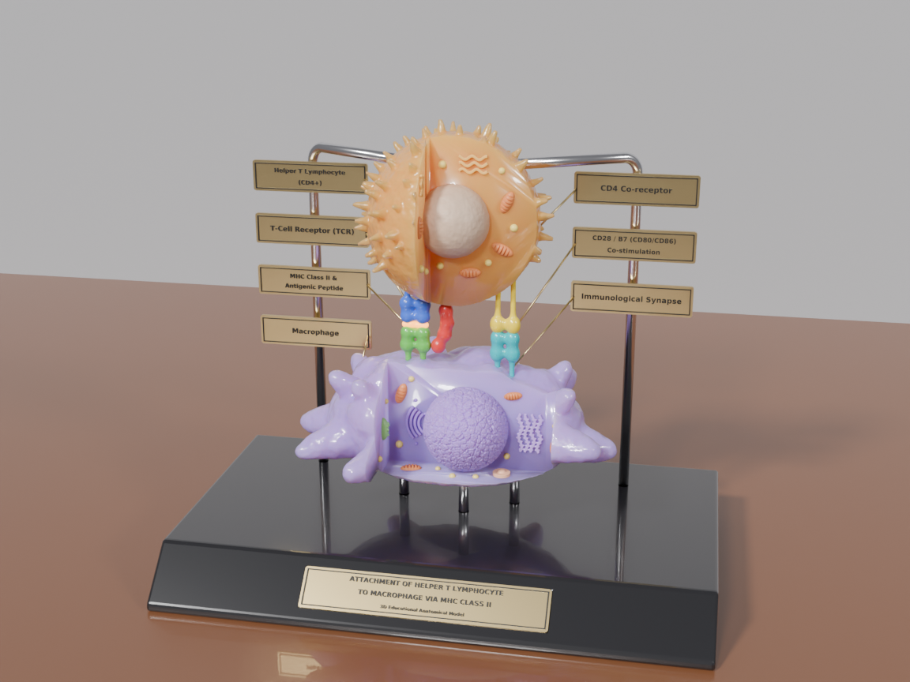

# مجسم التصاق الخلية التائية المساعدة بالبلعم عبر MHC-II — جاهز للطباعة ثلاثية الأبعاد



| البند | القيمة |
|---|---|
| عرض القاعدة | **400 mm (40 cm)** |
| المقاس الكلي | 400 × 240 × 338 mm |
| الوحدة داخل بلندر | 1 Blender unit = 1 mm (Unit Scale = 0.001) |
| إصدار بلندر | 4.2 LTS أو أحدث (تم الاختبار على 5.3) |
| كل القطع | Manifold (مغلقة، بدون حواف مفتوحة) — تم الفحص آلياً |

## الملفات

| الملف | الوصف |
|---|---|
| `immune_synapse_model.py` | سكربت بلندر يبني المجسم بالكامل (إجرائي — Procedural) |
| `immune_synapse_model.blend` | ملف بلندر جاهز (مع خامات وإضاءة وكاميرا) |
| `immune_synapse_STL.zip` | كل القطع بصيغة STL منفصلة (بالمليمتر) |
| `preview_render.png` / `preview_closeup.png` | صور معاينة (Cycles) |

## التشغيل داخل بلندر

1. `File > New > General` (السكربت يحذف كائنات المشهد الحالي).
2. تبويب **Scripting** ← **Open** ← اختر `immune_synapse_model.py`.
3. في أعلى السكربت عدّل إن أردت:
   - `EXPORT_DIR = r"C:\prints\synapse_stl"` لتصدير STL تلقائياً.
   - `QUALITY = 1.0` (0.6 سريع للتجربة، 1.4 أنعم وأثقل).
   - `FONT_FILE` لاستخدام خط معيّن للكتابة على اللوحات.
4. **Run Script** (حوالي 15–40 ثانية).

أو من الطرفية:
```
blender -b -P immune_synapse_model.py -- --export ./stl --save model.blend --render preview.png
```

كل جزء في Collection خاصة: `01_Base`, `02_Macrophage`, `03_T_Cell`, `04_Proteins`, `05_Rods_Posts`, `06_Labels`, `07_Leader_Wires` (و`99_Render_Scene` للطاولة والكاميرا فقط — لا تُطبع).

## قائمة القطع والألوان المقترحة

| القطعة | اللون / الخامة | المقاس التقريبي |
|---|---|---|
| `Base_Left`, `Base_Right` | أسود لامع (PLA Silk/Glossy) | 200×240×40 لكل نصف |
| `Macrophage_Body` | بنفسجي شفاف (PETG/PLA Translucent) | 240×178×90 |
| `M_Nucleus`, `M_Golgi` | بنفسجي غامق | — |
| `M_Rough_ER` | ليلكي | — |
| `T_Cell_Body` | برتقالي شفاف | Ø 144 |
| `T_Nucleus` | بيج | — |
| `T_ER` | كهرماني | — |
| `M_Mitochondria`, `T_Mitochondria` | برتقالي صدئ | — |
| `M_Vesicles`, `T_Vesicles` | أصفر | — |
| `M_Lysosome` | أخضر | — |
| `M_Phagosome` | خوخي | — |
| `TCR` | أزرق | 24×11×35 |
| `MHC_II` | أخضر | 24×11×33 |
| `Antigen_Peptide` | برتقالي فاقع / Glow | 20×7×6.5 |
| `CD4` | أحمر | 18×10×47 |
| `CD28` | أصفر | 22×11×46 |
| `B7_CD80_CD86` | تركوازي | 22×10×41 |
| `Rod_Left`, `Rod_Right` | قضيب معدني 8 mm (أو طباعة فضي) | انظر أدناه |
| `Post_1..3` | قضيب/وتد 8 mm بطول 63 mm | — |
| `Plaque_Plate`, `Label_*_Plate`, `Label_*_Clip` | ذهبي (Silk Gold) | لوحة 176×30، لافتات 92×24 |
| `Plaque_Text`, `Label_*_Text` | أسود | نص بارز 0.7 mm |
| `Wire_*` | سلك نحاسي 1.5 mm (أو طباعة) | قص حسب المكان |

> كل ملفات STL مصدّرة **بنفس إحداثيات التجميع**. في Bambu Studio / OrcaSlicer / PrusaSlicer:
> اسحب ملفات الخلية مع عُضيّاتها معاً (مثلاً `Macrophage_Body` + كل `M_*`) ← اختر
> **"Load as a single object with multiple parts"** ← عيّن لون لكل جزء ← طباعة متعددة الألوان (AMS/MMU) في قطعة واحدة.
> أو اطبع كل قطعة وحدها بلونها ثم ألصقها — الأوتاد (Pegs) والثقوب مصممة مسبقاً بخلوص 0.25 mm.

## إعدادات الطباعة المقترحة

* فوهة 0.4، طبقة 0.16–0.2 mm (البروتينات والنصوص 0.12 mm أفضل).
* **القاعدة:** كل نصف مقلوب على قاعدته (يناسب سرير 250×210 بالتدوير)، بدون دعامات، Infill 15%.
* **البلعم (Macrophage):** القاعدة المسطحة على السرير (z = 76 mm)، دعامات **Tree/Organic** للأذرع البارزة. يناسب سرير 250×210.
* **الخلية التائية:** كما هي في التصميم، دعامات Tree، Infill 10–15% (لتخفيف الوزن)، Brim.
* **البروتينات:** اطبعها واقفة على الوتد مع Brim، أو مائلة بدعامات Tree خفيفة.
* **العضيّات** (إن طُبعت منفصلة): كل قطعة لها وجه مسطح — استعمل "Lay on face" في السلايسر وافصلها بـ "Split to objects".
* **اللوحات:** الوجه المكتوب للأعلى (النص بلون ثانٍ، أو اطبع ذهبي ثم لوّن النص بقلم أسود). المشابك `Clip` تُطبع واقفة (محور الحلقة عمودي) بدون دعامات.

## القضبان (Rods)

* قضيب ألمنيوم/ستيل **قطر 8 mm** عدد 2.
* الطول المفرود ≈ **392 mm**: جزء رأسي 278 mm مستقيم + انحناء 90° بنصف قطر 12 mm + جزء أفقي ≈ 95 mm.
* الجزء الرأسي ينزل 25 mm داخل القاعدة، والأفقي يدخل 14 mm في جانب الخلية التائية.
* الأعمدة القصيرة: 3 قطع × 63 mm (15 mm داخل القاعدة + 12 mm داخل البلعم).

## خطوات التجميع

1. ألصق نصفي القاعدة بوتدين خشبيين **6×30 mm** + غراء.
2. ألصق اللوحة الذهبية (Plaque) في التجويف على الوجه المائل الأمامي.
3. ركّب الأعمدة الثلاثة القصيرة في القاعدة، ثم ضع البلعم فوقها.
4. ركّب `MHC_II` و `B7` في ثقوب البلعم، وضع `Antigen_Peptide` في أخدود MHC.
5. ركّب `TCR` و `CD4` و `CD28` في ثقوب أسفل الخلية التائية.
6. أدخل الطرف الأفقي لكل قضيب في ثقبي جانب الخلية التائية، ثم أنزل (الخلية + القضيبين) معاً حتى يدخل الطرفان الرأسيان في ثقوب القاعدة. نقاط تلامس البروتينات تُلصق بنقطة غراء.
7. اكبس مشابك اللافتات على القضبان (Snap-fit) وألصق اللوحات عليها بالترتيب:
   يسار: Helper T Lymphocyte ← TCR ← MHC II & Peptide ← Macrophage — يمين: CD4 ← CD28/B7 ← Immunological Synapse.
8. اثنِ أسلاك نحاس 1.5 mm من طرف كل لافتة للجزء المقصود (مرسومة في Collection `07_Leader_Wires`).

## تعديلات سهلة في السكربت

| المتغير | الوظيفة |
|---|---|
| `T_C`, `T_R` | مكان ونصف قطر الخلية التائية |
| `M_C`, `MRX/MRY/MRZ`, `PODS` | شكل البلعم وأذرعه الكاذبة |
| `T_CUT`, `M_CUT` | حجم ومكان المقطع المفتوح |
| `T_SPECS`, `M_SPECS` | أماكن العضيّات (الميتوكوندريا، جولجي، ER، الحويصلات...) |
| `LABELS` | نص اللافتات وارتفاعها |
| `CLR` | خلوص الأوتاد في الثقوب (زد إلى 0.3 إذا كانت ضيقة على طابعتك) |
| `SEED` | يغيّر التوزيع العشوائي للنتوءات |
