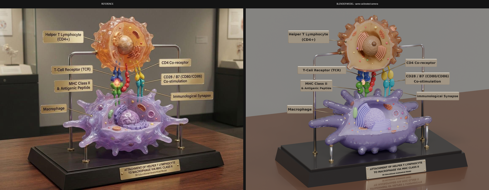

# مجسم التصاق الخلية التائية المساعدة بالبلعم عبر MHC-II — مطابق للصورة المرجعية وجاهز للطباعة



يسار: الصورة المرجعية — يمين: مجسم بلندر مصوَّر **بنفس زاوية الكاميرا** (كاميرا معايَرة رياضياً من الصورة).

## 1) طريقة العمل (تحليل ← نمذجة ← مقارنة ← تصحيح)

1. **قياس الصورة:** قسّمت الصورة المرجعية بشبكة إحداثيات وكبّرت كل منطقة (القاعدة، الخلية التائية، البروتينات، البلعم، المقطع) وسجّلت مواقع النقاط بالبكسل.
2. **معايرة الكاميرا:** حلّ بطريقة أقل المربعات (least squares) على 14 نقطة (زوايا القاعدة + القضبان) مع تثبيت عرض القاعدة 400 mm → موقع الكاميرا وزاويتها وعدستها (خطأ ≈ 7 بكسل). القيم في `camera_calibration.json`.
3. **الإسقاط العكسي:** كل جزء (أطراف أذرع البلعم، البروتينات، العضيّات، اللافتات، اللوحة) وُضِع في 3D بإسقاط موقعه في الصورة عبر الكاميرا المعايَرة — ليس بالتخمين.
4. **المقارنة والتصحيح:** 12 دورة: رندر بنفس الكاميرا ← مقارنة جنب-لجنب + تراكب حواف + أقنعة لونية (IoU) + قياس الألوان بالبكسل ← تعديل.

| المؤشر | أول دورة | النهائي |
|---|---|---|
| تطابق شكل الخلية التائية (IoU) | 0.42 | **0.72** (المساحة 57,600 مقابل 57,184 بكسل، المركز مطابق ±3 بكسل) |
| تطابق شكل البلعم (IoU) | 0.37 | **0.65** |
| لون جدار مقطع البلعم | — | (161,149,174) مقابل المرجع (158,136,170) |

## 2) المكونات والمقاسات (مقاسة من الصورة)

| الجزء | المقاس |
|---|---|
| القاعدة: قاعدة سفلية بجوانب مائلة + لوح علوي | **400 × 221 × 38.5 mm** (نصفان 200 × 221) |
| المجسم كامل | ≈ 400 × 222 × 352 mm (اللافتتان اليسريان تبرزان قليلاً عن حافة القاعدة كما في الصورة) |
| الخلية التائية (مفلطحة قليلاً) | 146 × 143 × 129 mm، قطع V أمامي، نواة كروية Ø 46 mm، شبكة إندوبلازمية وميتوكوندريا |
| البلعم | 299 × 165 × 150 mm (أذرع منتفخة الأطراف، مقطع: جدار خلفي + جدار أيسر + أرضية) |
| داخل البلعم | نواة بتلافيف (Ø 55)، جولجي مقوّس، شبكة إندوبلازمية خشنة بطبقات، ميتوكوندريا، جسم متعدد الحويصلات، ليسوسوم أخضر، فجوة بلعمية، حبيبات |
| البروتينات | TCR، MHC-II، الببتيد المضيء، CD4، CD28، B7 — كل بروتين سلسلتان منفصلتان كما في الصورة، بأوتاد Ø 4 mm |
| الهيكل | قضيبان L قطر 6 mm + عمودان قصيران تحت طرفي ذراعين + حلقات ذهبية |
| اللافتات | 7 لوحات بمقاساتها المقاسة من الصورة + اللوحة الأمامية (150 × 29 mm، مزاحة لليمين كما في الصورة) |

## 2.1) التحديث الأخير — التفاصيل التشريحية

* **غشاء بسماكة حقيقية:** كل خلية الآن قطعتان: **غشاء خارجي شفاف لامع** (3.5 mm للبلعم، 4 mm للخلية التائية) + **سيتوبلازم** داخله. حافة الغشاء تظهر في المقطع، وحبيبات داخلية تظهر من خلال الغشاء الشفاف.
* **البلعم:** ميتوكوندريا مفتوحة بحافة + أعراف (cristae) بلون ثانٍ، شبكة إندوبلازمية ملساء، ليسوسومات كثيفة، حويصلات أكثر، نواة كبيرة بتلافيف.
* **الخلية التائية:** نتوءات تاجية غير منتظمة الحجم والميل، نواة مع نوية (nucleolus)، جولجي، 4 ميتوكوندريا، ريبوسومات على الشبكة، جسيمان مركزيان (centrioles)، ليسوسومات.
* **البروتينات:** حلزونتا α تكوّنان أخدود MHC-II حول الببتيد، حلقات CDR في أطراف TCR، سطح عضوي غير أملس.
* **المواد:** غشاء شفاف لامع مع امتصاص حجمي (لون يتعمّق مع السماكة)، وإزالة النقاط اللامعة المتناثرة ("البكسلات") من السطح، ورندر بدقة مضاعفة.
* للطباعة: الغشاء والسيتوبلازم يُطبعان معاً بطابعة متعددة الألوان (غشاء بفلامنت شفاف)، أو يُدمجان كقطعة واحدة. البلعم مُصدَّر أيضاً بنصفين (غشاء + سيتوبلازم لكل نصف). الحبيبات الداخلية (`*_Inclusions`) للطباعة متعددة الألوان فقط.

## 3) الملفات

| الملف | الوصف |
|---|---|
| `immune_synapse_model.py` | السكربت الكامل (يحتوي الكاميرا المعايَرة وكل القياسات) |
| `immune_synapse_model_blend.zip` (ملف بلندر — يُرسل مباشرة، أكبر من حد GitHub؛ أو شغّل السكربت لإعادة بنائه) | ملف بلندر جاهز (الكاميرا مضبوطة على زاوية الصورة) |
| `immune_synapse_STL_part1_macrophage.zip` + `immune_synapse_STL_part2_tcell_proteins_base_labels.zip` | كل القطع STL بالمليمتر + `mesh_report.txt` |
| `preview_render.png` | الرندر النهائي بزاوية الصورة |
| `compare_reference_vs_model.png` | المقارنة جنب-لجنب |

تشغيل السكربت: بلندر 4.2+ ← `File > New` ← Scripting ← Open ← Run Script. أو:
```
blender -b -P immune_synapse_model.py -- --export ./stl --save model.blend --render preview.png
```

## 4) الطباعة

* كل ملفات STL **بنفس إحداثيات التجميع** → في Bambu/Orca/Prusa اسحب الخلية مع عضيّاتها واختر *Load as single object with multiple parts* لطباعة ملونة، أو اطبع كل قطعة وحدها وألصقها.
* **البلعم عرضه ≈ 30 سم** (كما في الصورة)، لذلك يوجد أيضاً:
  `Macrophage_Body_PART_L` (104 × 127 × 140) و `Macrophage_Body_PART_R` (195 × 165 × 145) — يناسبان سرير 250 × 210 — مع ثقبَي وتد 6 mm للربط.
* القاعدة: نصفان + وتدان 6 × 32 mm. اطبعهما بدون دعامات.
* الخليتان: دعامات Tree. البروتينات: واقفة على الوتد مع Brim.
* العضيّات واللوحات: الوجه المسطح على السرير.
* تم فحص كل القطع: **مغلقة بالكامل (0 حواف مفتوحة)**، وكل أوتاد البروتينات تدخل في مادة صلبة (تم التحقق آلياً).

## 5) الألوان المقترحة

بنفسجي شفاف (البلعم) — برتقالي كهرماني شفاف (الخلية التائية) — بني (نواة T) — ليلكي (نواة البلعم/جولجي/ER) — برتقالي صدئ (ميتوكوندريا) — أزرق (TCR) — أخضر داكن (MHC) — برتقالي مضيء (الببتيد) — أحمر (CD4) — أصفر (CD28) — تركوازي (B7) — ذهبي (اللوحات والحلقات) — أسود (القاعدة والنصوص).

## 6) التجميع

1. ألصق نصفي القاعدة بالأوتاد، ثم اللوحة الأمامية على الوجه المائل.
2. ركّب العمودين القصيرين والحلقات الذهبية، ثم البلعم (مطبوع كاملاً أو نصفين ملصوقين بالأوتاد) على القاعدة.
3. ركّب MHC-II و B7 في ثقوب أعلى البلعم، والببتيد بين سلسلتي MHC.
4. ركّب TCR و CD4 و CD28 في ثقوب أسفل الخلية التائية، والنواة في تجويفها.
5. أدخل الطرف الأفقي للقضيبين (6 mm) في جانبي الخلية التائية ثم أنزل الكل في ثقوب القاعدة.
6. اكبس مشابك اللافتات على القضبان. لافتتا **Helper T** و **Macrophage** ليس خلفهما قضيب في الصورة، فتُحمل على سلك نحاسي 2 mm يمر مكان خط الإشارة.

## 7) فروقات متبقية (بصراحة)

* الصورة المرجعية رندر مولّد: يظهر داخل الخلايا من خلال جسم شفاف كالزجاج — في الطباعة يتحقق هذا فقط بفلامنت شفاف/ريزن.
* خلفية المتحف في الصورة ليست جزءاً من المجسم.
* البروتينات وُضعت خلف جدار المقطع بـ 22 mm (مع الحفاظ على موقعها في الصورة) حتى تثبت أوتاد MHC في مادة صلبة.
