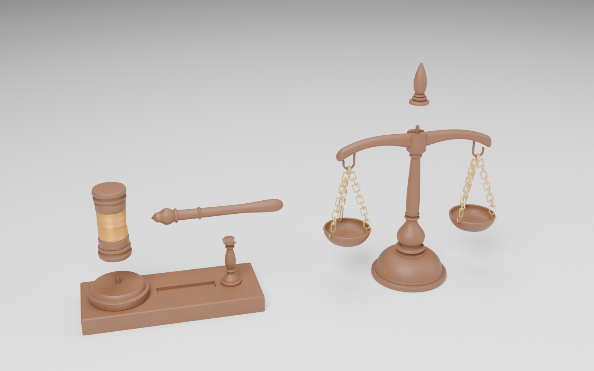
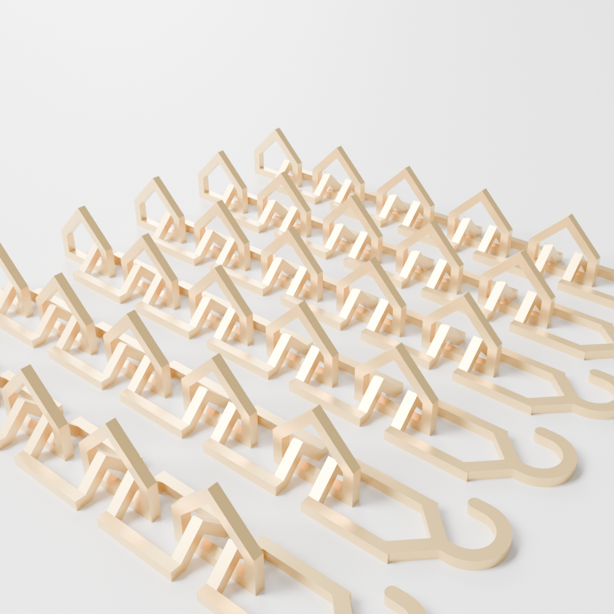
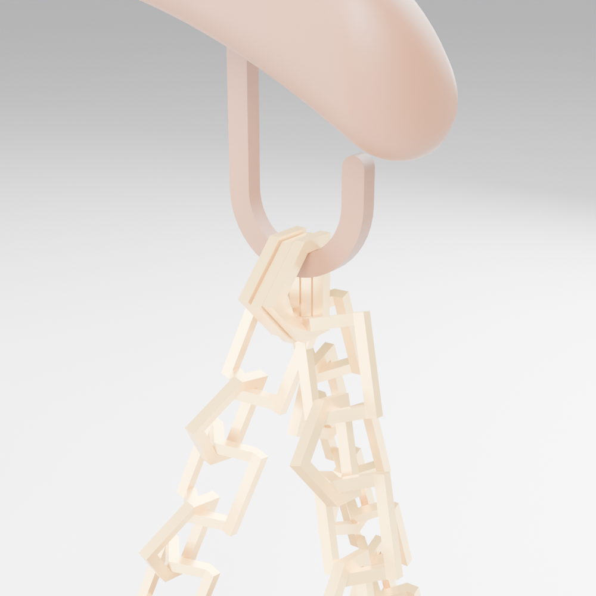
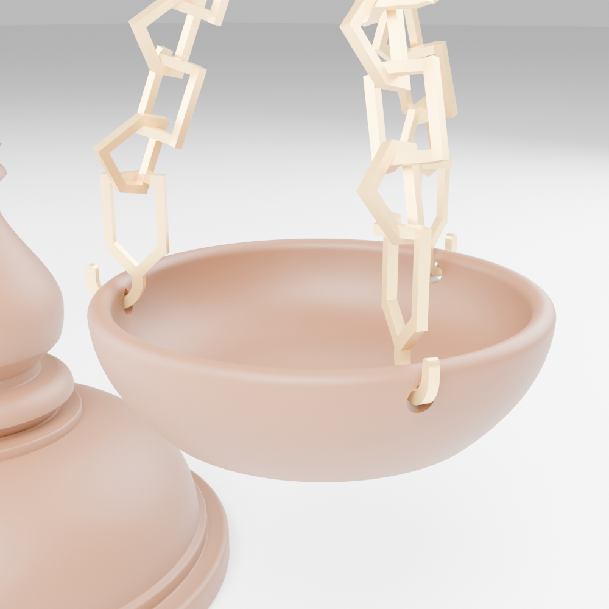

# ميزان العدالة + مطرقة القاضي — Blender

نموذج ثلاثي الأبعاد بمقاسات حقيقية، مبني على الصورة المرجعية:

| القطعة | المقاس |
|---|---|
| الميزان | **ارتفاع 20 سم** بالضبط (القاعدة 7.9 سم، عرض الذراع 16.4 سم) |
| المطرقة | **طول 15 سم** (من طرف المقبض إلى الجهة الأخرى من الرأس)، الرأس 7 سم × قطر 3.2 سم |
| قاعدة المطرقة | 17.4 × 7.2 × 1.7 سم + قرص الطرق بقطر 5.9 سم |


## الملفات

| الملف | الوصف |
|---|---|
| `justice_scale_gavel.blend` | ملف Blender جاهز: النموذج + الخامات + الإضاءة + 3 كاميرات |
| `justice_scale_gavel.glb` | الشكل الهندسي فقط للتصدير لبرامج أخرى (بدون الخامات الإجرائية) |
| `justice_scale_gavel.py` | السكربت الذي يبني كل شيء من الصفر (قابل للتعديل) |
| `print_stl/` + `print_parts.py` + `justice_scale_gavel_print.blend` | **نسخة الطباعة 3D بدون دعامات مع سلاسل متحركة** (انظر الأسفل) |
| `renders/` | صور الرندر (Cycles) |

## التفاصيل

**الميزان**
- العمود مخروط (Lathe) بقطاع مفصّل: قرص القاعدة، القبة، حلقة أبنوس، المزهرية (Baluster)، الرقبة، العمود الطويل المستدق، صندوق المحور، وقمة على شكل بلوطة تنتهي عند 20 سم.
- الذراع بشكل الجناح المتموّج مع أطراف منحنية للأسفل (Sweep بمقطع super-ellipse + Subdivision).
- الكفّتان مجوّفتان بحافة مستديرة وقاعدة، ومثقوبتان 3 ثقوب لكل كفة.
- عتاد ذهبي حقيقي: حلقة براغي تحت الذراع، خطاف S، حلقة وصل، و**3 سلاسل لكل كفة بحلقات متشابكة فعلياً** (كل حلقة مستديرة 90° عن التي قبلها)، وحلقات صغيرة تمر من ثقوب الكفة.

**المطرقة**
- الرأس: وجهان مقبّبان قليلاً، أخاديد وحلقات داكنة، وحزام نحاسي في الوسط بحواف بارزة.
- المقبض مخروط بحلقة زخرفية، حلقة في المنتصف، ومقبض منتفخ في النهاية.
- المطرقة **مستقيمة**: الرأس واقف على قرص الطرق والمقبض أفقي تماماً (زاوية 90° مع الرأس)، ومستقيمة مع القاعدة بدون دوران.
- حامل خشبي مخروط صغير (`Gavel_Handle_Rest`) بتجويف دائري يسند المقبض من الأسفل — يمكن حذفه إذا لم ترده.
- قاعدة خشبية بحواف مشطوفة (Bevel modifier غير مطبّق لتبقى قابلة للتعديل) وأخدود زخرفي، وقرص طرق مستدير.

**الخامات (إجرائية بالكامل — لا تحتاج صور)**
- خشب ماهوجني ملمّع (Coat) مع عروق الخشب في اتجاه الألياف الصحيح لكل قطعة.
- خشب داكن للحلقات، ذهب للسلاسل، نحاس للحزام.

## الاستخدام

افتح `justice_scale_gavel.blend` مباشرة. كل قطعة في Collection خاص بها
(`Scale_Mizan_20cm`، `Gavel_Mitraqa_15cm`، `Studio`) ومرتبطة بـ Empty
(`SCALE_ROOT`، `GAVEL_ROOT`) لتحريكها بسهولة. احذف Collection `Studio` إذا أردت النموذج فقط.

لإعادة البناء من السكربت: افتح ملف Blender جديد ← تبويب Scripting ← Open ← `justice_scale_gavel.py` ← Run Script
(السكربت يمسح المشهد الحالي أولاً). يعمل على Blender 4.2 وما بعده (مختبر على 5.2).

الوحدات: Metric، العرض بالسنتيمتر — المقاسات حقيقية (مناسبة للطباعة ثلاثية الأبعاد أيضاً).

---

# نسخة الطباعة ثلاثية الأبعاد — بدون دعامات، مع **سلاسل متحركة**



كل الملفات في `print_stl/` بالمليمتر، و**كل ملف موجّه مسبقاً بوضعية الطباعة** — اطبعه كما هو مع إيقاف الـ Supports.

| الملف | العدد | المقاس (مم) | المحتوى | الوضعية |
|---|---|---|---|---|
| `scale_S1_Column` | 1 | 79 × 79 × 166 | القاعدة + العمود + المحور + مسمار مدمج | واقف |
| `scale_S2_Top` | 1 | 20 × 20 × 41 | غطاء المحور + القمة | واقف |
| `scale_S3_Beam` | 1 | 164 × 34 × 9 | الذراع + **الخطافان مدمجان** | الوجه للأعلى، الظهر المسطّح على السرير |
| `scale_S4_Pan_x2` | **2** | 48 × 48 × 13 | الكفّة مع 3 ثقوب في الحافة | واقف على قاعدته |
| `scale_S5_Chains_x6` | 1 | 65 × 67 × 8 | **6 سلاسل متحركة** (10 حلقات لكل سلسلة) — طبعة واحدة | مسطّح |
| `gavel_G1_Base` | 1 | 174 × 72 × 65 | القاعدة + قرص الطرق + حامل المقبض + مسمار مدمج | مسطّح |
| `gavel_G2_Head` | 1 | 32 × 32 × 70 | رأس المطرقة مع الحزام | وجه الطرق للأسفل |
| `gavel_G3_Handle` | 1 | 16 × 16 × 128 | المقبض | واقف — **Brim** |

**المجموع: 8 ملفات / 9 طبعات** — بدون مسامير منفصلة وبدون قطع معدنية للشراء.
الارتفاع بعد التركيب **200 مم** والمطرقة **150 مم**.

## السلاسل المتحركة (Print-in-Place)


السلاسل تُطبع **مسطّحة ومركّبة داخل بعضها** وتخرج من الطابعة **متحركة** — كل حلقة منفصلة عن الأخرى:
- حلقة **واقفة** (أسفلها مستقيم على السرير، أعلاها مدبّب 45°) ↔ حلقة **نائمة** (طرفاها خيمة 45° تعبر فوق الحلقة الواقفة).
- **فراغ 0.4 مم** بين كل حلقتين (تم فحصه: 0 أسطح متلامسة في الطباعة) — لذلك لا تلتصق.
- آخر حلقة في كل سلسلة **خطاف J** يدخل في ثقب حافة الكفّة، وأول حلقة تُعلّق على خطاف الذراع (3 سلاسل جنب بعض).
- سلك الحلقة 1.0 مم. بعد الطباعة حرّك كل حلقة بلطف بأصابعك لتحريرها.

 

## الفحص (تم برمجياً)
- **0 مم²** ميلان أكثر من 45° فوق الطبقة الأولى في كل الملفات.
- **0** حواف مفتوحة (كل الأجزاء Manifold).
- **0 مم³** تداخل بين الأجزاء بعد التركيب، والسلاسل وهي معلّقة لا تتداخل مع الذراع أو الكفّتين.
- أقل فراغ بين حلقات السلسلة المطبوعة: **0.41 مم**.

## الحزام الذهبي (تغيير لون)
اطبع `G2_Head` بفلمنت بني، وغيّر إلى **ذهبي (Silk Gold)** عند ارتفاع **21.0 مم** ثم ارجع للبني عند **49.0 مم**
(في السلايسر: Filament Change عند هذه الطبقات). والسلاسل تُطبع كلها بالذهبي.

## إعدادات الطباعة المقترحة
PLA، نوزل 0.4، طبقة **0.12 مم للسلاسل** و0.16 مم للباقي، 3 جدران، Infill 15%.
Brim للأجزاء الطويلة: المقبض والعمود. للسلاسل: سرعة بطيئة وتبريد كامل، وبدون Brim.

## التجميع
**الميزان**
1. ضع الذراع `S3` في الشق أعلى العمود `S1` — المسمار المدمج يدخل في ثقب الذراع.
2. ركّب `S2` فوقه (المسمار يدخل فيه) والصق بقطرة غراء.
3. علّق 3 سلاسل على كل خطاف من حلقتها الأولى.
4. أدخل خطاف J في آخر كل سلسلة في ثقب من ثقوب الكفّة (من الداخل للخارج).

**المطرقة**
1. أدخل المقبض `G3` في ثقب الرأس `G2` (مع غراء).
2. ضع الرأس على قرص الطرق (المسمار المدمج يدخل في ثقب أسفل الرأس) والمقبض يرتكز على الحامل.

## إعادة التوليد
```
blender --background --python print_parts.py
```
يولّد ملفات STL، و`justice_scale_gavel_print.blend` (الأجزاء مرتّبة + منظر التجميع)، وصور الرندر.
