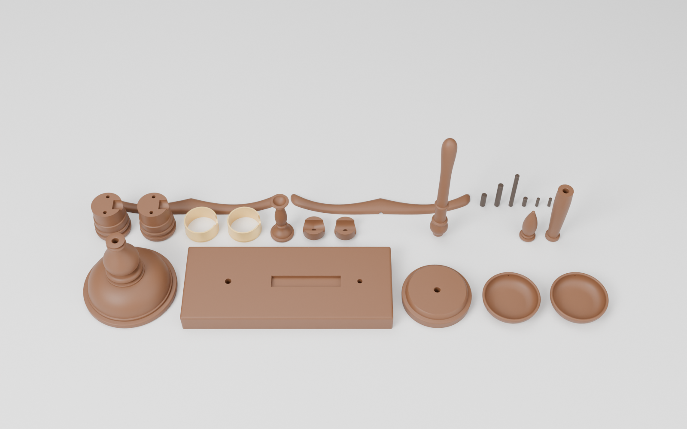

# ميزان العدالة + مطرقة القاضي — Blender

نموذج ثلاثي الأبعاد بمقاسات حقيقية، مبني على الصورة المرجعية:

| القطعة | المقاس |
|---|---|
| الميزان | **ارتفاع 20 سم** بالضبط (القاعدة 7.9 سم، عرض الذراع 16.4 سم) |
| المطرقة | **طول 15 سم** (من طرف المقبض إلى الجهة الأخرى من الرأس)، الرأس 7 سم × قطر 3.2 سم |
| قاعدة المطرقة | 17.4 × 7.2 × 1.7 سم + قرص الطرق بقطر 5.9 سم |


## الملفات

| الملف | الوصف |
|---|---|
| `justice_scale_gavel.blend` | ملف Blender جاهز: النموذج + الخامات + الإضاءة + 3 كاميرات |
| `justice_scale_gavel.glb` | الشكل الهندسي فقط للتصدير لبرامج أخرى (بدون الخامات الإجرائية) |
| `justice_scale_gavel.py` | السكربت الذي يبني كل شيء من الصفر (قابل للتعديل) |
| `print_stl/` + `print_parts.py` + `justice_scale_gavel_print.blend` | **نسخة الطباعة 3D مجزّأة بدون دعامات** (انظر الأسفل) |
| `renders/` | صور الرندر (Cycles) |

## التفاصيل

**الميزان**
- العمود مخروط (Lathe) بقطاع مفصّل: قرص القاعدة، القبة، حلقة أبنوس، المزهرية (Baluster)، الرقبة، العمود الطويل المستدق، صندوق المحور، وقمة على شكل بلوطة تنتهي عند 20 سم.
- الذراع بشكل الجناح المتموّج مع أطراف منحنية للأسفل (Sweep بمقطع super-ellipse + Subdivision).
- الكفّتان مجوّفتان بحافة مستديرة وقاعدة، ومثقوبتان 3 ثقوب لكل كفة.
- عتاد ذهبي حقيقي: حلقة براغي تحت الذراع، خطاف S، حلقة وصل، و**3 سلاسل لكل كفة بحلقات متشابكة فعلياً** (كل حلقة مستديرة 90° عن التي قبلها)، وحلقات صغيرة تمر من ثقوب الكفة.

**المطرقة**
- الرأس: وجهان مقبّبان قليلاً، أخاديد وحلقات داكنة، وحزام نحاسي في الوسط بحواف بارزة.
- المقبض مخروط بحلقة زخرفية، حلقة في المنتصف، ومقبض منتفخ في النهاية.
- المطرقة **مستقيمة**: الرأس واقف على قرص الطرق والمقبض أفقي تماماً (زاوية 90° مع الرأس)، ومستقيمة مع القاعدة بدون دوران.
- حامل خشبي مخروط صغير (`Gavel_Handle_Rest`) بتجويف دائري يسند المقبض من الأسفل — يمكن حذفه إذا لم ترده.
- قاعدة خشبية بحواف مشطوفة (Bevel modifier غير مطبّق لتبقى قابلة للتعديل) وأخدود زخرفي، وقرص طرق مستدير.

**الخامات (إجرائية بالكامل — لا تحتاج صور)**
- خشب ماهوجني ملمّع (Coat) مع عروق الخشب في اتجاه الألياف الصحيح لكل قطعة.
- خشب داكن للحلقات، ذهب للسلاسل، نحاس للحزام.

## الاستخدام

افتح `justice_scale_gavel.blend` مباشرة. كل قطعة في Collection خاص بها
(`Scale_Mizan_20cm`، `Gavel_Mitraqa_15cm`، `Studio`) ومرتبطة بـ Empty
(`SCALE_ROOT`، `GAVEL_ROOT`) لتحريكها بسهولة. احذف Collection `Studio` إذا أردت النموذج فقط.

لإعادة البناء من السكربت: افتح ملف Blender جديد ← تبويب Scripting ← Open ← `justice_scale_gavel.py` ← Run Script
(السكربت يمسح المشهد الحالي أولاً). يعمل على Blender 4.2 وما بعده (مختبر على 5.2).

الوحدات: Metric، العرض بالسنتيمتر — المقاسات حقيقية (مناسبة للطباعة ثلاثية الأبعاد أيضاً).

---

# نسخة الطباعة ثلاثية الأبعاد — أجزاء بدون دعامات (No Supports)




كل الملفات في مجلد `print_stl/` بالمليمتر، و**كل ملف موجّه مسبقاً بالوضعية الصحيحة للطباعة** — افتحه في السلايسر واطبعه كما هو بدون Supports.
تم فحص كل جزء برمجياً: **0 مم² من الميلان أكثر من 45°** و**0 حواف غير مغلقة (Manifold)**.
(للمقارنة: الموديل الأصلي غير المجزّأ فيه 842 مم² ميلان يحتاج دعامات في العمود وحده.)

## قائمة الأجزاء

| الملف | العدد | المقاس (مم) | وضعية الطباعة |
|---|---|---|---|
| `scale_S1_Base` | 1 | 79 × 79 × 71 | واقف على قاعدته |
| `scale_S2_Spindle` | 1 | 14 × 14 × 66 | مقلوب (طرف المحور على السرير) |
| `scale_S3_Hub_Lower` | 1 | 20 × 20 × 13 | الطرف الضيق للأسفل، التجويف للأعلى |
| `scale_S4_Beam_Half_x2` | **2** | 164 × 23 × 6 | مسطّح — نصفان متطابقان يُلصقان معاً |
| `scale_S5_Hub_Upper` | 1 | 20 × 20 × 13 | مقلوب، التجويف للأعلى |
| `scale_S6_Finial` | 1 | 14 × 14 × 37 | واقف |
| `scale_S7_Pan_x2` | **2** | 48 × 48 × 13 | واقف على قاعدته |
| `gavel_G1_Stand` | 1 | 174 × 72 × 17 | مسطّح |
| `gavel_G2_Sound_Block` | 1 | 59 × 59 × 14 | واقف |
| `gavel_G3_Head_Half_Bottom` | 1 | 32 × 32 × 35 | وجه الطرق على السرير |
| `gavel_G4_Band_Half_x2` | **2** | 30 × 30 × 14 | واقف — **فلمنت ذهبي (Silk Gold)** |
| `gavel_G5_Head_Half_Top` | 1 | 32 × 32 × 35 | وجه الطرق على السرير |
| `gavel_G6_Handle` | 1 | 16 × 16 × 128 | واقف على طرفه — **استخدم Brim** |
| `gavel_G7_Handle_Rest` | 1 | 21 × 21 × 47 | واقف |
| `pins_P1…P5` | 6 | Ø3–5 مم | واقفة (أو استخدم أعواد خشب/معدن بنفس القطر) |

الارتفاع بعد التركيب: 71 + 66 + 13 + 13 + 37 = **200 مم** بالضبط، والمطرقة **150 مم**.

## كيف أصبحت بدون دعامات
- كل قطعة مخروطة تُطبع واقفة على وجه مقطوع مسطّح، والحواف البارزة من الأسفل (الحلقات والخرزات) صارت بميل **45°** — شكلها لا يزال كالخشب المخروط.
- **الذراع** مقسوم بالطول إلى نصفين متطابقين يُطبعان مسطّحين ثم يُلصقان.
- **صندوق المحور** مقسوم عند مستوى الذراع؛ الذراع ينزل في تجويف مفتوح ثم يُغطّى بالنصف العلوي.
- **رأس المطرقة** مقسوم عند محور المقبض، فمكان المقبض صار مجرى مفتوحاً للأعلى، و**الحزام الذهبي** حلقتان تُركّبان حول خصر الرأس.
- الثقوب التي تفتح على السرير تنتهي بسقف مخروطي 45°، والثقوب الأفقية الصغيرة بشكل قطرة (Teardrop).
- خلوص التركيب 0.15 مم للحزام والمقبض والذراع، و0.15 مم في ثقوب المسامير.

## إعدادات الطباعة المقترحة
PLA (يفضّل Wood PLA أو بني)، طبقة 0.12–0.16 مم، 3 جدران، Infill 15%.
Brim للأجزاء الطويلة الرفيعة: المقبض، العمود، القمة، حامل المقبض.
الحلقات الداكنة (الأبنوس) يمكن تلوينها بفرشاة بعد الطباعة.

## التجميع
**الميزان**
1. الصق نصفي الذراع `S4` معاً (المجرى الأوسط وثقوب الخطافات تتطابق).
2. `S1` القاعدة ← مسمار **P1** (5×15) ← `S2` العمود.
3. أدخل مسمار **P2** (4×43) من أعلى العمود: `S3` ← الذراع ← `S5` ← `S6` القمة.
4. الكفّتان `S7` لكل منهما 3 ثقوب في الحافة.

**المطرقة**
1. `G1` القاعدة ← مسمار **P3** (5×29) يمر عبر `G2` قرص الطرق إلى `G3` نصف الرأس السفلي.
2. ضع حلقتي الحزام `G4` على الخصر، أدخل المقبض `G6` في المجرى، ثم `G5` النصف العلوي مع مسماري **P5** (3×11).
3. `G7` حامل المقبض على القاعدة بمسمار **P4** (4×11).

## قطع معدنية تُشترى جاهزة (مثل الصورة الأصلية)
السلاسل رفيعة جداً للطباعة (سلك 0.6 مم)، لذلك استخدم إكسسوارات ذهبية جاهزة:
- سلسلة ذهبية ناعمة 1.5–2 مم: **6 قطع × ~70 مم**
- 2 خطاف S (~10 مم) + 2 حلقة وصل 4–5 مم
- 6 حلقات صغيرة 3 مم (لثقوب الكفّتين، سلك ≤ 0.8 مم)
- 2 مسمار عين صغير (Screw eye) — يوجد ثقب تمهيدي 1.3 مم تحت كل طرف من الذراع

## إعادة التوليد
```
blender --background --python print_parts.py
```
يولّد ملفات STL، و`justice_scale_gavel_print.blend` (الأجزاء مرتّبة + منظر التجميع المفكّك)، وصور الرندر.
