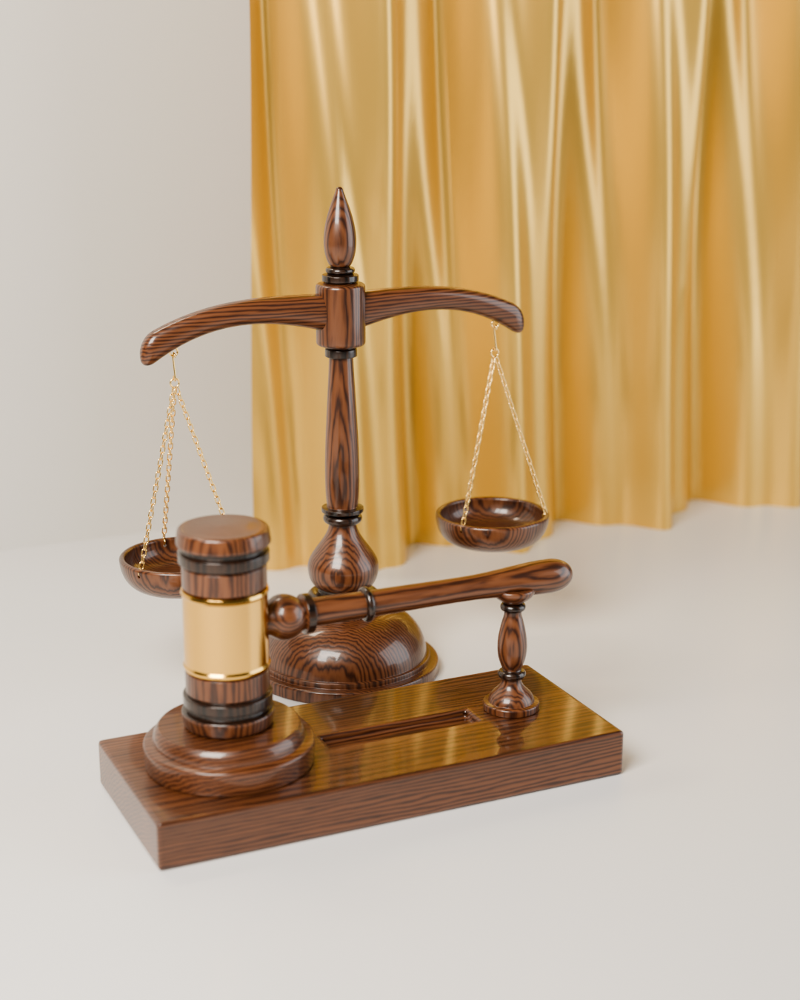

# ميزان العدالة + مطرقة القاضي — Blender

نموذج ثلاثي الأبعاد بمقاسات حقيقية، مبني على الصورة المرجعية:

| القطعة | المقاس |
|---|---|
| الميزان | **ارتفاع 20 سم** بالضبط (القاعدة 7.9 سم، عرض الذراع 16.4 سم) |
| المطرقة | **طول 15 سم** (من طرف المقبض إلى الجهة الأخرى من الرأس)، الرأس 7 سم × قطر 3.2 سم |
| قاعدة المطرقة | 17.4 × 7.2 × 1.7 سم + قرص الطرق بقطر 5.9 سم |

## الملفات

| الملف | الوصف |
|---|---|
| `justice_scale_gavel.blend` | ملف Blender جاهز: النموذج + الخامات + الإضاءة + 3 كاميرات |
| `justice_scale_gavel.glb` | الشكل الهندسي فقط للتصدير لبرامج أخرى (بدون الخامات الإجرائية) |
| `justice_scale_gavel.py` | السكربت الذي يبني كل شيء من الصفر (قابل للتعديل) |
| `renders/` | صور الرندر (Cycles) |

## التفاصيل

**الميزان**
- العمود مخروط (Lathe) بقطاع مفصّل: قرص القاعدة، القبة، حلقة أبنوس، المزهرية (Baluster)، الرقبة، العمود الطويل المستدق، صندوق المحور، وقمة على شكل بلوطة تنتهي عند 20 سم.
- الذراع بشكل الجناح المتموّج مع أطراف منحنية للأسفل (Sweep بمقطع super-ellipse + Subdivision).
- الكفّتان مجوّفتان بحافة مستديرة وقاعدة، ومثقوبتان 3 ثقوب لكل كفة.
- عتاد ذهبي حقيقي: حلقة براغي تحت الذراع، خطاف S، حلقة وصل، و**3 سلاسل لكل كفة بحلقات متشابكة فعلياً** (كل حلقة مستديرة 90° عن التي قبلها)، وحلقات صغيرة تمر من ثقوب الكفة.

**المطرقة**
- الرأس: وجهان مقبّبان قليلاً، أخاديد وحلقات داكنة، وحزام نحاسي في الوسط بحواف بارزة.
- المقبض مخروط بحلقة زخرفية، حلقة في المنتصف، ومقبض منتفخ في النهاية.
- المطرقة **مستقيمة**: الرأس واقف على قرص الطرق والمقبض أفقي تماماً (زاوية 90° مع الرأس)، ومستقيمة مع القاعدة بدون دوران.
- حامل خشبي مخروط صغير (`Gavel_Handle_Rest`) بتجويف دائري يسند المقبض من الأسفل — يمكن حذفه إذا لم ترده.
- قاعدة خشبية بحواف مشطوفة (Bevel modifier غير مطبّق لتبقى قابلة للتعديل) وأخدود زخرفي، وقرص طرق مستدير.

**الخامات (إجرائية بالكامل — لا تحتاج صور)**
- خشب ماهوجني ملمّع (Coat) مع عروق الخشب في اتجاه الألياف الصحيح لكل قطعة.
- خشب داكن للحلقات، ذهب للسلاسل، نحاس للحزام.

## الاستخدام

افتح `justice_scale_gavel.blend` مباشرة. كل قطعة في Collection خاص بها
(`Scale_Mizan_20cm`، `Gavel_Mitraqa_15cm`، `Studio`) ومرتبطة بـ Empty
(`SCALE_ROOT`، `GAVEL_ROOT`) لتحريكها بسهولة. احذف Collection `Studio` إذا أردت النموذج فقط.

لإعادة البناء من السكربت: افتح ملف Blender جديد ← تبويب Scripting ← Open ← `justice_scale_gavel.py` ← Run Script
(السكربت يمسح المشهد الحالي أولاً). يعمل على Blender 4.2 وما بعده (مختبر على 5.2).

الوحدات: Metric، العرض بالسنتيمتر — المقاسات حقيقية (مناسبة للطباعة ثلاثية الأبعاد أيضاً).
