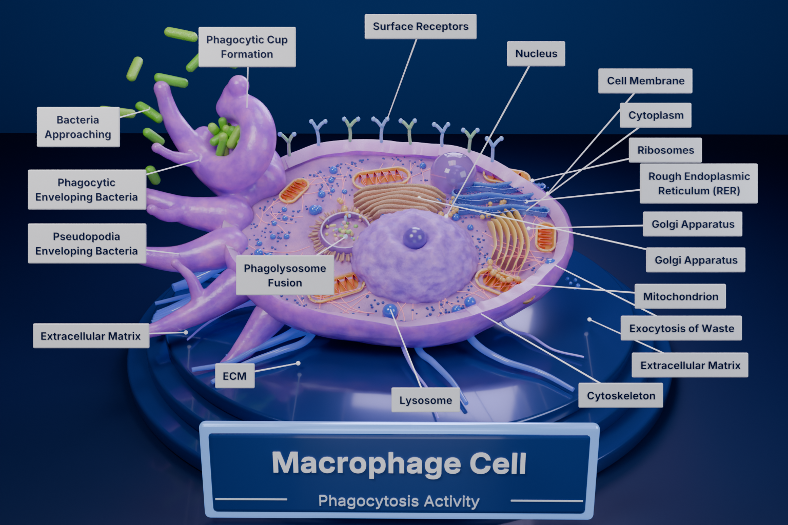
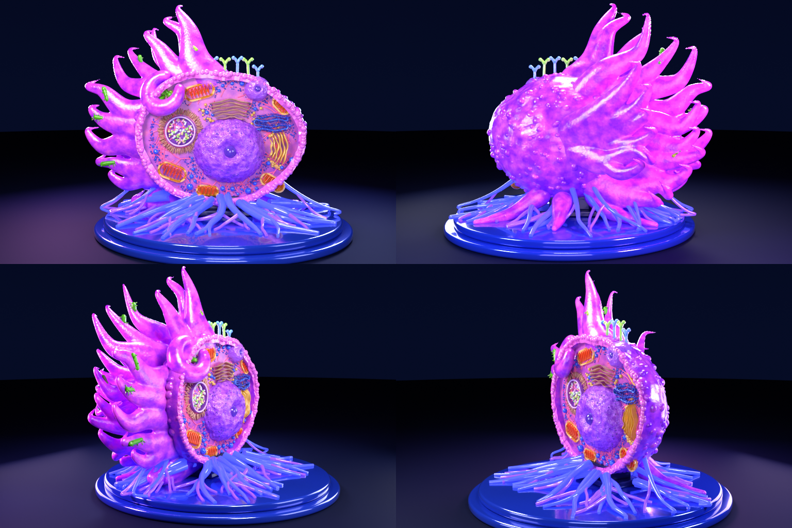
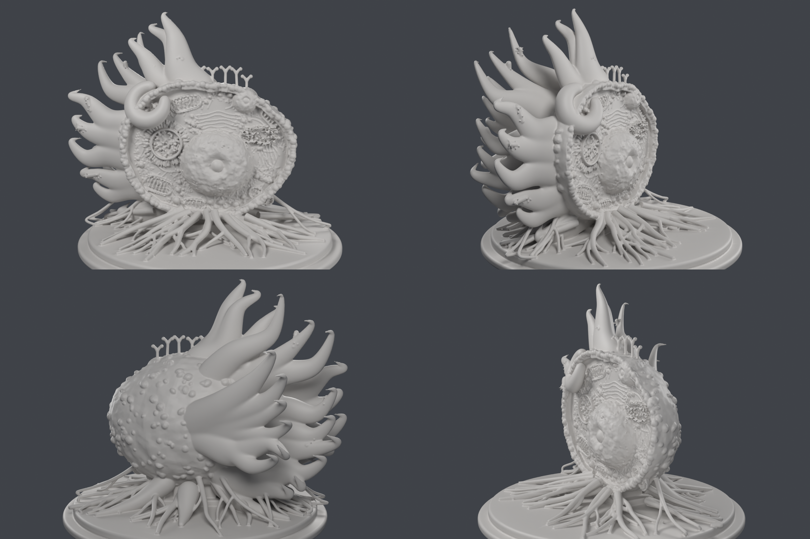

# Macrophage Cell – Phagocytosis Activity (Blender)

مجسم ثلاثي الأبعاد عالي التفاصيل لخلية بلعمية (Macrophage) أثناء البلعمة، مع لوحات الشرح والقاعدة، مبني بالكامل بسكربت بايثون داخل Blender.



## الملفات
| الملف | الوصف |
|---|---|
| `macrophage_cell.py` | السكربت الذي يبني المشهد كاملاً (Blender 4.2 / 4.5 / 5.x) |
| `macrophage_cell.blend` | المشهد جاهز (محفوظ من Blender 5.3، يُفتح في 5.x) |
| `preview_render.png` | رندر Cycles للمشهد |

## طريقة التشغيل
1. افتح Blender ← **File > New > General**.
2. اذهب إلى تبويب **Scripting** ← **Open** ← اختر `macrophage_cell.py` ← **Run Script** (Alt+P).
   > تنبيه: السكربت يمسح المشهد الحالي قبل البناء.
3. اضغط **F12** للرندر (الكاميرا والإضاءة وإعدادات Cycles جاهزة).

من سطر الأوامر:
```
blender -b -P macrophage_cell.py -- --render out.png --samples 256 --save cell.blend
```
خيارات: `--scale 50` (نسبة الدقة)، `--no-labels` (بدون لوحات الشرح).

## محتوى المشهد (Collections)
- **Cell**: الغشاء الخلوي المقطوع (Solidify + Bevel)، السيتوبلازم، الأقدام الكاذبة والكأس البلعمي (Metaballs)، المستقبلات السطحية.
- **Organelles**: النواة والنوية ومسام النواة، 6 ميتوكوندريا مقطوعة مع الأعراف (Cristae)، جهازا جولجي، الشبكة الإندوبلازمية الخشنة مع الريبوسومات، الجسيم البلعمي الحالّ، الليسوسومات، الهيكل الخلوي، الإخراج الخلوي.
- **Bacteria**: بكتيريا داخل الكأس وأخرى تقترب.
- **ECM**: ألياف المادة خارج الخلوية الزجاجية.
- **Pedestal**: القاعدة بثلاث طبقات مع حواف مضيئة ولوحة الاسم.
- **Labels**: 20 لوحة شرح بخطوط إشارة، موضوعة بنفس أماكن الصورة المرجعية.
- **Lighting**: الكاميرا، 5 إضاءات Area، الخلفية المتدرجة.

## تعديل سريع
- أعلى السكربت: `CELL_TILT` (ميلان الخلية)، `RENDER_SAMPLES`، `SHOW_LABELS`، `SEED` (يغيّر التوزيع العشوائي).
- كل الخامات Principled BSDF عادية، عدّلها مباشرة من Shader Editor.
- لتغيير نص أي لوحة: قائمة `LABELS` في السكربت، أو عدّل كائن النص `Label_XX_Text` في Blender.

---

# النسخة الثانية v2 – خلية قائمة بمقطع عمودي (4 زوايا)



| الملف | الوصف |
|---|---|
| `macrophage_cell_v2.py` | سكربت النسخة الثانية |
| `macrophage_cell_v2.blend` | المشهد جاهز (Blender 5.3) |
| `renders_v2/` | رندر للزوايا الأربع + صورة مجمعة 2×2 |

**الفروق عن النسخة الأولى (مأخوذة من الصورة المرجعية الثانية):**
- الخلية واقفة والمقطع عمودي يواجه الكاميرا، والظهر مغلق ومليء بالنتوءات (Blebs).
- غشاء لامع جداً (Coat كامل) بألوان فوشي/بنفسجي مشبعة، وحافة المقطع مخرزة (Beads).
- الأقدام الكاذبة على شكل ألسنة لهب مسطحة ومدببة ومنحنية، بعضها يتجه للخلف.
- بكتيريا عليها شعيرات (Pili).
- جذور ECM زرقاء متوهجة متفرعة فوق قاعدة بطبقتين، بدون لوحات شرح.
- 4 كاميرات جاهزة: `Cam_front`, `Cam_back`, `Cam_left34`, `Cam_right34`.

```
blender -b -P macrophage_cell_v2.py -- --render out.png --views front,back,left34,right34 --samples 256
```

## الطباعة ثلاثية الأبعاد (v2)



ملف جاهز للطباعة: `print/macrophage_print_150mm.zip` (بداخله STL).

- **جسم واحد مغلق (Watertight)**: كل الأجزاء (الخلية، العضيات، البكتيريا، ألياف ECM، القاعدة) مدموجة بـ Voxel Remesh، و**0 حواف غير سليمة (Non-manifold)**، ولا أجزاء طائرة.
- **المقاس**: 150 × 142 × 125.5 مم، الوحدة مليمتر، والقاعدة واقفة على سطح الطباعة (z = 0).
- **الحجم**: ~315 سم³ (مصمت). للريزن يفضَّل التفريغ (Hollow) بسماكة 2–3 مم مع فتحات تصريف.
- **أقل سماكة** عند مقاس 150 مم ≈ 0.7–1 مم (المستقبلات، الشعيرات، الأعراف). لو بتطبع أصغر من 100 مم كبّر هذه الأجزاء أو اطبع بالريزن.
- **الدعامات (Supports)**: ضرورية تحت ألسنة اللهب والأقدام الكاذبة الأفقية (Tree supports في FDM أو دعامات خفيفة في الريزن).

تصدير بمقاس أو دقة مختلفة:
```
blender -b -P macrophage_cell_v2.py -- --print cell.stl --print-size 200 --voxel 0.018
```
`--voxel` أصغر = تفاصيل أدق وملف أكبر.
