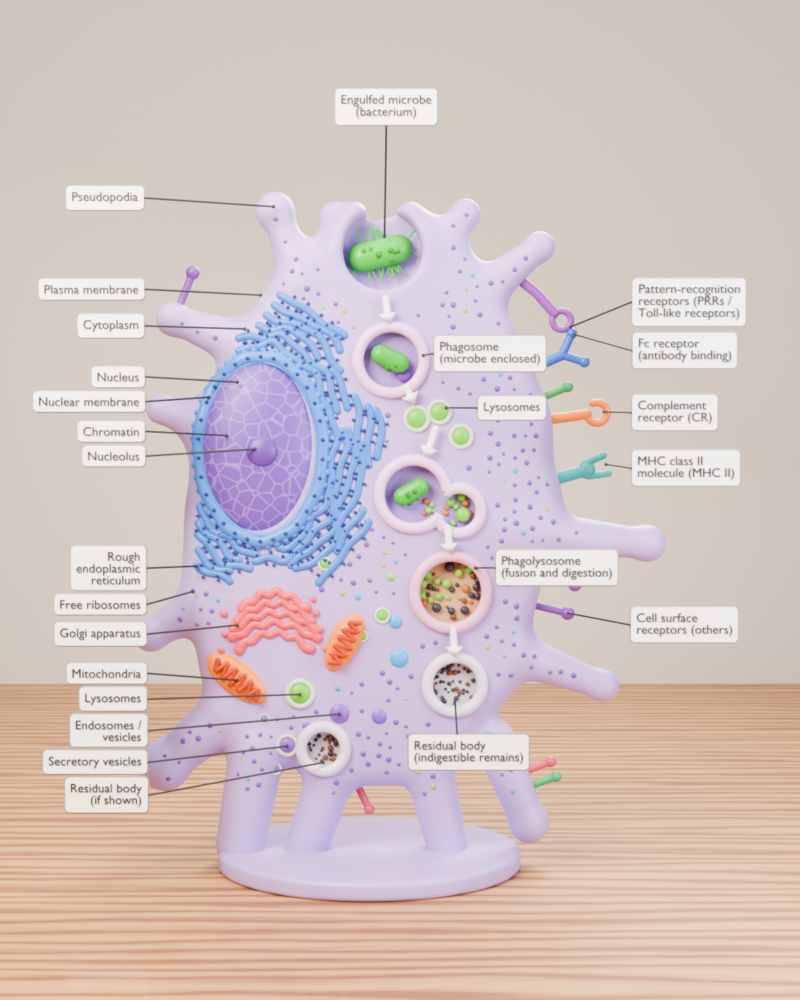
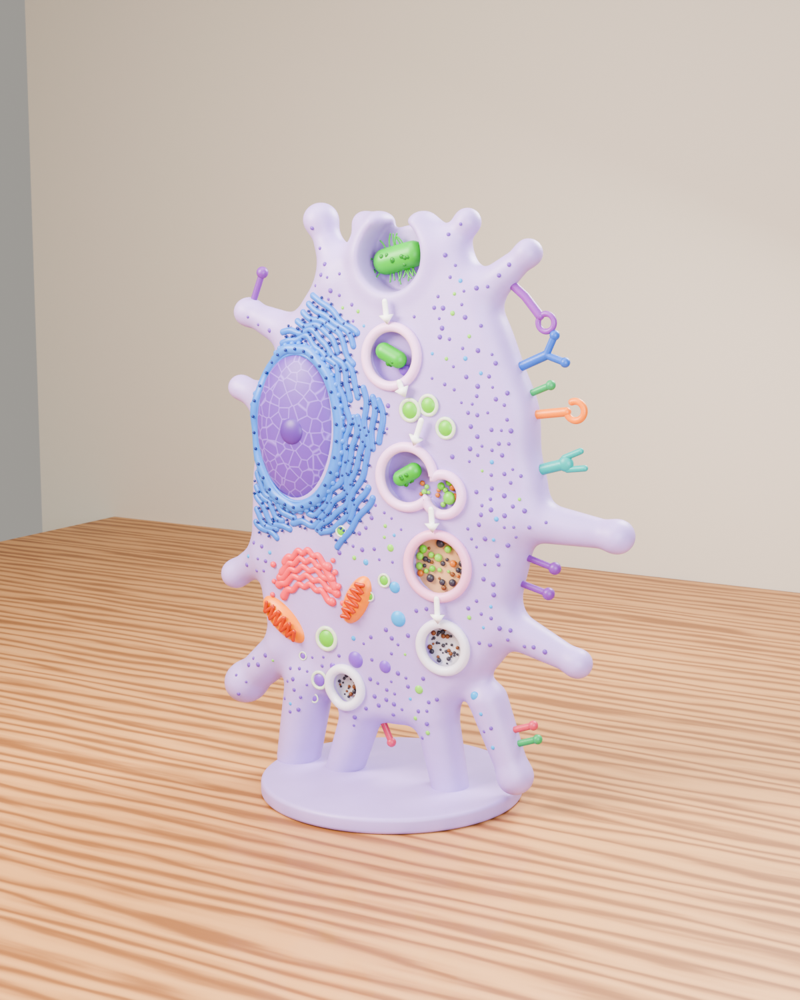

# نموذج الخلية البلعمية (Macrophage) — Blender

نموذج ثلاثي الأبعاد عالي التفاصيل لخلية بلعمية بأسلوب مجسّم تعليمي مطبوع ثلاثي الأبعاد،
مطابق لصورة المرجع: النواة، الشبكة الإندوبلازمية الخشنة، جهاز غولجي، الميتوكوندريا،
الليسوسومات، الحويصلات، مسار البلعمة كاملًا، المستقبلات السطحية، القاعدة، والملصقات.

| من الأمام (مع الملصقات) | زاوية 3/4 (بدون ملصقات) |
|---|---|
|  |  |

## الملفات

| الملف | الوصف |
|---|---|
| `macrophage_cell.blend` | المشهد جاهز: افتحه مباشرة في Blender 4.0 أو أحدث |
| `macrophage_cell.py` | سكربت Python يبني المشهد كاملًا من الصفر (لتعديل الأبعاد والألوان) |
| `render_front_labels.png` / `render_3_4.png` | صور الرندر |

## طريقة الاستخدام

**الأسهل:** افتح `macrophage_cell.blend` ثم اضغط `F12` للرندر (Cycles).

**إعادة البناء من السكربت:** Blender ← مساحة Scripting ← Open ← `macrophage_cell.py` ← Run Script.
يستغرق البناء من 20 إلى 60 ثانية تقريبًا.

من سطر الأوامر:

```bash
blender --background --python macrophage_cell.py -- --save cell.blend --render cell.png --res 1600 2000 --samples 128
# إضافات: --no-labels  لإخفاء الملصقات،  --camera Camera_3_4  للزاوية الجانبية
```

## محتوى المشهد (Collections)

| المجموعة | المحتوى |
|---|---|
| `Cell_Body` | جسم الخلية والأرجل الكاذبة (Pseudopodia) والكأس البلعمي: شبكة رباعية ناعمة مبنية من حقل مسافة (SDF) |
| `Nucleus` | النواة مع شبكة الكروماتين (Voronoi)، النوية بحلقاتها، الغلاف النووي الأزرق ومسامه |
| `Rough_ER` | 6 صفائح متموجة من الشبكة الإندوبلازمية مع ريبوسومات داكنة على حوافها |
| `Golgi_Apparatus` | 5 صهاريج مقوسة بأطراف منتفخة وحويصلات صغيرة |
| `Mitochondria` | ميتوكوندريون اثنان: غشاء خارجي وداخلي وأعراف متعرجة (Cristae) |
| `Vesicles_Lysosomes` | ليسوسومات خضراء بحافة شفافة، حويصلات زرقاء وبنفسجية، حويصلات إفرازية |
| `Phagocytosis_Pathway` | بكتيريا مبتلعة (بأهداب ونقاط) ← جسيم بلعمي ← ليسوسومات ← اندماج ← جسيم بلعمي حال ← جسم متبقٍّ، مع الأسهم البيضاء |
| `Surface_Receptors` | PRR/TLR، مستقبل Fc، مستقبل المتمّمة CR، جزيء MHC II، ومستقبلات أخرى |
| `Cytoplasm_Ribosomes` | نحو 230 ريبوسومًا حرًّا موزعة دون تداخل |
| `Display_Base` | القاعدة الدائرية |
| `Labels` | ملصقات بيضاء بخطوط إشارة (يمكن إخفاؤها بزر العين) |
| `Environment` | مكتب خشبي، جدار، 4 إضاءات Area، كاميرتان (`Camera_Front` و`Camera_3_4`) |

## التخصيص السريع (داخل السكربت)

- **الألوان:** القاموس `PALETTE` في أعلى الملف.
- **الدقة:** `VOXEL = 0.0105`؛ قيمة أصغر تعطي تفاصيل أكثر للجسم (0.008 دقة عالية جدًا لكنها أبطأ).
- **تأثير طبقات الطباعة ثلاثية الأبعاد:** `LAYER_LINES = True / False`.
- **الملصقات والبيئة:** `ADD_LABELS` و`ADD_ENVIRONMENT`.
- **الشكل:** القائمة `PSEUDOPODS` تحدد كل رجل كاذبة (القاعدة، الطرف، نصف القطر، الكرة الطرفية)؛
  ويمكن تحريك أي عضيّة عبر ثوابت `NUC` و`GOLGI` و`PHAGOSOME` وغيرها.

كل العناصر هندسة حقيقية (Mesh) بلا إضافات خارجية، والخامات Principled BSDF بمظهر بلاستيك PLA،
لذلك يمكن تصدير النموذج للطباعة ثلاثية الأبعاد أو للمحركات الأخرى.
