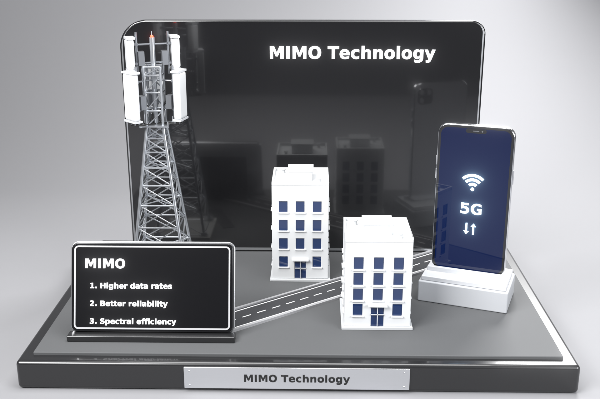

# مجسّم MIMO Technology — Blender



مجسّم ثلاثي الأبعاد كامل (ليس نصًا فقط) لتقنية **MIMO** بارتفاع **60 سم بالضبط**
(من أسفل القاعدة إلى أعلى اللوحة الخلفية). وحدات المشهد بالسنتيمتر.

## الملفات

| الملف | الوصف |
|---|---|
| `mimo_diorama.blend` | ملف بلندر جاهز — افتحه مباشرة |
| `mimo_diorama.py` | السكربت الذي يبني المجسّم كاملًا من الصفر (قابل للتعديل) |
| `mimo_render.png` | رندر Cycles للمجسّم |

## محتوى المجسّم

- **القاعدة**: قاعدة سوداء 100×62×5.5 سم بحواف مشطوفة، سطح رمادي، ولوحة اسم
  من الألمنيوم المصقول بمسامير وكتابة بارزة.
- **اللوحة الخلفية**: أسود لامع بحافة كروم وعنوان «MIMO Technology» بارز.
- **برج الاتصالات**: هيكل شبكي حقيقي (أرجل مخروطية، تقاطعات X، حلقات أفقية)،
  منصة، سارية، مانعة صواعق، ضوء تحذير أحمر، سلّم، 5 لوحات هوائيات مع أغطية
  وأنابيب تثبيت وأذرع ووحدات RRU وكابلات.
- **مبنيان**: نوافذ **محفورة فعليًا** (Boolean) بزجاج كحلي، عتبات، باب بإطار
  ومظلة، حاجز سطح، غرفة سطح وفتحات تهوية.
- **الطريق**: إسفلت، أرصفة، خطوط جانبية ومتقطعة.
- **الهاتف 5G**: إطار فضي، زجاج، شاشة متوهجة بتدرج أزرق، نوتش وكاميرا أمامية،
  أيقونة Wi‑Fi و«5G» وأسهم، أزرار جانبية وكاميرا خلفية — على قاعدة رمادية.
- **لوحة المعلومات**: مائلة على حامل، بإطار فضي ونص بارز.
- **أشعة MIMO الملوّنة**: محذوفة حاليًا. لإرجاعها اجعل `SHOW_BEAMS = True` في
  أعلى السكربت وشغّله (8 أشعة: 5 من الهوائيات + 3 منعكسة من المبنى).
- **الاستوديو**: خلفية منحنية، 4 إضاءات Area، كاميرا بعمق ميدان، وتوهج Bloom.

## الاستخدام

1. افتح `mimo_diorama.blend` في **Blender 4.2 أو أحدث** (مُختبر على 5.1).
2. اضغط `F12` للرندر (Cycles).

أو أعد البناء من السكربت: تبويب **Scripting** ← **Open** ← `mimo_diorama.py` ← **Run Script**.

من سطر الأوامر:

```
blender -b -P mimo_diorama.py -- --save mimo.blend --render mimo.png --samples 256
```

## التعديل

في أعلى السكربت: `TOTAL_HEIGHT` (الارتفاع)، `TITLE`، `SIGN_LINES` (نصوص اللوحة)، `SHOW_BEAMS` (إظهار الأشعة)،
`BEAM_STRENGTH` (قوة توهج الأشعة). كل جزء في Collection منفصلة
(Base / Backboard / Tower / Buildings_Road / Phone / Info_Sign / MIMO_Beams / Studio).

> ملاحظة: الصورة الأصلية فيها «4. Spectral efficiency» بعد البند 2 — صُحّح إلى «3.»
> ويمكن تغييره من `SIGN_LINES`.

### للطباعة ثلاثية الأبعاد
أخفِ مجموعة `Studio` ثم صدّر STL بوحدة السنتيمتر/المليمتر.
