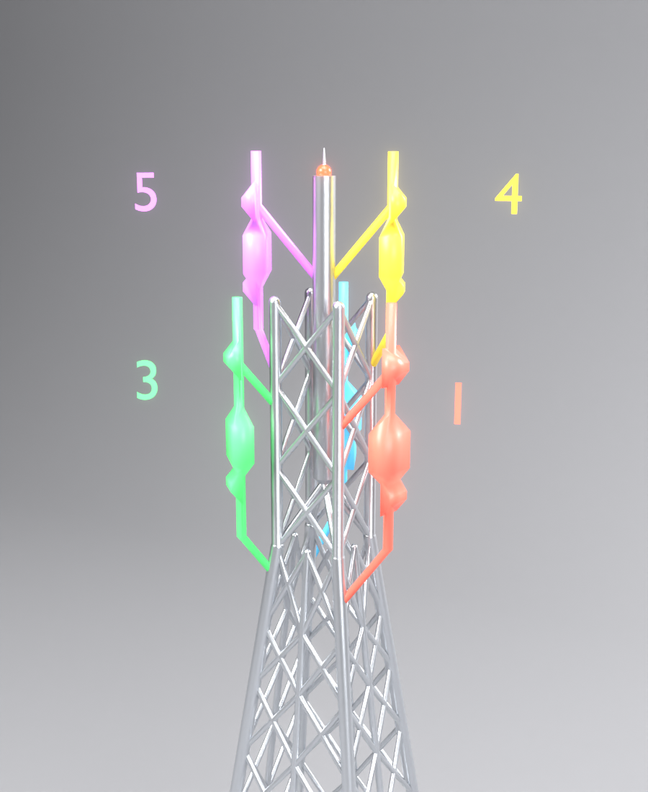
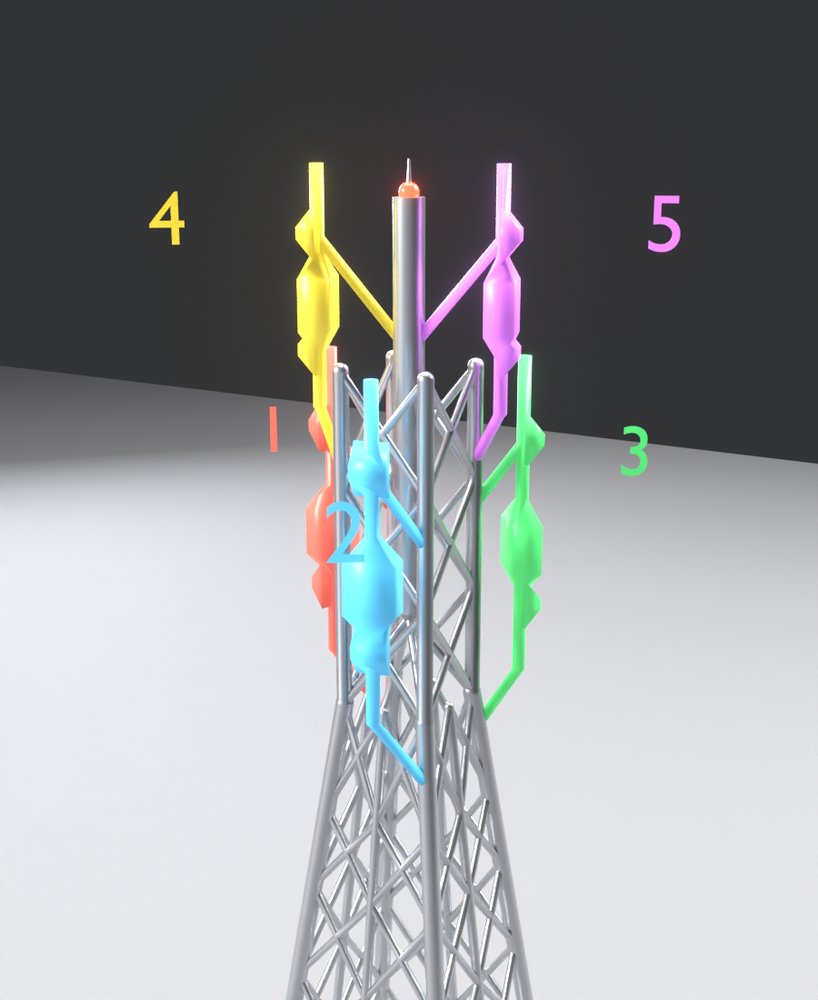

# مجسّم MIMO Technology — Blender


مجسّم ثلاثي الأبعاد كامل (ليس نصًا فقط) لتقنية **MIMO** بارتفاع **60 سم بالضبط**
(من أسفل القاعدة إلى أعلى اللوحة الخلفية). وحدات المشهد بالسنتيمتر.

## الملفات

| الملف | الوصف |
|---|---|
| `mimo_diorama.blend` | ملف بلندر جاهز — افتحه مباشرة |
| `mimo_diorama.py` | السكربت الذي يبني المجسّم كاملًا من الصفر (قابل للتعديل) |
| `mimo_render.png` | رندر Cycles للمجسّم |

## محتوى المجسّم

- **القاعدة**: قاعدة سوداء 100×62×5.5 سم بحواف مشطوفة، سطح رمادي، ولوحة اسم
  من الألمنيوم المصقول بمسامير وكتابة بارزة.
- **اللوحة الخلفية**: أسود لامع بحافة كروم وعنوان «MIMO Technology» بارز.
- **برج الاتصالات** (يُطبع بدون سبورت): هيكل شبكي بأرجل مخروطية، عمود وسط كل وجه
  وتقاطعات X بزاوية أكثر من 45°، سارية واقفة على 4 دعامات مائلة، مانعة صواعق،
  ضوء تحذير أحمر، أنابيب تثبيت ودعامات مائلة 45° ووحدات RRU.
- **لوحات الهوائيات البيضاء** (5 لوحات بأغطيتها): **قطع منفصلة** في مجموعة
  `Antenna_Parts_White` — تُطبع لوحدها واقفة ثم تُلصق على حوامل البرج.
- **مبنيان**: نوافذ **محفورة فعليًا** (Boolean) بزجاج كحلي، عتبات، باب بإطار
  ومظلة، حاجز سطح، غرفة سطح وفتحات تهوية.
- **الطريق**: إسفلت، أرصفة، خطوط جانبية ومتقطعة.
- **الهاتف 5G**: إطار فضي، زجاج، شاشة متوهجة بتدرج أزرق، نوتش وكاميرا أمامية،
  أيقونة Wi‑Fi و«5G» وأسهم، أزرار جانبية وكاميرا خلفية — على قاعدة رمادية.
- **لوحة المعلومات**: مائلة على حامل، بإطار فضي ونص بارز.
- **أشعة MIMO الملوّنة**: محذوفة حاليًا. لإرجاعها اجعل `SHOW_BEAMS = True` في
  أعلى السكربت وشغّله (8 أشعة: 5 من الهوائيات + 3 منعكسة من المبنى).
- **الاستوديو**: خلفية منحنية، 4 إضاءات Area، كاميرا بعمق ميدان، وتوهج Bloom.

## الاستخدام

1. افتح `mimo_diorama.blend` في **Blender 4.2 أو أحدث** (مُختبر على 5.1).
2. اضغط `F12` للرندر (Cycles).

أو أعد البناء من السكربت: تبويب **Scripting** ← **Open** ← `mimo_diorama.py` ← **Run Script**.

من سطر الأوامر:

```
blender -b -P mimo_diorama.py -- --save mimo.blend --render mimo.png --samples 256
```

## التعديل

في أعلى السكربت: `TOTAL_HEIGHT` (الارتفاع)، `TITLE`، `SIGN_LINES` (نصوص اللوحة)، `SHOW_BEAMS` (إظهار الأشعة)،
`BEAM_STRENGTH` (قوة توهج الأشعة). كل جزء في Collection منفصلة
(Base / Backboard / Tower / Buildings_Road / Phone / Info_Sign / MIMO_Beams / Studio).

> ملاحظة: الصورة الأصلية فيها «4. Spectral efficiency» بعد البند 2 — صُحّح إلى «3.»
> ويمكن تغييره من `SIGN_LINES`.

### للطباعة ثلاثية الأبعاد (بدون سبورت)

كل ملفات الطباعة في `stl/` بالمليمتر، وتُنتج كلها بأمر واحد:

```
blender -b -P mimo_diorama.py -- --export-stl stl
```

| الملف | المقاس (مم) | طريقة الطباعة |
|---|---|---|
| `Tower.stl` | 150×150×533.5 | واقف — البرج بدون الحوامل |
| `Mount_1.stl` … `Mount_5.stl` | 20–34 × 20–29 × 102–146 | **مقلوب** (طرف الأنبوب على السرير) + Brim |
| `Antennas_White.stl` | 122×40×103 | واقف — 5 لوحات بيضاء |
| `BuildingA.stl` / `BuildingB.stl` | 130×131×240 / 135×136×200 | واقف |

#### حوامل الهوائيات (Mount_1 … Mount_5)
كل حامل = أنبوب + دعامتان مائلتان + كتيفتان + وحدة RRU، **قطعة واحدة** لكل هوائي.
طرف كل دعامة مقصوص بشكل القضيب الذي يركب عليه في البرج (البرج مطروح منه)،
فيجلس عليه بالضبط ويُلصق.

**الطباعة:** الملفات جاهزة مقلوبة (طرف الأنبوب العلوي على السرير)، فالدعامات
تصعد بزاوية 45° ولا تحتاج سبورت. لأن القاعدة صغيرة (أنبوب 4.8 مم):
- فعّل **Brim** بعرض 8–10 مم (ليس Support).
- سرعة بطيئة للقطع الصغيرة، وتبريد 100%، وارتفاع طبقة 0.12–0.16 مم.
- اطبع الخمسة معًا في نفس الصحن حتى تبرد كل طبقة.

**التركيب** (انظر الصورتين):
1. افصل الـ Brim ونظّف طرف الأنبوب.
2. جرّب كل حامل على مكانه قبل اللصق — الرقم حسب الصورة. إذا كان ضيقًا قليلًا
   اصقل طرف الدعامة بورق صنفرة.
3. ألصق بغراء سريع (CA / سوبر غلو) — نقطة صغيرة على طرف كل دعامة.
4. بعد الجفاف ألصق اللوحة البيضاء على الكتيفتين (الوجه المسطح خلف اللوحة).
   اللوحات الكبيرة على 1 و2 و3، والصغيرة على 4 و5.

| من الأمام | من الخلف |
|---|---|
|  |  |

- المباني: عتبات النوافذ ومظلة الباب أسفلها مائل 45°، أعلى الفتحات مشطوف، والحاجز جزء من الجدار.
- البرج: لا قضبان أفقية، كل تقاطع X أشد من 45°، والوصلات ملتحمة (قطعة واحدة).
- فُحصت كل الملفات (STL نفسه): لا سطح يحتاج دعامة، وكل حامل قطعة واحدة مغلقة.
