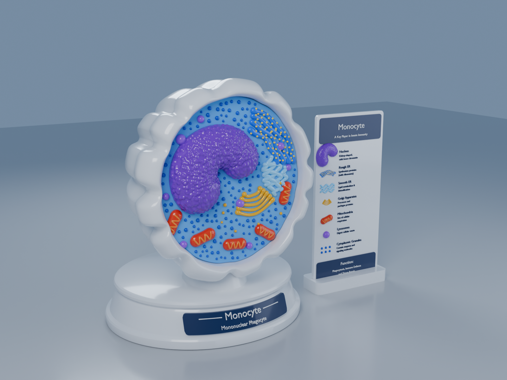
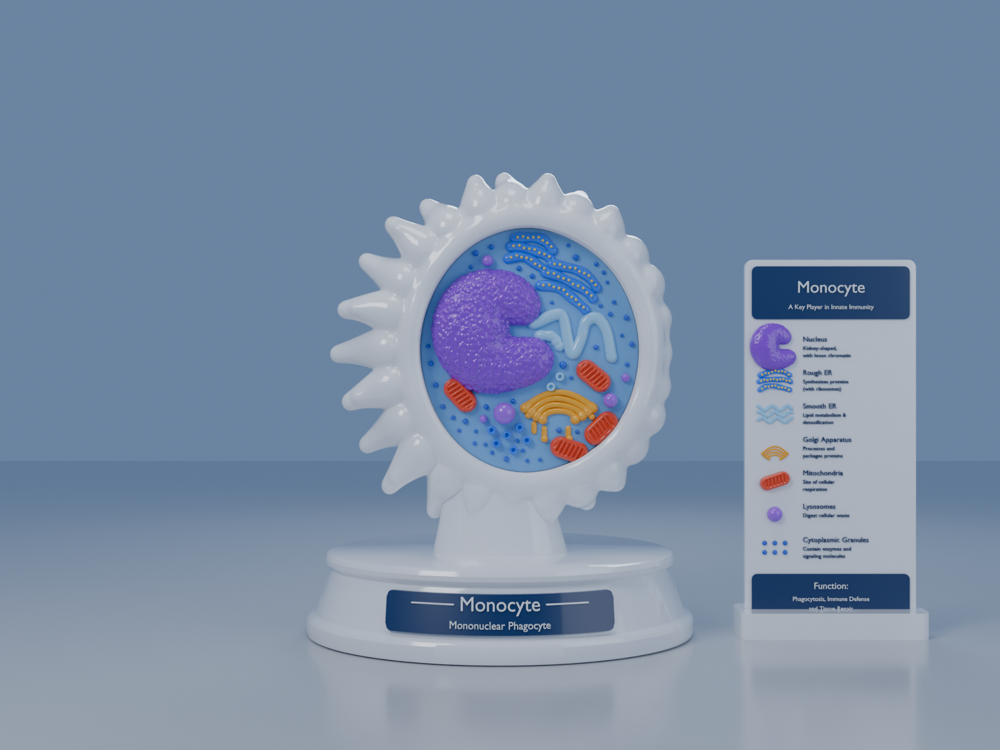
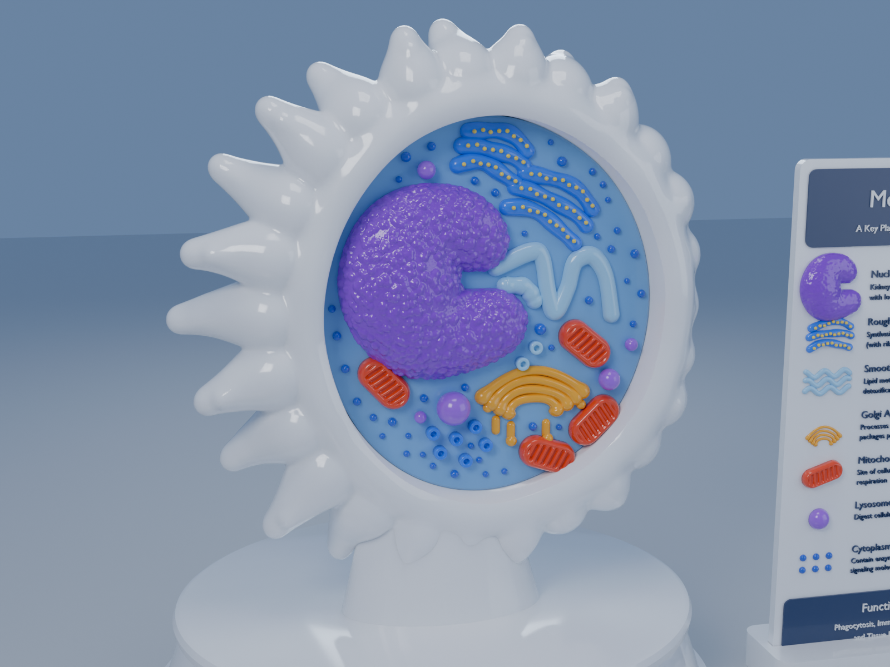

# مجسم الخلية الوحيدة (Monocyte) – Blender + طباعة ثلاثية الأبعاد

مجسم كامل بالأبعاد المطلوبة، مولَّد بالكامل بسكربت Blender (Python)، وكل لون قطعة مستقلة جاهزة للطباعة FDM.



| | |
|---|---|
|  |  |

## الأبعاد (مطابقة لطلب الزبون)

| البند | القيمة |
|---|---|
| الارتفاع الكلي مع القاعدة | **250 mm** |
| عرض جسم الخلية مع الأقدام الكاذبة | **185 mm** (المطلوب 170-190) |
| ارتفاع جسم الخلية | 195 mm |
| عمق جسم الخلية | **≈150 mm** (المطلوب 140-160) |
| أبعاد القاعدة | **210 × 190 mm** |

كل الأرقام في أعلى ملف `monocyte_model.py` (قسم `PARAMETERS`) — غيّر الرقم وأعد تشغيل السكربت فيُبنى المجسم من جديد.

## الملفات

| الملف | الوصف |
|---|---|
| `monocyte_model.py` | السكربت الذي يبني المجسم بالكامل |
| `Monocyte_Model.blend` | ملف Blender جاهز (مع إضاءة وكاميرا للعرض) |
| `stl/*.stl` | كل قطعة STL منفصلة بالمليمتر |
| `renders/*.png` | صور معاينة |

## الفتح في Blender

1. افتح `Monocyte_Model.blend` مباشرة، **أو**
2. Blender ‏(4.2 أو أحدث) ← تبويب **Scripting** ← Open ← `monocyte_model.py` ← **Run Script**.

الوحدات مضبوطة على المليمتر (Unit Scale = 0.001).
المجموعات (Collections): `Monocyte_Cell` و`Monocyte_Base` و`Monocyte_InfoCard`، أما `Studio_Preview` فللعرض فقط ولا تُطبع.

## القطع والألوان (PLA)

| القطعة (STL) | اللون |
|---|---|
| `Membrane_White` – الغشاء بشكل سائل: حافة سميكة ملفوفة، أقدام كاذبة متموجة وملتفة على اليسار، تقطرات بالأسفل، وقبة خلفية | أبيض لامع / PLA+ |
| `Cytoplasm_LightBlue` – صفيحة السيتوبلازم (تدخل في تجويف الغشاء) | أزرق فاتح |
| `Nucleus_Purple` – النواة بشكل الكلية مع ملمس الكروماتين | بنفسجي |
| `RoughER_Blue` + `RoughER_Ribosomes_Yellow` | أزرق + نقاط صفراء |
| `SmoothER_Cyan` | سماوي |
| `Golgi_Yellow` + `Golgi_Vesicles_Yellow` | أصفر/برتقالي |
| `Mitochondria_Red` – بيضوية مع حافة خارجية وطيّات عرضية (Cristae) | أحمر (قطعة واحدة) |
| `Lysosomes_Violet` | بنفسجي فاتح |
| `Granules_DarkBlue` – الحبيبات السيتوبلازمية | أزرق غامق |
| `Base_White` – القاعدة مع المهد (cradle) والوتد | أبيض |
| `Base_Plaque_Navy` + `Base_Text_White` – اللوحة المنحنية والكتابة | كحلي + أبيض |
| `Card_*` – بطاقة الشرح الجانبية مع أيقونات بارزة + الحامل | حسب الاسم |

## إعدادات الطباعة المقترحة

- ارتفاع الطبقة: **0.16 mm** للعضيات والكتابة، و**0.20 mm** للغشاء والقاعدة.
- كل العضيات **ظهرها مسطح**، فاطبعها على الظهر المسطح بلا دعامات.
- الغشاء: اطبعه والقبة للأسفل (التجويف للأعلى) مع **Tree supports** تحت القبة، Infill بنسبة 10-15%.
- القاعدة: تُطبع كما هي على أرضيتها، والوتد يكون للأعلى.
- الحبيبات والريبوسومات قطع صغيرة جداً، فالأفضل طباعتها بـ AMS/MMU مع صفيحة السيتوبلازم كطباعة متعددة الألوان، أو تلوينها بالأكريليك على شكل نقاط.
- اللوحة والبطاقة: الكتابة بارزة 0.8 mm، فيمكن تبديل الفلامنت عند ارتفاع الكتابة (Color change at layer).

## التجميع

1. ألصق صفيحة السيتوبلازم داخل تجويف الغشاء (السماحية 0.25 mm).
2. ألصق العضيات على وجه السيتوبلازم (مواقعها تظهر في ملف `.blend` وصور المعاينة).
3. أدخل وتد القاعدة (قطره 16 mm) في الفتحة أسفل الغشاء، فتجلس الخلية في المهد المطابق لشكلها، ثم ثبّتها بالغراء.
4. ألصق اللوحة الكحلية على مقدمة القاعدة، ثم الكتابة البيضاء فوقها.

## خيارات سريعة في السكربت

```python
ADD_TEXT = True        # False = بدون كتابة على القاعدة
ADD_INFO_CARD = True   # False = بدون بطاقة الشرح
CELL_DEPTH = 150.0     # عمق الخلية
FIT_CLEARANCE = 0.25   # سماحية التركيب
```

توليد كل شيء من سطر الأوامر (STL + .blend + صور):

```bash
blender -b -P monocyte_model.py -- --export --blend --render
```
