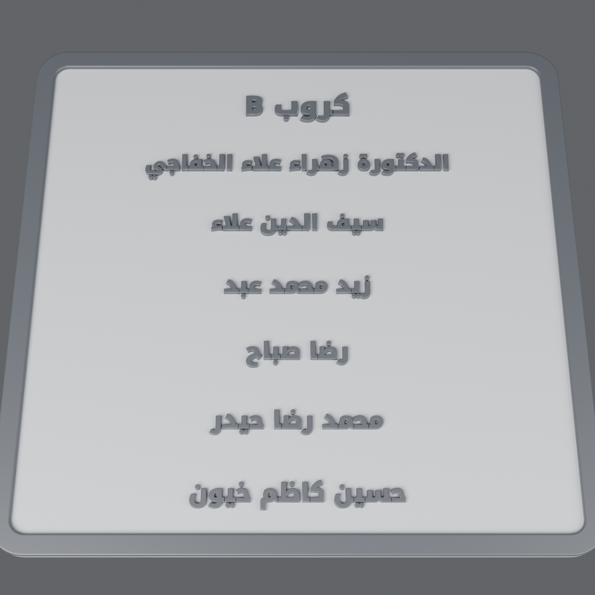

# لوحة أسماء كروب B — Blender



لوحة أسماء ثلاثية الأبعاد بنفس ستايل الصورة: إطار بارز غامق، وجه رمادي فاتح،
وكتابة عربية بارزة **موصولة وبالاتجاه الصحيح**.

| الملف | الوصف |
|---|---|
| `name_plate.blend` | ملف بلندر جاهز (الخط مدمج داخله) |
| `name_plate.stl` | ملف الطباعة بالمليمتر: 200×190×5 مم |
| `name_plate.py` | السكربت — غيّر الأسماء من `TITLE` و `LINES` |
| `NotoKufiArabic-ExtraBold.ttf` | الخط (Noto Kufi Arabic، رخصة SIL OFL 1.1) |

## الطباعة (بدون سبورت)
- اطبعها **مسطحة** والكتابة للأعلى.
- اللوح 3 مم، الإطار يرتفع 2 مم، والكتابة 1.4 مم.
- **لونان:** أضف تغيير فلامنت (Pause / Filament Change) عند ارتفاع **3.0 مم**:
  الطبقات قبلها رمادي فاتح (اللوح)، وبعدها غامق (الإطار والكتابة).
- طبقة 0.12–0.16 مم تعطي حروفًا أنظف.

## تغيير الأسماء
بلندر لا يوصل الحروف العربية لوحده، لذلك السكربت يشكّل الحروف (أول/وسط/آخر الكلمة
ولام ألف) ويرتبها من اليمين لليسار. لا تكتب العربي مباشرة في Text داخل بلندر —
عدّل `LINES` في السكربت ثم شغّله:

```
blender -b -P name_plate.py -- --save name_plate.blend --stl name_plate.stl --render name_plate.png
```
