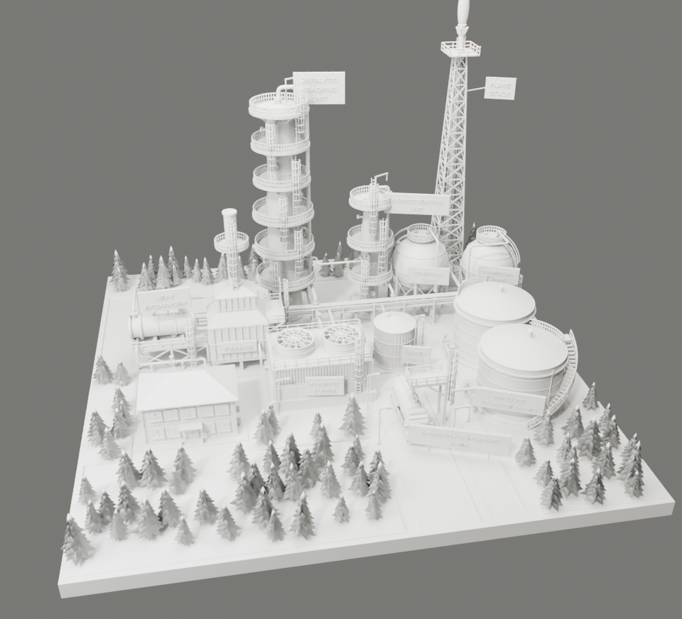

# مجسم مصفاة نفط – Blender


مجسم ديوراما كامل لمصفاة نفط على طاولة. كل قطعة فيه مبنية بشكل إجرائي (Procedural) من سكربت Python واحد،
ويشتغل على **Blender 4.0 وما بعده** (تمت تجربته على 5.1).

## طريقة التشغيل

1. افتح Blender، ثم ادخل تبويب **Scripting**.
2. اضغط **Open** واختر الملف `refinery_diorama.py`.
3. اضغط **Run Script** (أو `Alt+P`). يبني السكربت المشهد كاملاً خلال ثوانٍ، ويمسح أي شيء موجود في المشهد قبلها.
4. اضغط **F12** للرندر (Cycles). السكربت يحاول تفعيل كرت الشاشة (GPU) تلقائياً.

أو بدون واجهة:

```bash
blender -b -P refinery_diorama.py -- --render out.png --samples 256
```

خيارات إضافية: `--percent 50` لتصغير الدقة، `--no-hair` لإلغاء شعر العشب، `--save scene.blend` لحفظ الملف.

> الملف `refinery_diorama.blend` محفوظ من Blender 5.1. إذا كانت نسختك أقدم، شغّل السكربت بدلاً منه.

## محتويات المشهد

| الوحدة | التفاصيل |
|---|---|
| **وحدة التكسير الحفزي** (Catalytic Cracking) | عمود ارتفاعه 7م بقطرين وجزء انتقالي مخروطي، رأس بيضاوي، 6 منصات دائرية من الشبك، درابزين أصفر، سلالم بأقفاص حماية، فتحات تفتيش بمسامير، نوزلات بفلنجات، خط أبخرة علوي، رافعة (Davit) |
| **وحدة المعالجة الهيدروجينية** (Hydrotreating) | عمود أصغر بنفس مستوى التفاصيل |
| **الفرن** (Furnace) | صندوق احتراق على أرجل، دعامات تقوية، فتحات مراقبة، شعلات سفلية، قسم الحمل الحراري مع أكواع الأنابيب، مدخنة مخططة أحمر/أبيض مع منصة وسلم |
| **المبادل الحراري** (Heat Exchanger) | غلاف أفقي على هيكل فولاذي مع تقاطعات، منصة شبك ودرابزين، فلنجات بمسامير، رأس قناة، نوزلات |
| **برج التبريد** (Cooling Tower) | أحواض خرسانية، فتحات تهوية مائلة (Louvers)، ألواح مضلعة، مروحتان بشفرات وشبك حماية |
| **خزانات كروية** ×2 | 8 أرجل مع تقاطعات X، سلم منحني على سطح الكرة، منصة علوية، خطوط لحام |
| **مشعل الغاز** (Flare Stack) | برج شبكي مدبب بتقاطعات، ماسورة، رأس المشعل، **لهب مضيء** مع إضاءة برتقالية، أضواء تحذير حمراء |
| **خزانات المنتجات** ×2 | خزانات بيضاء بسقف مقبب، **درج حلزوني** حول الخزان، حلقة رياح، محابس حمراء، مؤشر مستوى |
| **خزان المياه** | خزان أخضر بجدار مضلع وسقف مخروطي |
| **مبنى الإدارة** | طابقان، سقف أزرق هرمي، نوافذ بإطارات زرقاء، مدخل بمظلة ودرج |
| **شاحنة صهريج** | قمرة صفراء، صهريج فضي، عجلات بإطارات وجنوط ومسامير، مرايا، أضواء |
| **منطقة التحميل** | جسر تحميل مع ذراع، طرق بخطوط صفراء وبيضاء وأسهم، أعمدة إنارة |
| **الأنابيب** | حامل أنابيب بطابقين، أكثر من 25 خطاً بأكواع دائرية، فلنجات، محابس، دعامات |
| **البيئة** | قاعدة حصى (Voronoi)، أرصفة، عشب حقيقي (Hair Particles)، 4 أنواع من أشجار الصنوبر، لوحات تعريف بنصوص ثلاثية الأبعاد، إطار أسود للمجسم |

## نسخة الطباعة ثلاثية الأبعاد – 30 × 30 سم



ملفات STL جاهزة في المجلد [`print_30cm/`](print_30cm). المقاسات بالمليمتر، وكل الملفات مغلقة (Watertight) بدون حواف مفتوحة، وتم فحصها آلياً.

- **القاعدة:** 300 × 300 مم بالضبط مع الإطار. القاعدة مربعة في هذه النسخة.
- **المقياس:** 1 وحدة في Blender = 21.25 مم. أطول جزء هو مشعل الغاز (197 مم بدون اللهب).
- **أقل سماكة:** 0.8 مم، فالدرابزين والسلالم والبرج الشبكي كلها قابلة للطباعة على FDM بفوهة 0.4 مم وعلى الريزن.

| الملف | المقاس (مم) | ملاحظات |
|---|---|---|
| `00_Full_model_300mm.stl` | 300 × 300 × 197 | المجسم كامل قطعة واحدة، لطابعة سريرها 300 مم أو أكبر |
| `01_Tile_front_left.stl` | 171 × 197 × 112 | |
| `01_Tile_front_right.stl` | 129 × 186 × 57 | |
| `01_Tile_back_left.stl` | 171 × 103 × 178 | |
| `01_Tile_back_right.stl` | 129 × 114 × 197 | |
| `02_Trees.stl` | 95 شجرة | تُلصق على العشب |
| `02_TankerTruck.stl` | 17 × 45 × 21 | توضع على الطريق تحت جسر التحميل |
| `02_Flame.stl` | 7 × 7 × 31 | تُلصق على رأس المشعل، ويفضل طباعتها ببرتقالي شفاف |

**القطع الأربع (Tiles):** كل الوحدات والأنابيب واللوحات ملتحمة مع القاعدة، فما فيه تركيب قطع صغيرة.
خطوط القص اخترتها بحيث ما تقطع أي عمود أو خزان أو مبنى، بس تمر على الأنابيب والطرق.
كل قطعة تدخل في طابعة سريرها **200 × 200 مم وارتفاعها 200 مم**، مثل Bambu A1/P1/X1 وPrusa MK4 وEnder 3.
شوف [`assembly_map.png`](print_30cm/assembly_map.png) لمكان كل قطعة، و`parts.txt` لتفاصيل الفحص.

**نصائح الطباعة:**
- اطبع القطع واقفة كما هي. المنصات الدائرية تحتاج **دعامات (Supports)**، ويفضل Tree supports.
- الملفات فيها أجسام متداخلة (مثل kitbash)، والسلايسر يدمجها تلقائياً. في Cura تأكد إن "Union Overlapping Volumes" مفعّل (مفعّل افتراضياً).
- الحصى والخطوط على الطرق ألوان فقط، تُرسم بالفرشاة بعد الطباعة.
- `refinery_print_30cm.blend` هو نسخة الطباعة داخل Blender، ووحداتها مضبوطة على المليمتر.

**مقاس أو طابعة مختلفة:**

```bash
blender -b -P export_print.py -- --size 400 --min 0.5    # لوح 40 سم، وأقل سماكة 0.5 مم لطابعات الريزن
```

## تعديلات سريعة

في أعلى السكربت:

- `GRASS_HAIR = False` لإلغاء العشب إذا كان الجهاز بطيئاً.
- `RENDER_SAMPLES` عدد العينات.
- `RES_X, RES_Y` دقة الصورة.
- `CAM_LOC` / `CAM_TARGET` مكان الكاميرا والنقطة التي تنظر إليها.

كل الخامات تُنشأ في الدالة `build_materials()`، وتقدر تعدّلها من **Shader Editor** بعد التشغيل.
الكائنات مرتبة في Collections منفصلة: Base, Units, Piping, Labels, Vegetation, Vehicles, Lighting_Camera.
