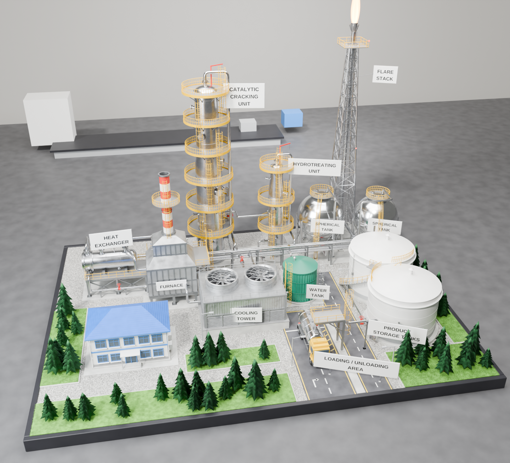

# مجسم مصفاة نفط – Blender



مجسم ديوراما كامل لمصفاة نفط على طاولة. كل قطعة فيه مبنية بشكل إجرائي (Procedural) من سكربت Python واحد،
ويشتغل على **Blender 4.0 وما بعده** (تمت تجربته على 5.1).

## طريقة التشغيل

1. افتح Blender، ثم ادخل تبويب **Scripting**.
2. اضغط **Open** واختر الملف `refinery_diorama.py`.
3. اضغط **Run Script** (أو `Alt+P`). يبني السكربت المشهد كاملاً خلال ثوانٍ، ويمسح أي شيء موجود في المشهد قبلها.
4. اضغط **F12** للرندر (Cycles). السكربت يحاول تفعيل كرت الشاشة (GPU) تلقائياً.

أو بدون واجهة:

```bash
blender -b -P refinery_diorama.py -- --render out.png --samples 256
```

خيارات إضافية: `--percent 50` لتصغير الدقة، `--no-hair` لإلغاء شعر العشب، `--save scene.blend` لحفظ الملف.

> الملف `refinery_diorama.blend` محفوظ من Blender 5.1. إذا كانت نسختك أقدم، شغّل السكربت بدلاً منه.

## محتويات المشهد

| الوحدة | التفاصيل |
|---|---|
| **وحدة التكسير الحفزي** (Catalytic Cracking) | عمود ارتفاعه 7م بقطرين وجزء انتقالي مخروطي، رأس بيضاوي، 6 منصات دائرية من الشبك، درابزين أصفر، سلالم بأقفاص حماية، فتحات تفتيش بمسامير، نوزلات بفلنجات، خط أبخرة علوي، رافعة (Davit) |
| **وحدة المعالجة الهيدروجينية** (Hydrotreating) | عمود أصغر بنفس مستوى التفاصيل |
| **الفرن** (Furnace) | صندوق احتراق على أرجل، دعامات تقوية، فتحات مراقبة، شعلات سفلية، قسم الحمل الحراري مع أكواع الأنابيب، مدخنة مخططة أحمر/أبيض مع منصة وسلم |
| **المبادل الحراري** (Heat Exchanger) | غلاف أفقي على هيكل فولاذي مع تقاطعات، منصة شبك ودرابزين، فلنجات بمسامير، رأس قناة، نوزلات |
| **برج التبريد** (Cooling Tower) | أحواض خرسانية، فتحات تهوية مائلة (Louvers)، ألواح مضلعة، مروحتان بشفرات وشبك حماية |
| **خزانات كروية** ×2 | 8 أرجل مع تقاطعات X، سلم منحني على سطح الكرة، منصة علوية، خطوط لحام |
| **مشعل الغاز** (Flare Stack) | برج شبكي مدبب بتقاطعات، ماسورة، رأس المشعل، **لهب مضيء** مع إضاءة برتقالية، أضواء تحذير حمراء |
| **خزانات المنتجات** ×2 | خزانات بيضاء بسقف مقبب، **درج حلزوني** حول الخزان، حلقة رياح، محابس حمراء، مؤشر مستوى |
| **خزان المياه** | خزان أخضر بجدار مضلع وسقف مخروطي |
| **مبنى الإدارة** | طابقان، سقف أزرق هرمي، نوافذ بإطارات زرقاء، مدخل بمظلة ودرج |
| **شاحنة صهريج** | قمرة صفراء، صهريج فضي، عجلات بإطارات وجنوط ومسامير، مرايا، أضواء |
| **منطقة التحميل** | جسر تحميل مع ذراع، طرق بخطوط صفراء وبيضاء وأسهم، أعمدة إنارة |
| **الأنابيب** | حامل أنابيب بطابقين، أكثر من 25 خطاً بأكواع دائرية، فلنجات، محابس، دعامات |
| **البيئة** | قاعدة حصى (Voronoi)، أرصفة، عشب حقيقي (Hair Particles)، 4 أنواع من أشجار الصنوبر، لوحات تعريف بنصوص ثلاثية الأبعاد، إطار أسود للمجسم |

## تعديلات سريعة

في أعلى السكربت:

- `GRASS_HAIR = False` لإلغاء العشب إذا كان الجهاز بطيئاً.
- `RENDER_SAMPLES` عدد العينات.
- `RES_X, RES_Y` دقة الصورة.
- `CAM_LOC` / `CAM_TARGET` مكان الكاميرا والنقطة التي تنظر إليها.

كل الخامات تُنشأ في الدالة `build_materials()`، وتقدر تعدّلها من **Shader Editor** بعد التشغيل.
الكائنات مرتبة في Collections منفصلة: Base, Units, Piping, Labels, Vegetation, Vehicles, Lighting_Camera.
