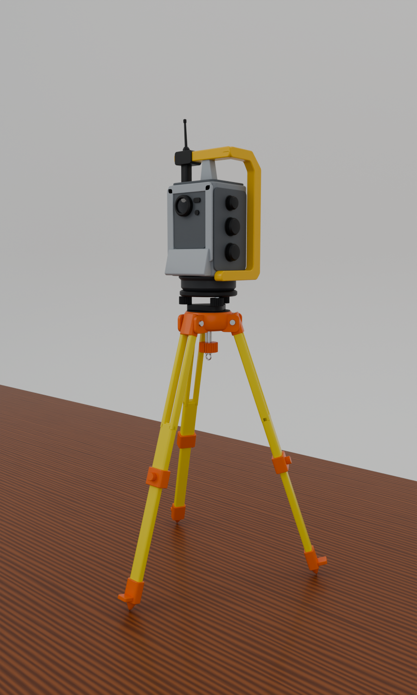
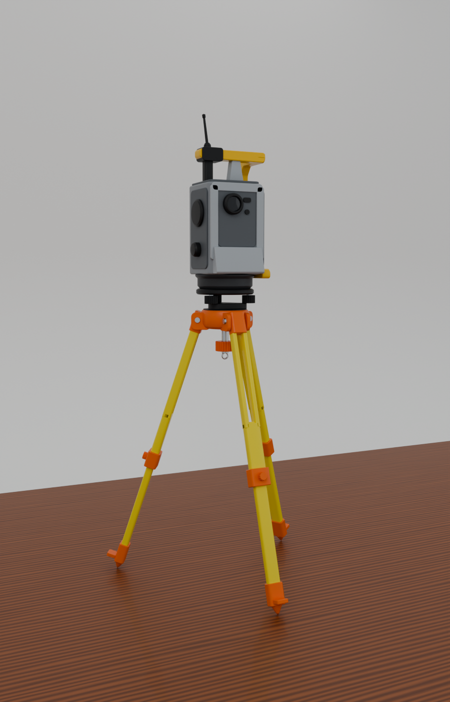
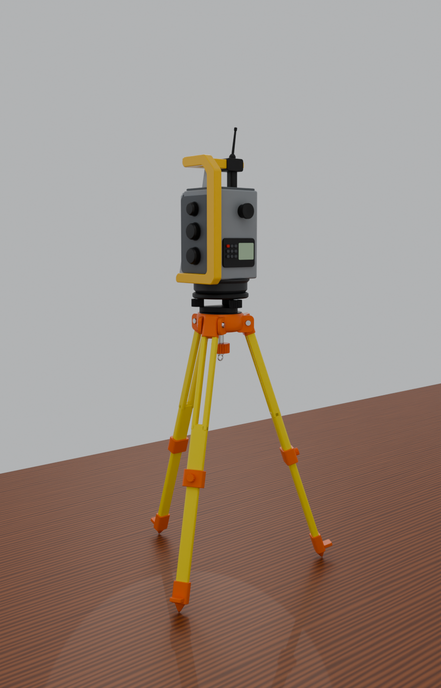
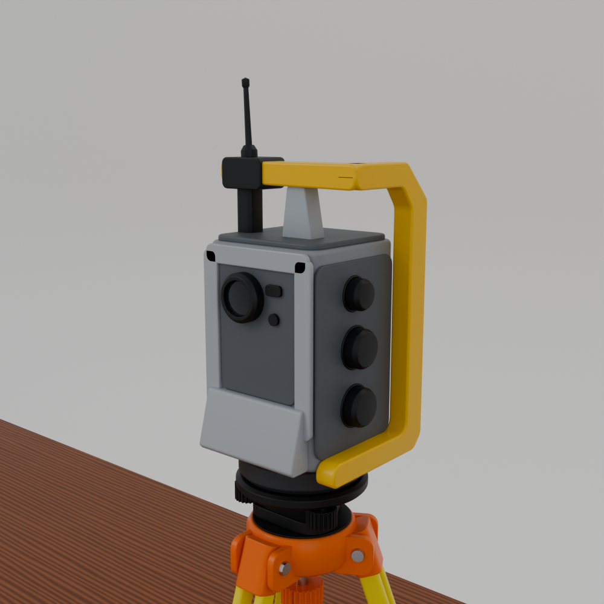

# جهاز توتال ستيشن روبوتي على حامل ثلاثي – ارتفاع 20 سم

نموذج بلندر مبني حسب الصورة المرجعية: جسم رمادي، مقبض أصفر فوقه ويلتف حول الجانب ذي الأزرار الثلاثة، هوائي أسود، حامل أصفر نحيف بأرجل مشقوقة من الأعلى، وقطع برتقالية (الرأس، الأقفال، الأقدام).

**الارتفاع الكلي = 200 مم بالضبط** (من سن القدم حتى رأس الهوائي). الوحدة في الملف = مليمتر.

| | | |
|---|---|---|
|  |  |  |

## الملفات

| الملف | الاستخدام |
|---|---|
| `robotic_total_station.blend` | ملف بلندر جاهز (المشهد + الإضاءة + 4 كاميرات، `Cam_Photo` بنفس زاوية الصورة) |
| `export/Robotic_Total_Station.glb` | النموذج بالألوان لأي برنامج |
| `export/Robotic_Total_Station_200mm.stl` | للطباعة ثلاثية الأبعاد (مم) |
| `build_robotic_total_station.py` | السكربت الذي يبني النموذج (المقاسات والألوان قابلة للتعديل) |

## الأجزاء

- **الحامل:** رأس برتقالي بثلاث مفصلات ومسامير، أرجل صفراء: جزء علوي بسكتين وشق طويل، قفل برتقالي بمسمار محزز، جزء سفلي منزلق، قدم برتقالية بسن ودعسة جانبية، مسمار التثبيت وخطاف الشاقول.
- **القاعدة (Tribrach):** سوداء، 3 براغي تسوية محززة، فقاعة تسوية، ذراع قفل، قاعدة دوران رمادية داكنة.
- **الجهاز:** جسم رمادي، وجه أمامي بإطار فاتح ولوحة داكنة وعدسة زجاجية ونافذة التتبع، ذقن مائل فاتح بالأسفل، جانب أيمن بلوحة داكنة و3 أزرار سوداء، جانب أيسر بغطاء سيرفو وزر، لوحة خلفية (شاشة + أزرار) وعينية.
- **المقبض الأصفر:** جسر علوي + إطار C حول الجانب ذي الأزرار، عمود رمادي في الوسط، علبة الهوائي السوداء والهوائي.

## الاستخدام

- افتح `robotic_total_station.blend` (بلندر 4.2 أو أحدث)، اختر الكاميرا ثم F12.
- لإعادة البناء: تبويب Scripting ← افتح السكربت ← Run Script (ينشئ مشهداً جديداً دون المساس بمشهدك).
- الألوان في الدالة `materials()` داخل السكربت.
