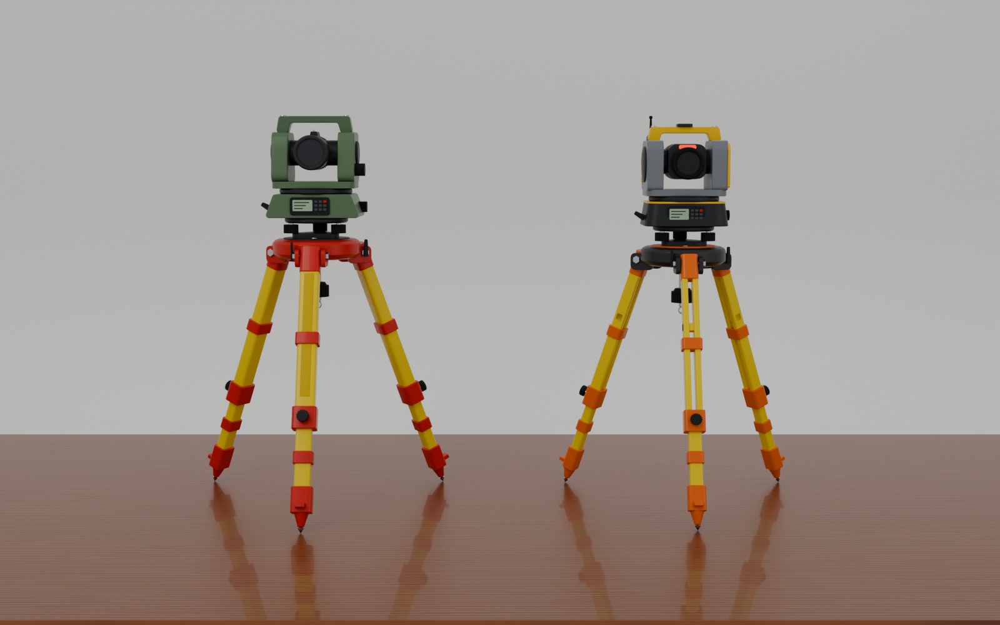
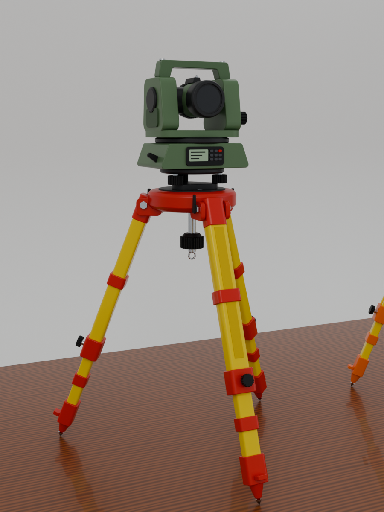
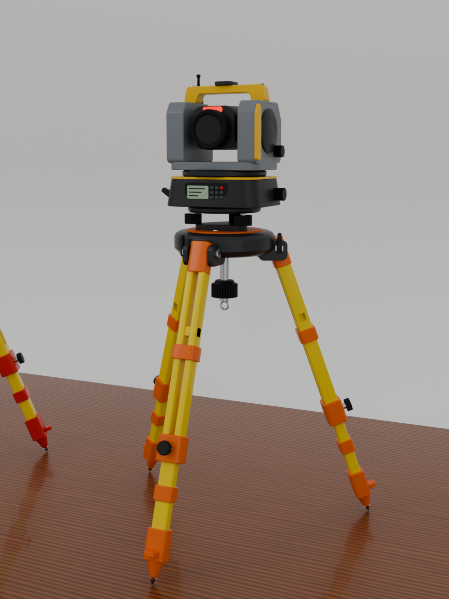
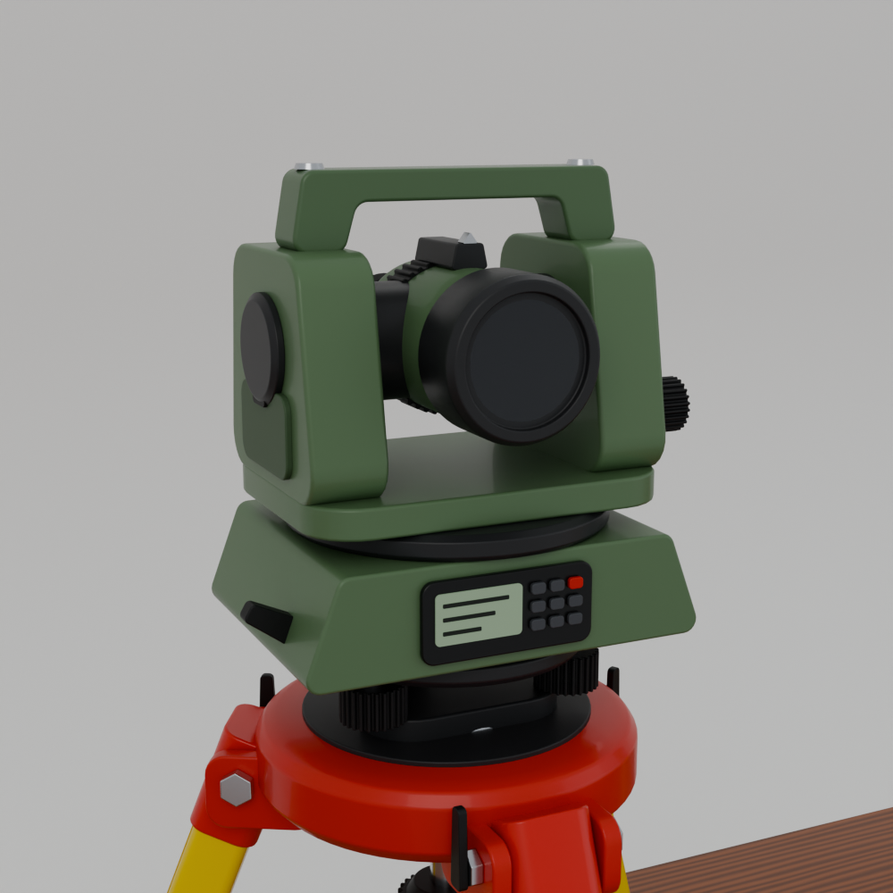
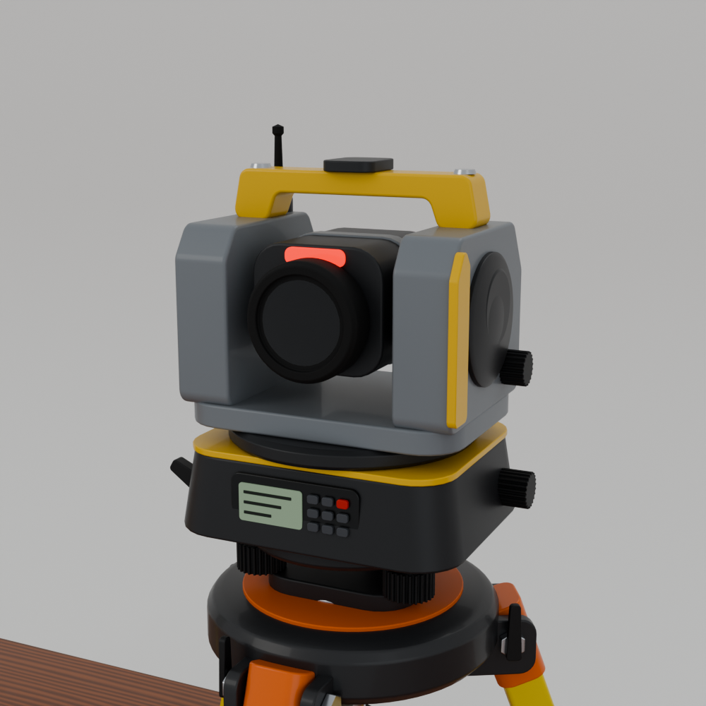

# أجهزة المساحة – نموذج بلندر (Total Station + Tripod)

جهازان كاملان (جهاز توتال ستيشن + حامل ثلاثي)، **ارتفاع كل جهاز 20 سم بالضبط (200 مم)**، مبنيان بالمليمتر داخل بلندر.

| الجهاز | الوصف |
|---|---|
| **TS_Classic** | توتال ستيشن كلاسيكي أخضر، حامل أصفر برأس وأحزمة وأقدام حمراء (مثل الصورة الثانية) |
| **TS_Robotic** | توتال ستيشن روبوتي رمادي بمقبض أصفر وهوائي، حامل أصفر بأحزمة وأقدام برتقالية (مثل الصورة الأولى) |



| | |
|---|---|
|  |  |
|  |  |

## الملفات

| الملف | الاستخدام |
|---|---|
| `surveying_devices.blend` | ملف بلندر الجاهز: الجهازان + الطاولة الخشبية + الخلفية + الإضاءة + 5 كاميرات |
| `export/TS_Classic.glb` و `export/TS_Robotic.glb` | نماذج بالألوان لأي برنامج (Unity / Unreal / Sketchfab / ويندوز 3D Viewer) |
| `export/TS_Classic_200mm.stl` و `export/TS_Robotic_200mm.stl` | للطباعة ثلاثية الأبعاد – الوحدة مليمتر، الارتفاع 200 مم |
| `build_surveying_devices.py` | السكربت الذي يبني كل شيء (يمكن تعديل المقاسات والألوان منه) |

## تفاصيل النموذج

- **الحامل الثلاثي:** رأس دائري، مفصلات بمسامير سداسية وصامولة جناح، أرجل تلسكوبية (جزء علوي + جزء منزلق)، أحزمة، قفل عند المفصل مع مقبض محزز، حذاء القدم مع دعسة القدم وسن معدني، مسمار التثبيت تحت الرأس مع خطاف خيط الشاقول.
- **القاعدة (Tribrach):** قاعدة مثلثية، 3 براغي تسوية محززة، فقاعة تسوية دائرية، ذراع قفل.
- **الجهاز:** جسم سفلي مع لوحتي تحكم (شاشة LCD + أزرار) أمامية وخلفية، حلقة الدوران الأفقي، القائمان (Standards)، التلسكوب مع عدسة زجاجية مطلية، حلقة التركيز المحززة، العينية المطاطية، مسامير الحركة البطيئة الأفقية والرأسية، غطاء البطارية، مقبض الحمل.
- **الروبوتي:** أغطية السيرفو الدائرية، لوحة جانبية صفراء، ضوء التوجيه الأحمر، هوائي الراديو، حساس علوي.
- كل القطع لها **Bevel** حقيقي ونعومة (Smooth + Sharp by angle) – بدون Booleans، والقطع منفصلة ومسماة وملونة بمواد منفصلة لتسهيل التعديل.
- كل جهاز مربوط بـ Empty اسمه `TS_Classic_ROOT` / `TS_Robotic_ROOT` – حركه أو كبّره من هنا.

## الاستخدام في بلندر

1. افتح `surveying_devices.blend` (بلندر 4.2 أو أحدث).
2. المشهد اسمه `Surveying_Devices`، الوحدة مليمتر.
3. للرندر: محرك Cycles جاهز – اختر الكاميرا (`Cam_Both`، `Cam_Classic`، ...) ثم F12.

### إعادة البناء أو التعديل

افتح تبويب **Scripting** ← افتح `build_surveying_devices.py` ← **Run Script**.
يُنشئ مشهداً جديداً `Surveying_Devices` (لا يلمس مشهدك الحالي).
الألوان في القاموس `STYLES` في أسفل السكربت (مثال: `body="5f7a58"` للون الأخضر).

من سطر الأوامر:

```bash
blender -b -P build_surveying_devices.py -- --out . --export --render --samples 128
```

## ملاحظة للطباعة ثلاثية الأبعاد

ملف STL يحتوي كل القطع كأجسام منفصلة متداخلة (كما في بلندر). أغلب برامج الشرائح (Cura / PrusaSlicer / Bambu Studio) تدمجها تلقائياً. للطباعة بالألوان اطبع القطع بألوان مختلفة من ملف `.blend` (كل قطعة باسمها).
