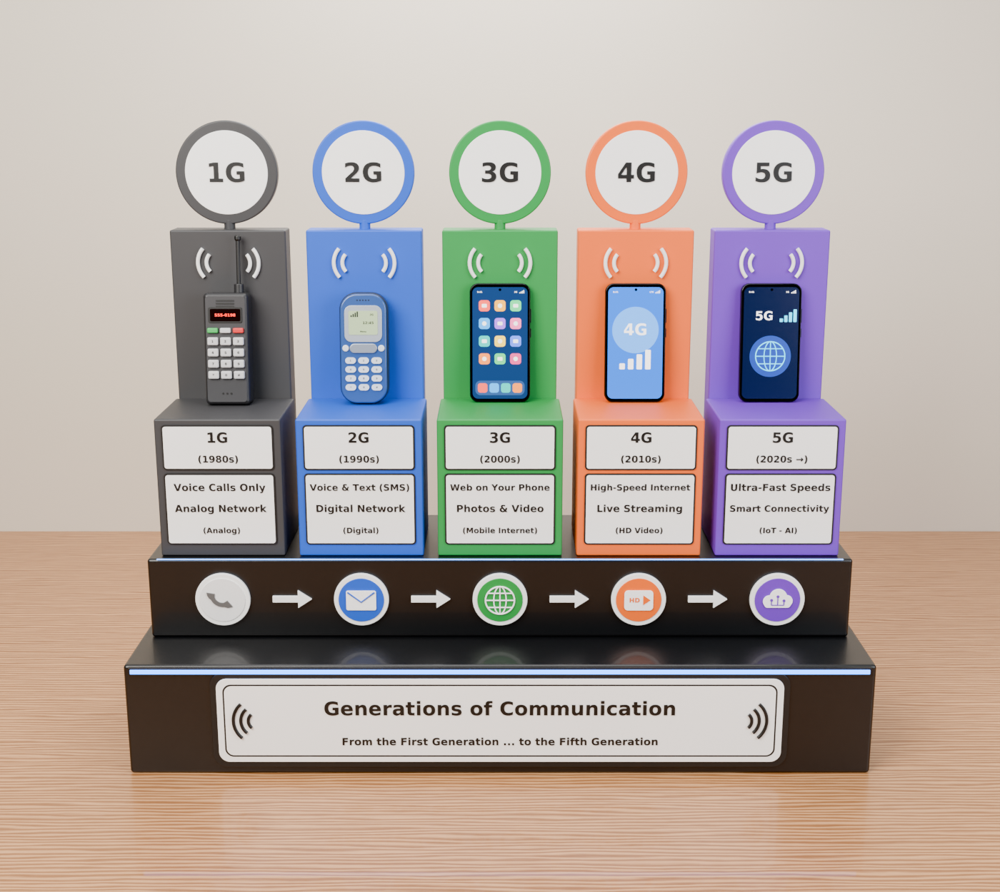
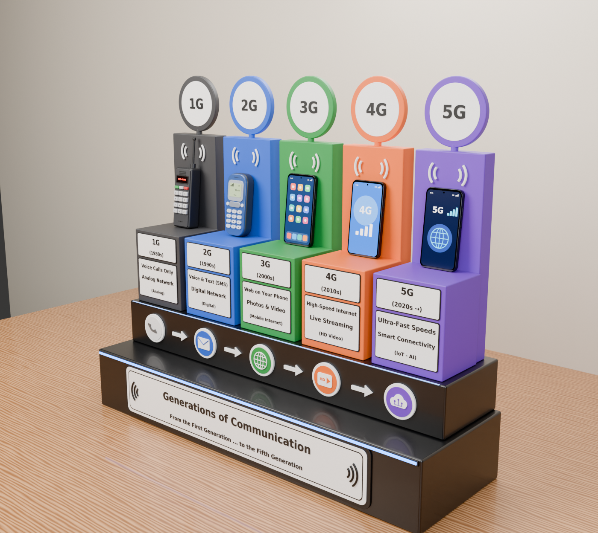

# "Generations of Communication" display — Blender model

A 3D model of the 1G → 5G mobile communication display, built at real-world scale:

| Dimension | Value |
|---|---|
| Total height | **60 cm** (bottom of the base to the top of the 5G disc) |
| Width | 70 cm |
| Depth | 22 cm |

## Files

| File | Description |
|---|---|
| `telecom_generations_60cm.blend` | Ready-to-open scene (font packed inside), saved with Blender 5.0 |
| `telecom_generations.py` | Script that builds the whole model — written for Blender 3.6, 4.x and 5.x |
| `DejaVuSans-Bold.ttf` | Font used for all labels (free licence, see `DejaVuSans-LICENSE.txt`) |

## If your Blender is older than 5.0

1. Open Blender and switch to the **Scripting** workspace
2. **Text › Open** and choose `telecom_generations.py` (keep the font file next to it)
3. Press **Run Script** — the full model is built in a few seconds

## Scene layout

- Each generation is in its own collection (`1G` … `5G`) and parented to an Empty
  (`1G_Root` …). Move or rotate the Empty to move the whole column.
- Each phone has its own Empty (`1G_Phone` …) and leans 6° against the back panel.
- `Base`: black stepped base, blue LED strip, icons and arrows, front title sign.
- `Environment` and `Lights_Camera`: wooden table, wall, 4 area lights and two cameras
  (`Camera_Front`, `Camera_3-4`). Hide `Environment` to get the model on its own.
- Everything is at real size (scene unit metre, displayed in centimetres). Edges use a
  non-applied Bevel modifier, so you can still tweak it.
- Render engine: Cycles, 256 samples with denoising. Switch to EEVEE for speed.

## Editing

- All label text is in the `TEXT` dictionary (and the `GENERATIONS` list) at the top of
  the script. Edit it and run the script again.
- To change the overall size, change `TOTAL_HEIGHT_CM` at the top of the script — every
  dimension scales with it.
