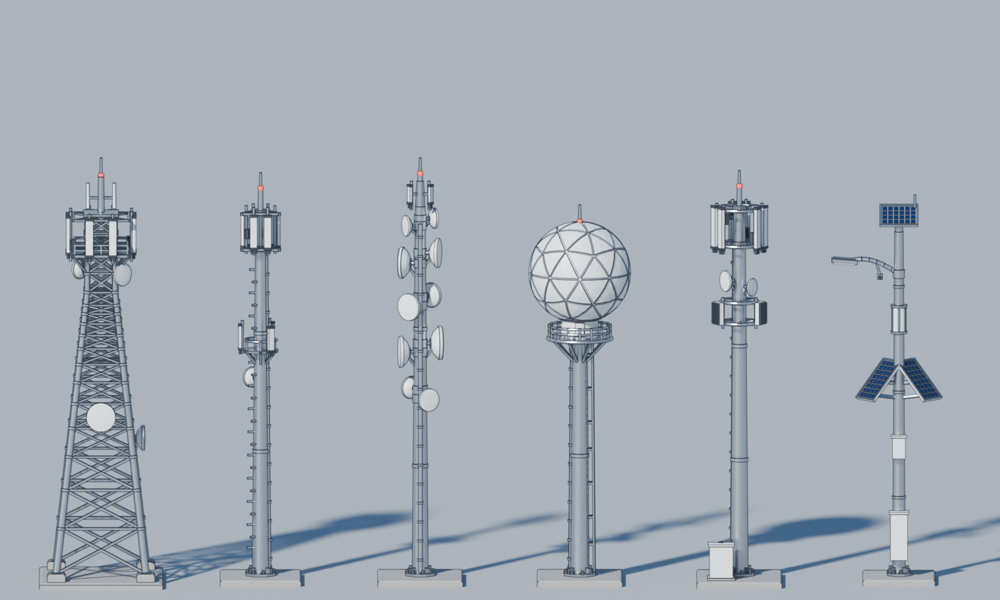
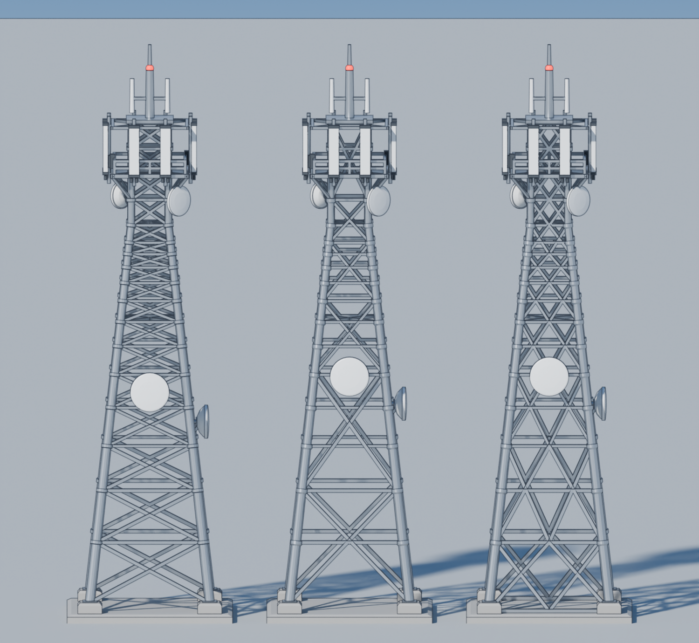
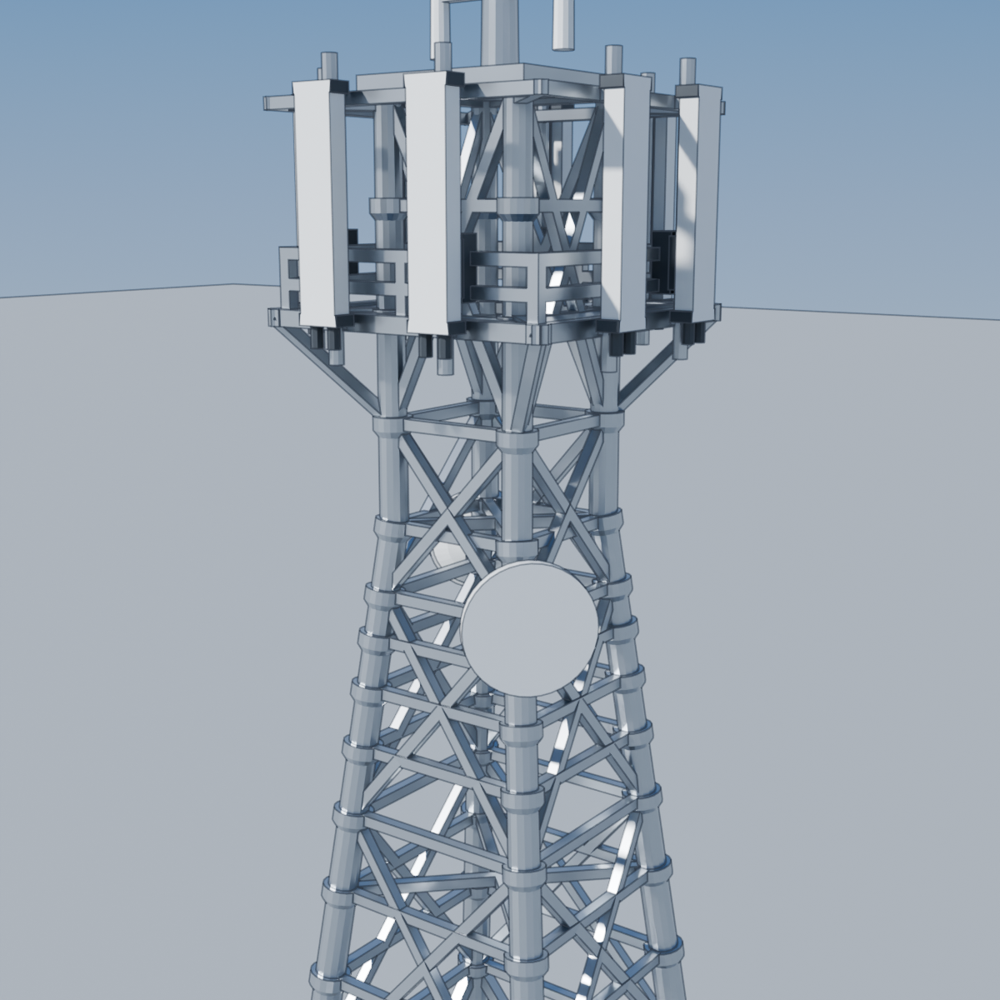
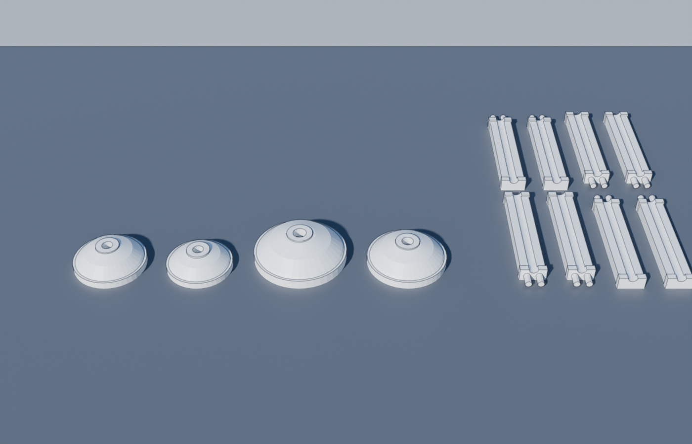
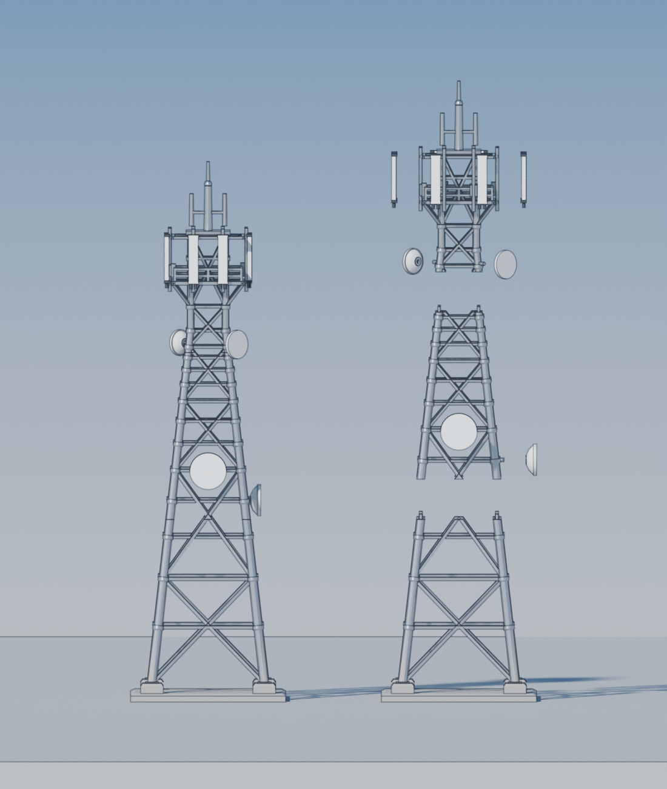
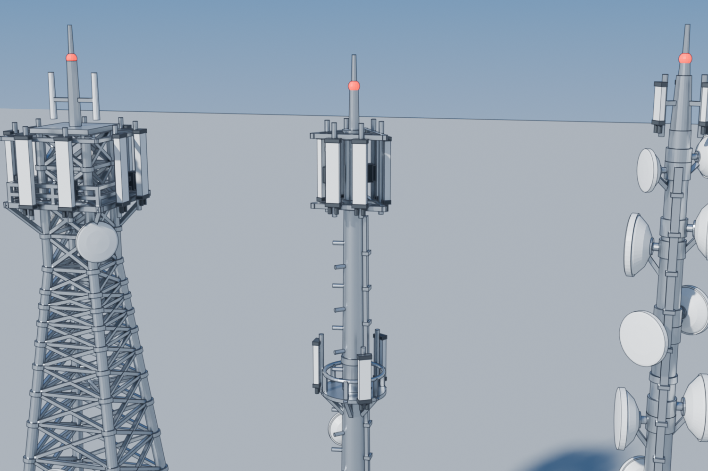
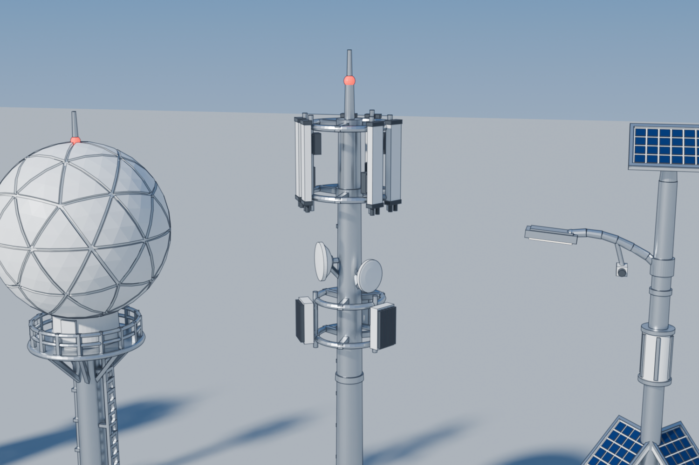

# هيكلية أبراج ومحطات الاتصالات: نموذج Blender جاهز للطباعة ثلاثية الأبعاد



ستة أبراج اتصالات مبنية برمجياً داخل Blender (Python) بنفس ترتيب الصورة المرجعية، من اليسار إلى اليمين:

| # | البرج | الملف | الأبعاد (عرض × عمق × ارتفاع) | الحجم التقريبي |
|---|-------|-------|------------------------------|----------------|
| 1 | أبراج شبكية (Lattice) | `stl/01_Lattice_Tower.stl` | 58 × 58 × 201 مم | 23.9 سم³ |
| 2 | أبراج أحادية (Monopole) | `stl/02_Monopole.stl` | 38 × 38 × 194 مم | 12.0 سم³ |
| 3 | أبراج مايكروويف | `stl/03_Microwave_Tower.stl` | 40 × 40 × 201 مم | 15.0 سم³ |
| 4 | محطات رادوم (حماية) | `stl/04_Radome_Station.stl` | 48 × 48 × 179 مم | 70.4 سم³ |
| 5 | محطات خلايا (4G/5G) | `stl/05_Cell_Site_4G_5G.stl` | 40 × 44 × 195 مم | 16.6 سم³ |
| 6 | أبراج ذكية ومستدامة | `stl/06_Smart_Solar_Pole.stl` | 52 × 34 × 183 مم | 10.0 سم³ |
| 7 | **أبراج شبكية: X بدون سبورت (خيار A)**، الأطباق والهوائيات قطع منفصلة | `stl/07_Lattice_PrintX_A.stl` + `_dishes` + `_panels` | 58 × 58 × 201 مم | 20.6 سم³ (الجسم) |
| 8 | **أبراج شبكية: X بدون سبورت (خيار B)** | `stl/08_Lattice_PrintX_B.stl` | 58 × 58 × 201 مم | 24.2 سم³ |

- **الوحدة:** 1 وحدة في Blender = 1 مم، فيفتح ملف STL في أي Slicer (Cura / PrusaSlicer / Bambu / Chitubox) بمقاسه الصحيح مباشرة.
- **كل برج جسم واحد مغلق** (Watertight / Manifold): دُمجت كل القطع بعملية Boolean Union، ثم فُحصت الملفات: لا حواف مفتوحة، ولا مثلثات معطوبة، ولا أجسام منفصلة.
- **يناسب أغلب الطابعات:** أكبر برج 58 × 58 × 201 مم، أي أنه يدخل في طابعة بمساحة 220 × 220 × 250 مثل Ender 3 وBambu A1/P1 وPrusa MK4، وفي طابعات الرزن ذات الارتفاع 200 مم فأكثر.
- **أرقّ عنصر 1.0 مم** (الدعامات والدرابزين ومانعة الصواعق)، وهو قابل للطباعة بفوهة 0.4 أو بالرزن.

## البرج الشبكي: حدايد X بدون سبورت (خياران: 7 و8)



*يسار: البرج القديم (رقم 1). وسط: خيار A (رقم 7). يمين: خيار B (رقم 8).*

الثلاثة جنب بعض في ملف Blender واحد: `lattice_3_options.blend`.

الخياران هما نفس البرج القديم: نفس الأرجل، ونفس المستويات والحدايد الأفقية، ونفس الرأس والمنصة والهوائيات والأطباق. **التغيير فقط في حدايد X**، حتى تكون زاوية كل حديدة 45° أو أكثر عن الأفقي، فتنطبع بدون سبورت. في القديم كانت الزاوية 15°–35°.

| | القديم (1) | خيار A (7) | خيار B (8) |
|--|--|--|--|
| شكل X | X واحد في كل مستوى | X واحد عريض يغطي 2–4 مستويات | X صغيرتان جنب بعض |
| عدد X في كل وجه | 17 | 6 | 22 |
| زاوية حدايد X | 15°–35° | 46°–64° | 48°–65° |
| يحتاج سبورت في حدايد X | نعم | لا | لا |

- **في الخيارين:** شطف 45° تحت حلقات وصل الأرجل، ما يغيّر الشكل.
- **في خيار B فقط:** عارضة أرضية على القاعدة، يبدأ منها أول صف X.
- **الرأس والأطباق:** مثل القديم، فتحتاج سبورت عادي.

**نصيحة:** في برنامج الطباعة استخدم **Support Painting** (في Bambu Studio وPrusaSlicer) أو **Support Blocker** (في Cura): لوّن الرأس والأطباق فقط كمناطق سبورت، وامنع السبورت على جسم البرج. تقدر تغيّر الزاوية من `PRINT_MIN_ANGLE` في السكربت.

### خيار A: الأطباق والهوائيات قطع منفصلة



في خيار A تُطبع أطباق المايكروويف والهوائيات المستطيلة وحدها، ثم تُركّب على البرج:

| الملف | المحتوى | طريقة الطباعة |
|--|--|--|
| `07_Lattice_PrintX_A.stl` | جسم البرج، ومعه أذرع الأطباق وأنابيب تثبيت الهوائيات | واقف |
| `07_Lattice_PrintX_A_dishes.stl` | 4 أطباق مايكروويف (54.8 × 13.7 × 4.7 مم) | على وجهها المسطّح، **بدون سبورت** |
| `07_Lattice_PrintX_A_panels.stl` | 8 هوائيات مستطيلة (24.6 × 43.2 × 2 مم) | نائمة على وجهها الأمامي، **بدون سبورت** |

**التركيب:**
- **الطبق:** في ظهره فتحة، وذراعه على البرج ينتهي بوتد طوله 1.2 مم. الوتد يدخل في الفتحة، والفراغ بينهما 0.15 مم. نقطة غراء وتثبت.
- **الهوائي:** في ظهره مجرى نصف دائري يجلس على أنبوب التثبيت في البرج، والفراغ 0.1 مم. يُلصق بالغراء.
- **الطبقان على زوايا البرج:** نزلتهما تحت الدعامات المائلة للمنصة، حتى لا تمر الدعامة داخل الطبق.

**الفحص الآلي:** فحصت كل قطعة وهي مركّبة في مكانها، وتداخلها مع البرج **0 مم³**. وتأكدت أن الفحص يكشف التداخل: لما حرّكت الأطباق 2 مم نحو البرج ظهر تداخل يصل إلى 30 مم³.



### خيار A بطول 60 سم، مقسّم لأجزاء



نفس خيار A مكبّر ×2.985 إلى **600 مم**، ومقسّم إلى 3 أجزاء يدخل كل واحد منها في طابعة ارتفاعها 220 مم أو أكثر (Prusa MK4، Ender 3، Bambu). الملفات في `stl/60cm/`، وملف Blender هو `lattice_A_60cm.blend`.

| الملف | المحتوى | المقاس (مم) |
|--|--|--|
| `07_Lattice_PrintX_A_60cm_part1.stl` | الجزء السفلي مع القاعدة (من 0 إلى 202 مم) | 173 × 173 × 208 |
| `07_Lattice_PrintX_A_60cm_part2.stl` | الجزء الأوسط (من 202 إلى 388 مم) | 98 × 94 × 192 |
| `07_Lattice_PrintX_A_60cm_part3.stl` | الجزء العلوي مع الرأس (من 388 إلى 600 مم) | 89 × 89 × 212 |
| `07_Lattice_PrintX_A_60cm_dishes.stl` | 4 أطباق | 146 × 41 × 14 |
| `07_Lattice_PrintX_A_60cm_panels.stl` | 8 هوائيات | 56 × 123 × 6 |

- **أماكن القص:** يختارها السكربت تلقائياً بين مستويين أفقيين، بعيداً عن حلقات الأرجل وأذرع الأطباق، وتحت الرأس. يختار أقل عدد أجزاء، وأقرب توزيع متساوٍ بينها.
- **التوصيل:** في كل رجل وتد طوله 6 مم بقطر حتى 4 مم يطلع من أعلى الجزء السفلي، ويقابله ثقب في أسفل الجزء العلوي. الفراغ بينهما 0.15 مم، ومعه غراء على أسطح القص.
- **فراغات التركيب لا تكبر مع الحجم:** فتحات الأطباق ومجاري الهوائيات بقيت بنفس الفراغ (0.15 و 0.1 مم)، ما تضاعفت ×3 مع باقي الأبعاد.
- **الفحص الآلي:** كل جزء مغلق وقطعة واحدة. والأجزاء وهي مركّبة: تداخل الوتد مع الثقب 0، وتداخل الأطباق والهوائيات مع البرج 0.

**انتبه عند الطباعة بهذا الحجم:**
- الحدايد الأفقية السفلية صار طولها حتى حوالي **100 مم**. تنطبع كجسر بين الأرجل، وهذا طويل وممكن يرتخي. فعّل سبورت (Support Painting) تحتها فقط، في الجزء الأول والثاني.
- ذراعا طبقي الواجهة (في الجزء الثاني) يحتاجان سبورت صغير.
- الرأس في الجزء الثالث يحتاج سبورت مثل الأصلي.
- حدايد X كلها بزاوية 45° أو أكثر، فما تحتاج سبورت.

لتغيير الطول أو أقصى ارتفاع للجزء: غيّر `BIG_TOWER_HEIGHT` و `MAX_SECTION` في السكربت، ثم شغّل:
```bash
blender -b -P telecom_towers.py -- --out ./stl/60cm --big lattice_A_60cm.blend
```

## التفاصيل المصمَّمة

- **الشبكي:** أربعة أرجل مائلة، وتقوية X على كل وجه، ووصلات ربط عند كل مستوى، وقواعد خرسانية، ومنصة علوية بدرابزين، و8 هوائيات قطاعية مع وحدات RRU، و4 أطباق مايكروويف، وصاري علوي بهوائيين Omni، وضوء تحذير للطيران، ومانعة صواعق.
- **الأحادي:** عمود مخروطي بوصلات انزلاقية، وأوتاد تسلّق متناوبة، ومسار كابلات، ورأس مثلث يحمل 6 هوائيات و3 وحدات RRU، ومنصة وسطى دائرية بدرابزين، وطبق مايكروويف، وقاعدة بفلنجة ومسامير تثبيت.
- **المايكروويف:** 10 أطباق مغطاة (Radome) بأحجام واتجاهات مختلفة، لكل منها ذراع ودعامة وطوق تثبيت.
- **الرادوم:** قبة جيوديسية من ألواح منحنية تفصلها خطوط، وأسطوانة معدات بباب، ومنصة دائرية بدرابزين مزدوج وأكتاف دعم، وسلّم.
- **الخلايا 4G/5G:** حلقتان تحملان 6 هوائيات 4G مع وحدات RRU، و3 وحدات 5G Massive MIMO بزعانف تبريد، وطبقا مايكروويف، وكابينة أرضية بباب وفتحات تهوية، وجسر كابلات.
- **الذكي المستدام:** لوح شمسي علوي مائل، ولوحان شمسيان جانبيان على شكل V بخلايا بارزة، وذراع إنارة LED منحنٍ، وكاميرا مراقبة، وخلية 5G صغيرة، وكابينة بطاريات وصندوق حساسات.

## الاستخدام في Blender

1. افتح `telecom_towers.blend` مباشرة، ففيه المشهد جاهزاً بالمواد والكاميرا والإضاءة.
2. أو أعد البناء من السكربت: **Scripting ← Open ← `telecom_towers.py` ← Run Script**. يُبنى المشهد من جديد وتُصدَّر ملفات STL إلى مجلد `stl` بجانب ملف .blend.
3. من سطر الأوامر:
   ```bash
   blender -b -P telecom_towers.py -- --out ./stl --save towers.blend --render preview.png
   ```

### إعدادات قابلة للتعديل (أعلى السكربت)

| المتغير | الافتراضي | الوظيفة |
|---------|-----------|---------|
| `MIN_FEATURE` | `1.0` | أقل سماكة لأي عنصر رفيع. للرزن: 0.6–0.8، ولـ FDM بفوهة 0.4: من 1.0 إلى 1.2 |
| `TOWER_SPACING` | `75` | المسافة بين الأبراج في المشهد |
| `EXPORT_STL` | `True` | تصدير STL تلقائياً |

> **تكبير أو تصغير:** إذا صغّرت النموذج في الـ Slicer تصغر السماكات بالنسبة نفسها. فعند تصغيره إلى 70% مثلاً، ارفع `MIN_FEATURE` إلى 1.4 وأعد تشغيل السكربت، حتى لا تقل الدعامات عن 1 مم.

## نصائح الطباعة

- **FDM:** طبقة 0.12 مم، وجداران (Walls)، وحشوة 15%، ودعامات Tree/Organic، مع تفعيل Brim للأبراج الطويلة.
- **رزن:** يُفضّل للحصول على أعلى دقة (الدرابزين وزعانف التبريد وخطوط القبة). اطبعه مائلاً 10–15° مع دعامات خفيفة، وفرّغ الرادوم (Hollow) بسماكة 2 مم مع فتحات تصريف لتوفير الرزن.
- الألواح الشمسية والأطباق تحتاج دعامات بسبب الميل.
- للتلوين: الأبراج رمادي معدني، والهوائيات والأطباق والقبة أبيض، والخلايا الشمسية أزرق داكن، والقاعدة رمادي خرساني.



