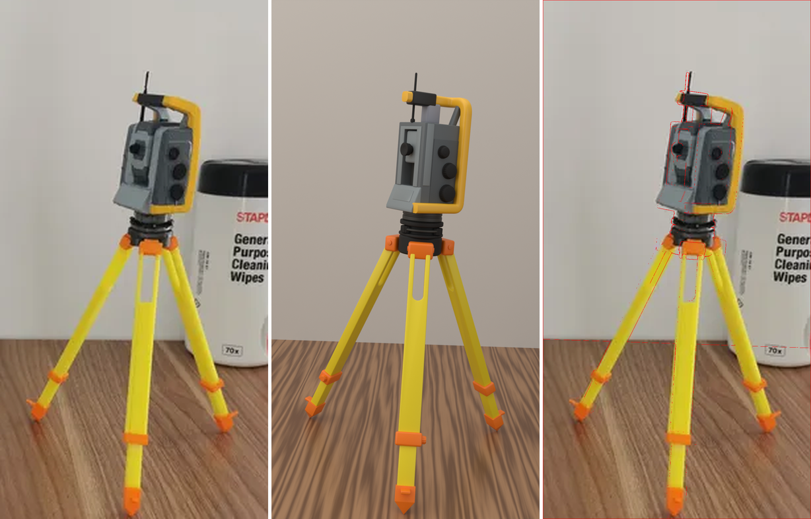
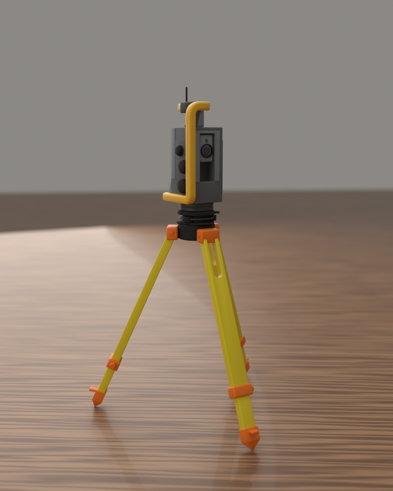
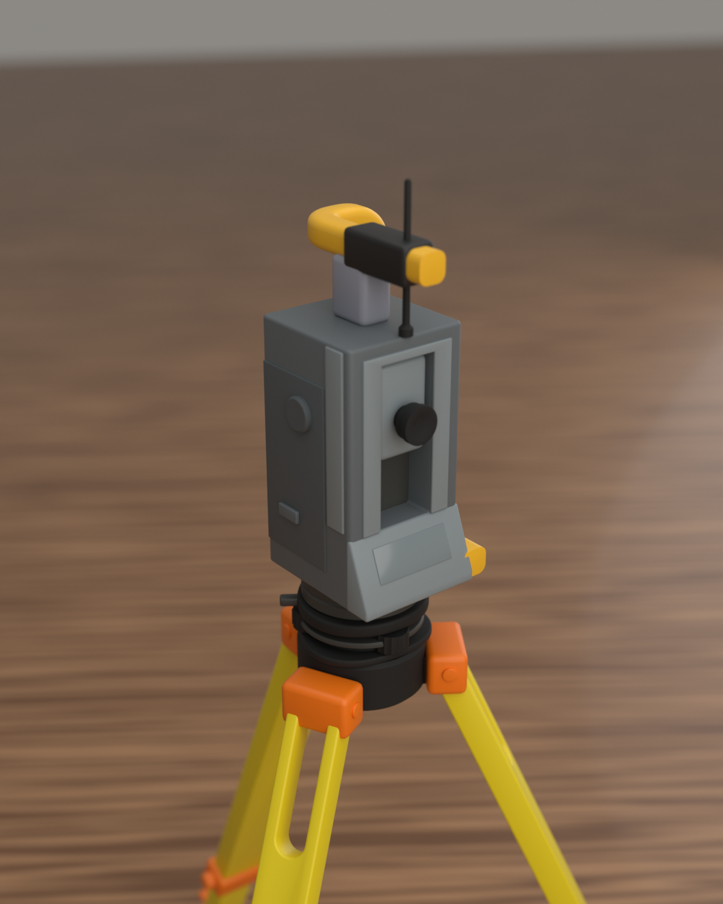
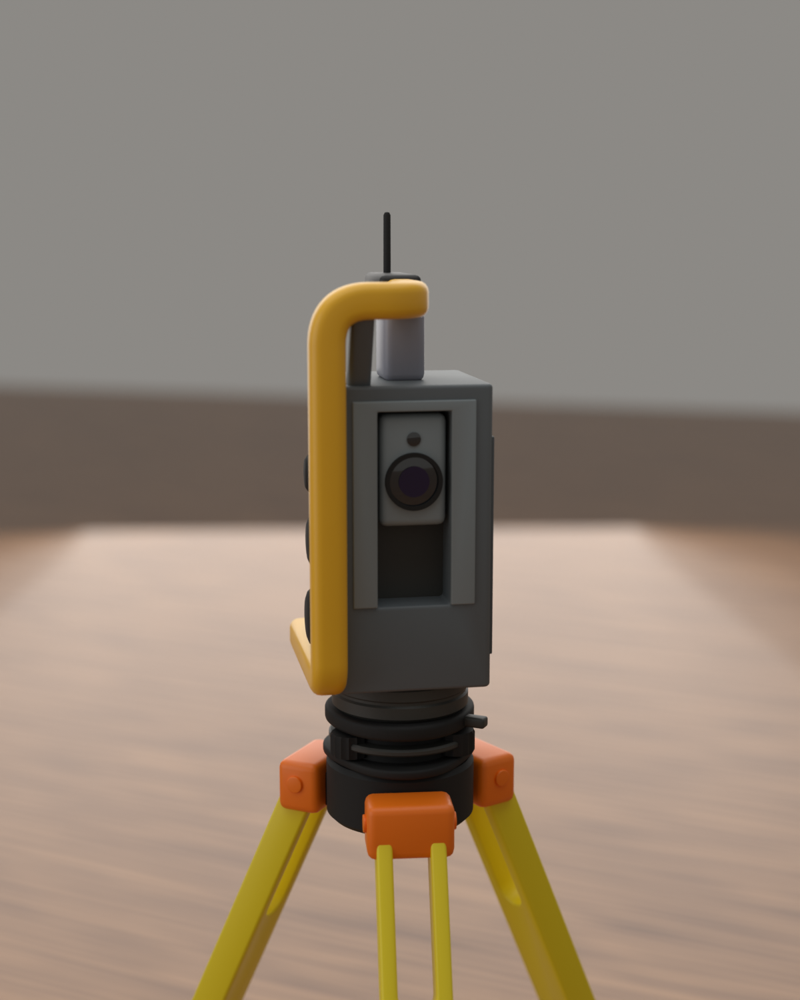

# جهاز المساحة Total Station على ترايبود — نموذج Blender مطابق للصورة (ارتفاع 20 سم)



*يسار: الصورة الأصلية — وسط: رندر النموذج من كاميرا `Cam_Photo` — يمين: حواف النموذج (أحمر) مرسومة فوق الصورة الأصلية.*

| | | |
|---|---|---|
|  |  |  |

---

## 1) تحليل الصورة

الصورة لمجسّم مطبوع 3D لجهاز Total Station روبوتي فوق ترايبود خشبي الطراز:

**الترايبود (أصفر + برتقالي):**
- 3 أرجل مسطحة. الجزء العلوي عريض (10 × 5.2 مم) وفيه **شق مفتوح** تحت الرأس مباشرة (سكتين) بطول ~26 مم.
- **مشبك برتقالي** عند 73% من طول الرجل، وتحته رجل منزلقة أنحف (7.8 × 5 مم).
- **حذاء برتقالي مدبّب** في آخر 10% من الرجل + **دواسة** أفقية تبرز للخارج.
- **رأس أسود** وعليه 3 **كتل برتقالية** (مفصلات) بارتفاع 8 مم.

**التريبراك والقاعدة:** حلقات سوداء متراكبة مع شريط رمادي، 3 براغي تسوية، ثم قاعدة دوّارة رمادية داكنة.

**الجهاز:**
- جسم رمادي شبه مكعب (22.7 × 22.6 × 44 مم).
- **الوجه الخلفي (جهة المشغّل):** إطار رمادي فاتح حول نافذة التلسكوب، **العينية السوداء**، تجويف داكن تحتها، و**كونسول مائل** فاتح في الأسفل (الشاشة/لوحة المفاتيح).
- **الجانب الأيمن:** لوح داكن عليه **3 مقابض سوداء** في عمود (Ø5.8 / Ø7.6 / Ø8.4 مم) وشريط فاتح قرب الحافة الخلفية.
- ملاحظة مهمة: **المقبض العلوي والعينية على نفس الارتفاع (30.5 مم)** = محور دوران التلسكوب، وهذا يؤكد صحة القياس.
- **المقبض الأصفر:** إطار يبدأ أسفل الجانب الأيمن، يصعد عند الزاوية الأمامية، ينحني فوق الجهاز ثم يمتد للخلف في المنتصف.
- **وحدة الراديو السوداء** على الجزء الخلفي من المقبض مع **طرف أصفر**، و**الأنتين** واقف على سطح الجهاز ويخترق الوحدة السوداء.
- دعامتان تحت المقبض: خلفية رمادية مزرقّة وأمامية رمادية مائلة.

## 2) طريقة القياس (حتى يكون الشكل نفسه بالضبط)

الصورة صغيرة (203×393) فلم أعتمد على التخمين:

1. حدّدت بكسلات دقيقة لنقاط واضحة: زوايا الجسم، رأس الأنتين، أطراف الأرجل الثلاثة، مركز التريبراك.
2. عملت **معايرة كاميرا (Least Squares)**: موقع الكاميرا، الميلان، البُعد البؤري، ودوران الجهاز — بخطأ ~1 بكسل.
   اكتشفت أن الصورة مائلة **4.4°** (الحواف والأنتين والعلبة كلها مائلة بنفس الزاوية) فتم تعويضها.
3. بعدها كل تفصيلة في الصورة **أسقطتها على مستوى الوجه الخاص بها** فطلعت بالمليمتر الحقيقي.
4. الارتفاع الكلي مثبّت على **200 مم** (من سن الرجل إلى رأس الأنتين).
5. الألوان مأخوذة من الصورة نفسها، والإضاءة معايرة حتى تطابق ألوان الرندر الصورة (فرق أقل من ~10%).

### المقاسات الأساسية (مم)

| الجزء | القيمة |
|---|---|
| الارتفاع الكلي | **200.0** |
| رأس الترايبود (مركز المفصلات) | 113 |
| التريبراك | 118.9 → 126.8 |
| القاعدة الدوّارة | 126.8 → 132 |
| جسم الجهاز | 132 → 176.1 (22.7 × 22.6 × 44.1) |
| محور التلسكوب | 162.5 (30.5 فوق أسفل الجسم) |
| المقبض الأصفر (مقطع 5 × 5) | أعلاه 190.4 |
| رأس الأنتين | 200 |
| نصف قطر الأرجل على الأرض | 65.4 (المسافة بين رجلين ≈ 113) |
| طول الرجل / ميلانها | 124 / 24.2° عن الرأسي |

## 3) خطة البناء (ما تم تنفيذه)

1. **TS_Tripod:** 3 أرجل (علوية بشق + مشبك + منزلقة + حذاء + دواسة) + كتل المفصلات والمسامير + الرأس.
2. **TS_Tribrach:** قاعدة مثلثة، 3 براغي تسوية مخرّشة، الحلقة الرمادية، اللوح العلوي، ذراع القفل.
3. **TS_Instrument:** الجسم (Boolean لنافذة التلسكوب + Bevel)، الإطارات الفاتحة، الألواح الجانبية، المقابض المخرّشة،
   الكونسول المائل، التلسكوب (العينية + العدسة الشيئية بطلاء + عدسة التتبع)، المقبض الأصفر (Sweep)، وحدة الراديو، الدعامتان، الأنتين.
4. **الكاميرا `Cam_Photo`** = نفس زاوية الصورة بالضبط (مع الميلان) للمقارنة.
5. الواجهات غير الظاهرة في الصورة (الأمام والجانب الأيسر) صممتها بنفس الأسلوب: نافذة أمامية مع العدسة الشيئية، وغطاء محور التلسكوب على الجانب الأيسر.

## الملفات

| الملف | الوصف |
|---|---|
| `total_station_20cm.blend` | ملف بلندر جاهز: النموذج + الطاولة والجدار + الإضاءة + 4 كاميرات |
| `total_station_20cm.glb` | النموذج مع الخامات (Sketchfab / Unity / Unreal / أي برنامج) |
| `total_station_20cm.obj` + `.mtl` | نسخة OBJ |
| `total_station_20cm_mm.stl` | للطباعة ثلاثية الأبعاد — **بالمليمتر (200 mm)** |
| `total_station.py` | السكربت الذي يبني النموذج كاملاً داخل بلندر |
| `renders/` | `photo.png` (نفس زاوية الصورة)، `hero.png`، `close.png`، `front.png`، `compare_photo.png` |

## الاستخدام داخل بلندر

- الوحدات: متر (Unit Scale = 1) والعرض بالسنتيمتر. كل قطعة كائن مستقل باسم واضح
  (مثل `LegFront_Upper`, `Knob_Vertical`, `Handle_Frame`, `Radio_Module`).
- **Empties للتحريك:**
  - `Alidade_Pivot` → دوّره على Z لتدوير الجهاز أفقياً.
  - `Telescope_Pivot` → دوّره على محوره المحلي X لرفع/خفض التلسكوب.
- لرؤية زاوية الصورة: اختر `Cam_Photo` واضغط Numpad 0 (الدقة 812×1572).
- مجموعة `TS_Stage` (طاولة، جدار، إضاءة) للرندر فقط — أخفها قبل التصدير لو تحتاج.

### إعادة البناء من السكربت
داخل بلندر (4.2 أو أحدث): **Scripting → Open → `total_station.py` → Run Script**.

أو من الطرفية مع الرندر والتصدير:
```bash
blender -b -P total_station.py -- --render --export
```
