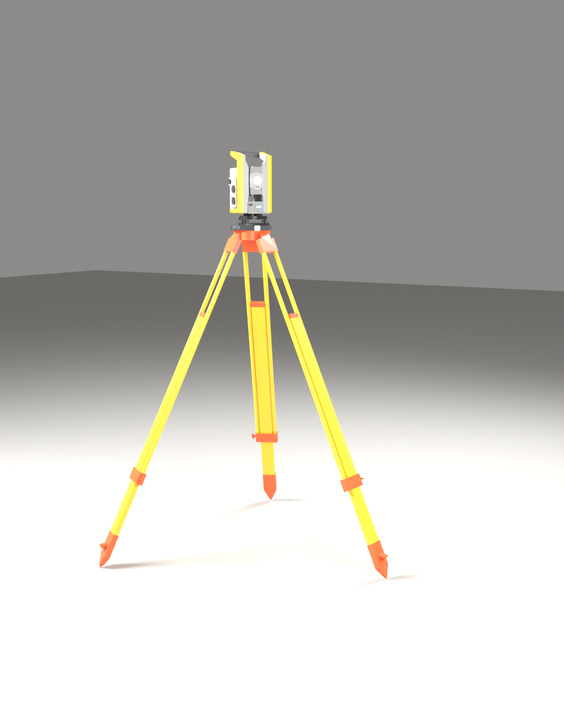
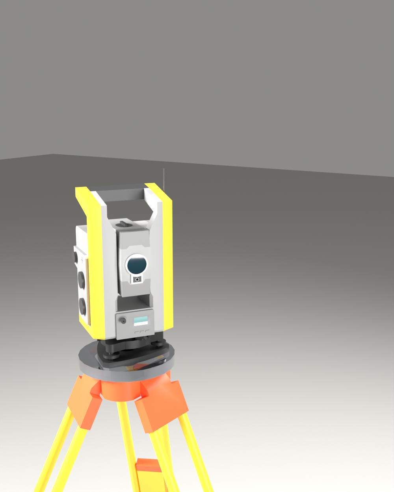
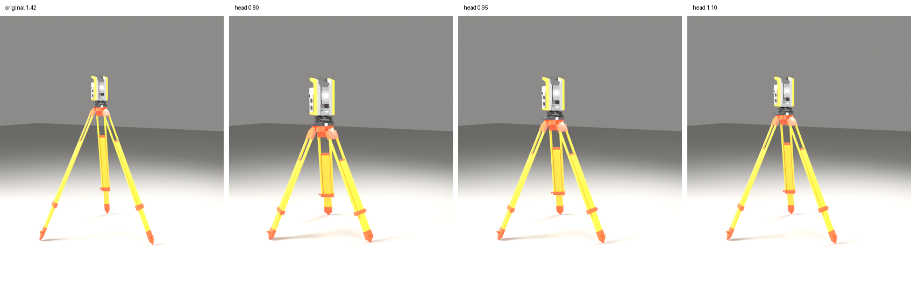

# Trimble S6 على ترايبود — تحويل من SketchUp إلى Blender

| | |
|---|---|
|  |  |

## ماذا حصل

الملف `TRIMBLE_TOTAL_STATION_S6TRIPOD.skp` بصيغة **SketchUp 2021**. بلندر لا يفتح هذه الصيغة،
وإضافات الاستيراد المعروفة تحتاج مكتبة SketchUp الرسمية (ويندوز/ماك فقط).

لذلك كتبت محوّل `skp_to_blender.py` يقرأ الملف مباشرة بدون SketchUp:

- ملف SKP الحديث هو **ZIP** فيه `material.xml` للخامات و `model.dat` للهندسة.
- `model.dat` عبارة عن شجرة سجلات (رقم وسم + طول + بيانات). فككت الوسوم من الملف نفسه:
  الرؤوس (x y z بالإنش) ← الحواف ← الحلقات ← الوجوه (مع الثقوب) ← المجموعات ومصفوفات تحويلها ← الخامات.
- الوجوه التي فيها ثقوب تُقسَّم مثلثات، والوجوه المصبوغة من الخلف تُقلب حتى يكون اللون للخارج،
  والتنعيم حسب الزاوية (35°) مثل SketchUp.

النتيجة: 3864 رأس، 2066 وجه SketchUp ← 4915 مضلع في بلندر، 12 خامة (أصفر، برتقالي، رماديات، زجاج العدسة…).
4 وجوه فقط تالفة/مكررة في الأصل تم تجاهلها.

## الملفات (تُولَّد في هذا المجلد)

| الملف | الوصف |
|---|---|
| `Trimble_S6_Tripod.blend` | ملف بلندر جاهز: الموديل + أرضية + إضاءة + كاميرتين |
| `Trimble_S6_Tripod.fbx` / `.glb` / `.obj` | للاستيراد في أي برنامج |
| `Trimble_S6_Tripod_200mm.stl` | نسخة للطباعة **بارتفاع 200 مم** (بالمليمتر) |

الموديل داخل بلندر بالحجم **الحقيقي**: 1.10 × 1.20 × **1.76 م** (المتر = 1 وحدة).
لتصغيره إلى 20 سم: حدده ← `S` ← اكتب `0.1136` ← Enter ← `Ctrl+A` ← Scale.

## إعادة التحويل (لأي ملف SketchUp 2021 أو أحدث)

```bash
blender -b -P skp_to_blender.py -- MODEL.skp OUT_DIR --render
```

## نسخة الأرجل الأقصر



`shorten_legs.py` يقصّر **الأرجل فقط**: كل رجل تنضغط على محورها هي، فتبقى زاوية الفتح (25°)
وسماكة القضبان ومواضع المشابك والأحذية كما هي، وكل شيء فوق المفصلات لم يتغير.

- الافتراضي: رأس الترايبود من 1.42 م إلى **0.95 م** (الأرجل أقصر بـ ~37%)، الارتفاع الكلي **1.29 م**.
- نسبة الصورة بالضبط (رأس 0.515 م) طلعت الأرجل قصيرة جداً وعريضة لأن سماكتها لا تتغير، فاخترت 0.95.
- الملفات: `Trimble_S6_Tripod_short.blend / .fbx / .glb / .obj` و `Trimble_S6_Tripod_short_200mm.stl`.

```bash
blender -b -P shorten_legs.py -- Trimble_S6_Tripod.blend OUT_DIR --render            # رأس 0.95 م
blender -b -P shorten_legs.py -- Trimble_S6_Tripod.blend OUT_DIR --head 1.1          # أو ارتفاع تختاره (متر)
```

## المصدر والترخيص

الموديل الأصلي من **3D Warehouse** (المؤلف: **D.Sosserov**، Model ID `85f16dd3-0274-4ce2-9082-785059b921a7`).
رخصة 3D Warehouse لا تسمح بإعادة توزيع الموديل، لذلك ملفات الموديل المحوّلة **غير مرفوعة إلى المستودع**
(موجودة في `.gitignore` مثل باقي الموديلات الخارجية) — المرفوع فقط المحوّل وهذا الملف والصور.
