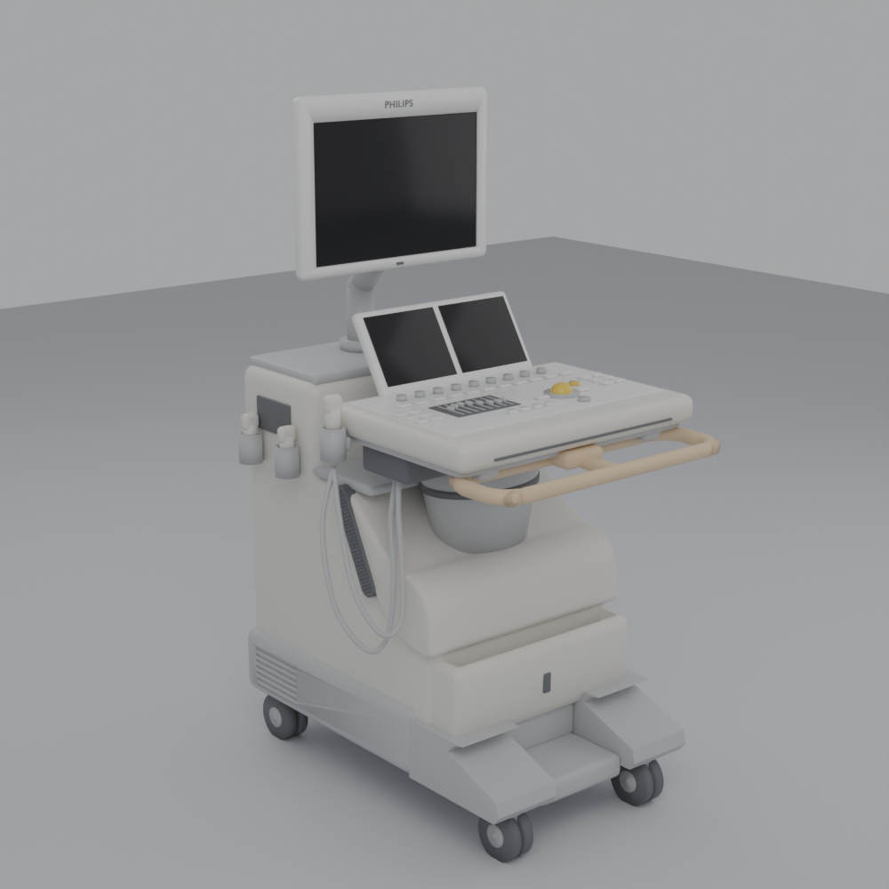

# جهاز السونار (Ultrasound Cart) — نموذج بلندر للطباعة ثلاثية الأبعاد

نموذج مبني بالكود (Python) داخل Blender لجهاز سونار على عربة، بنفس شكل الصورة:
شاشة كبيرة على ذراع، لوحة تحكم بأزرار وكرة تتبع، شاشة لمس مائلة، مقبض أمامي بيج،
حوامل مجسات (Probes) مع الكابلات، حاوية أمامية، شبكة سماعة، فتحات تهوية، و4 عجلات.

## الأبعاد (للطباعة)

| | القيمة |
|---|---|
| الطول (الارتفاع) | **400 مم** بالضبط (40 سم) |
| العرض | **195.6 مم** (≈ 20 سم، يشمل حوامل المجسات والكابلات) — بنفس نسبة الطول |
| العمق | **273.1 مم** (≈ 27 سم، يشمل المقبض الأمامي) — بنفس نسبة الطول |
| الوحدات | 1 وحدة بلندر = 1 مم |

لتغيير الطول: غيّر `TARGET_HEIGHT = 400.0` في أعلى الملف، والعرض والعمق يتغيران بنفس النسبة.

## محتويات المجلد

| الملف | الوصف |
|---|---|
| `ultrasound_machine.blend` | ملف بلندر جاهز — كل قطعة منفصلة ولها مادة/لون |
| `ultrasound_machine.py` | السكربت الذي يبني النموذج (يمكن تعديل المقاسات منه) |
| `export/` | ملفات STL جاهزة للطباعة (400 مم) |
| `previews/` | صور معاينة من 3 زوايا |

> ملف `ultrasound_solid.stl` تم فحصه: **قطعة واحدة مغلقة، 0 حواف غير سليمة (non-manifold)**، حوالي 56 ألف مثلث.

## طريقة التشغيل

1. افتح Blender (تمت التجربة على 4.2، ويعمل على 3.6 وما بعدها).
2. اذهب إلى تبويب **Scripting**.
3. **Open** ← اختر `ultrasound_machine.py`.
4. اضغط **Run Script** (أو `Alt+P`).
5. احفظ الملف `.blend` إذا أردت تعديل القطع يدوياً (كل قطعة كائن منفصل بلون خاص).

## الملفات الناتجة (STL بالمليمتر)

تُحفظ في مجلد `ultrasound_export` بجانب ملف الـ `.blend` (أو في مجلد المستخدم إذا الملف غير محفوظ):

| الملف | الاستخدام |
|---|---|
| `ultrasound_solid.stl` | **قطعة واحدة مغلقة (Watertight)** — الأفضل للطباعة بلون واحد ثم الدهان |
| `ultrasound_full.stl` | كل القطع متداخلة في ملف واحد (أي Slicer يدمجها تلقائياً) |
| `color_*.stl` | ملف لكل لون — للطابعات متعددة الألوان (AMS / MMU): حمّلها معاً كقطعة واحدة |

## الإعدادات في أعلى السكربت

| الإعداد | الوظيفة |
|---|---|
| `TARGET_HEIGHT` | الطول الكلي بالمليمتر |
| `WITH_CABLES` | إظهار كابلات المجسات (قطرها 3 مم) |
| `WITH_LOGO_TEXT` | النص البارز على إطار الشاشة |
| `FLAT_WHEELS` | تسطيح أسفل العجلات ليلتصق النموذج بسطح الطباعة |
| `PRINT_BASE` | إضافة قاعدة عرض 3 مم تحت العجلات |
| `MAKE_SOLID_UNION` | دمج كل القطع في مجسم واحد مغلق |
| `RENDER_PREVIEW` | إخراج صور معاينة PNG |

## نصائح الطباعة

- **FDM**: طبقة 0.12–0.16 مم، فوهة 0.4، Supports من نوع **Tree** (للشاشة، المقبض، لوحة التحكم، الكابلات).
- **Resin**: ممتاز للتفاصيل الصغيرة (الأزرار والنص). اجعل النموذج مجوّف (Hollow) بسماكة 2–2.5 مم مع فتحات تصريف.
- إذا أردت تقليل الدعامات: اطبع الشاشة مع الذراع منفصلة — افصلها في بلندر من عند `Arm_Post`.
- الكابلات رفيعة (3 مم): اطبعها بسرعة منخفضة أو أطفئها `WITH_CABLES = False` وأضف سلك حقيقي بعد الطباعة.

## ألوان الدهان

| المادة | اللون |
|---|---|
| Cream_Body | أبيض كريمي (جسم الجهاز) |
| Monitor_White | أبيض (إطار الشاشة والأزرار) |
| Light_Grey | رمادي فاتح (القاعدة، العمود، الذراع، الكابلات) |
| Dark_Grey | رمادي غامق (العجلات، السماعة) |
| Tan_Handle | بيج (المقبض الأمامي) |
| Trackball | أصفر/برتقالي (كرة التتبع) |
| Screen_Black | أسود (الشاشات) |
