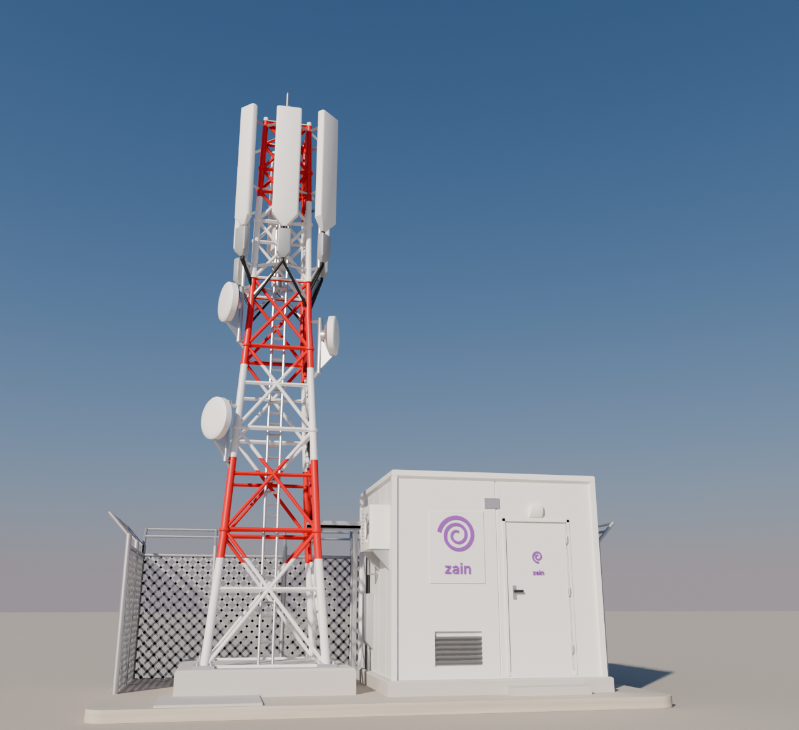
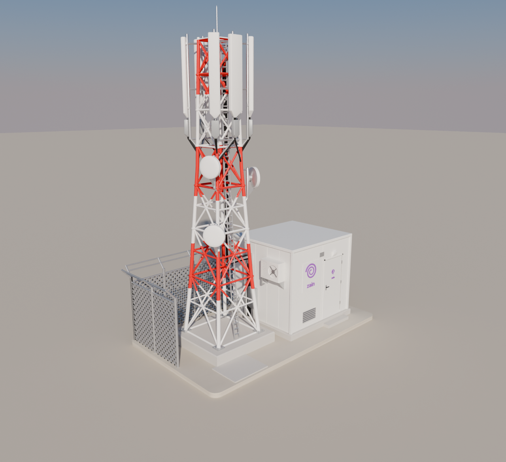
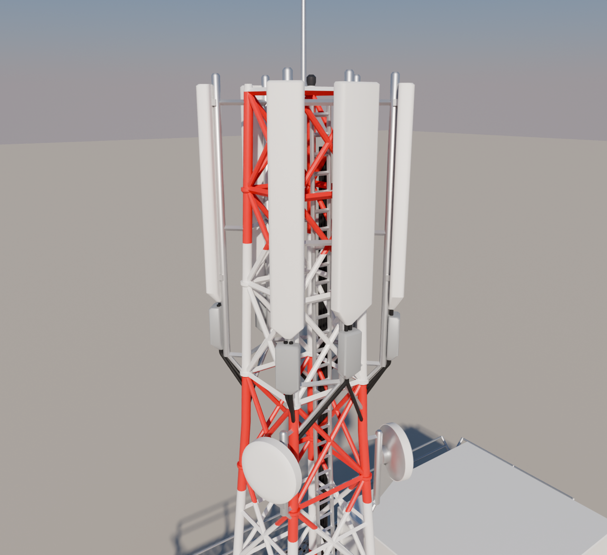
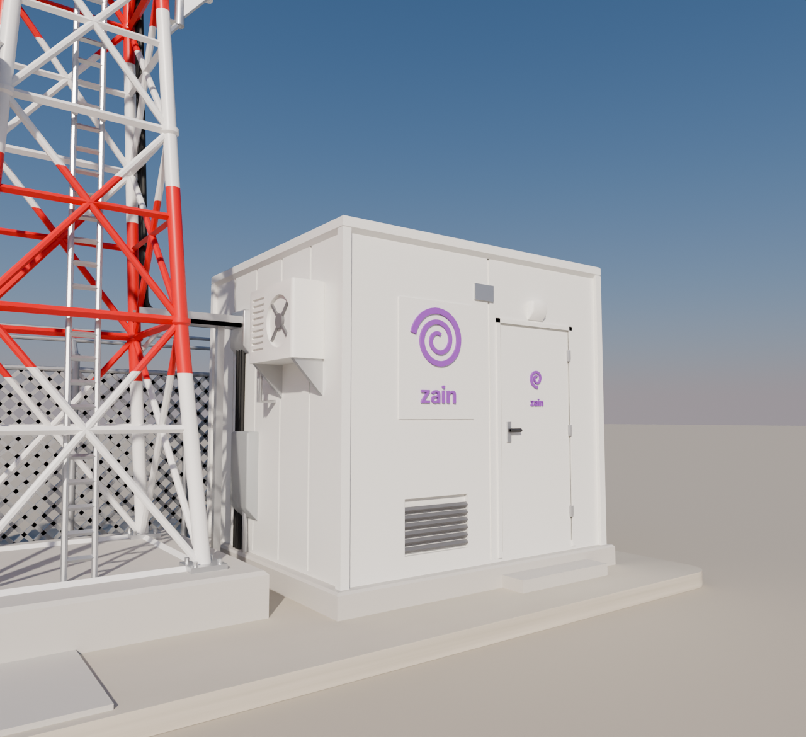

# برج اتصالات مع غرفة المعدات — موديل Blender قابل للطباعة

موديل كامل لموقع اتصالات (برج شبكي أحمر وأبيض + غرفة معدات + سياج)، مبني من
سكربت Python داخل Blender ومصمم للطباعة ثلاثية الأبعاد **بقطعة واحدة وبدون سبورت تقريبًا**.



| منظر ثلاثي الأبعاد | الهوائيات | الغرفة |
|---|---|---|
|  |  |  |

## الملفات

| الملف | الوصف |
|---|---|
| `zain_tower.py` | السكربت الذي يبني كل شيء (قابل للتعديل: الارتفاع، العرض، عدد الهوائيات…) |
| `zain_tower_site.blend` | مشهد Blender جاهز: مجموعات (Collections) مرتبة، خامات، كاميرا وإضاءة |
| `stl/zain_tower_site_full.stl` | **ملف الطباعة** — مجسم واحد مغلق (watertight) |
| `stl/colors/*.stl` | نفس الموديل مقسّم حسب اللون للطابعات متعددة الألوان (AMS / MMU) |
| `renders/print_check_*.png` | فحص الطباعة: الأحمر = أسطح سفلية أفقية (كلها جسور قصيرة) |

## المقاسات

- المقياس **1:50**، الوحدة **ملم**.
- الحجم الكلي: **161 × 94 × 208 ملم** (العرض × العمق × الارتفاع).
- يحتاج طابعة بمساحة 165 × 100 × 210 ملم على الأقل (Bambu A1/P1/X1، Prusa MK4، Ender 3…).

## إعدادات الطباعة المقترحة

| الإعداد | القيمة |
|---|---|
| الفوهة | 0.4 ملم (أو 0.2 للتفاصيل الأدق) |
| ارتفاع الطبقة | 0.12 – 0.16 ملم |
| الخامة | PLA |
| السبورت | **بدون** |
| التبريد | 100٪ |
| الحشو | 10–15٪ (الغرفة صلبة من الداخل) |
| الاتجاه | كما هو — القاعدة على السطح |

لا تصغّر الموديل أقل من **80٪** مع فوهة 0.4، لأن الأعمدة الرفيعة (0.8–1.1 ملم)
ستصبح أرفع من أن تُطبع. للتصغير أكثر استخدم فوهة 0.2.

## لماذا لا يحتاج سبورت

السكربت يتحقق تلقائيًا بعد التصدير: يقطع الموديل إلى طبقات 0.2 ملم ويبحث عن أي
جزء يبدأ في الهواء. النتيجة الحالية: **0 جزر معلّقة**. الطرق المستخدمة:

- **الأعمدة الأفقية** مربعة مقلوبة على حافتها (شكل ◇)، فأسفلها زاويتان 45° بدل سطح مسطح.
- **الهوائيات والـ RRU والصناديق على الجدران** أسفلها مائل 45° حتى نقطة التثبيت.
- **صحون المايكرويف** أسفلها زعنفة تثبيت مائلة 45° تحمل الحافة الدائرية.
- **كل أنبوب تثبيت** يبدأ من دعامة مائلة (knee brace) من رجل البرج.
- **الكابلات** تنزل بميل 50° أو أكثر، وتمر فوق جسر الكابلات وله عمود في المنتصف.
- **المكيّف** على حاملين مثلثين بزاوية 45°، وحافة السقف مشطوفة 45°.
- **شبك السياج** أسلاكه مائلة 45° أصلًا فهو يطبع بدون أي دعم.

ما تبقى من أسطح أفقية جسور قصيرة بين نقطتين (أطولها حوالي 30 ملم في أسفل البرج)،
وأي طابعة حديثة تطبعها بدون سبورت.

## الطباعة بالألوان

افتح كل ملفات `stl/colors/` معًا في Bambu Studio / OrcaSlicer / PrusaSlicer، وعندما
يسأل **"Load as a single object with multiple parts?"** اختر **Yes**، ثم أعط كل جزء لونه:

| الملف | اللون |
|---|---|
| `red.stl` | أحمر — أشرطة البرج |
| `white.stl` | أبيض — باقي البرج، الغرفة، الهوائيات، الصحون |
| `grey.stl` | رمادي — القاعدة، الخرسانة، السياج، حوامل الهوائيات |
| `black.stl` | أسود — الكابلات ومقبض الباب |
| `purple.stl` | بنفسجي — الشعار |

## التعديل داخل Blender

1. افتح `zain_tower_site.blend` مباشرة، أو
2. افتح Blender ← تبويب **Scripting** ← **Open** ← `zain_tower.py` ← **Run Script**.

أهم المتغيرات في أعلى السكربت:

| المتغير | المعنى |
|---|---|
| `H` | ارتفاع البرج الشبكي (180 ملم) |
| `HW_KNOTS` | نصف عرض البرج على الارتفاعات المختلفة (شكل الاستدقاق) |
| `BANDS` | عدد الأشرطة الأحمر/الأبيض |
| `ANTENNAS` | اتجاه ومقاس كل هوائي |
| `DISHES` | مكان واتجاه صحون المايكرويف |
| `SH` | أبعاد غرفة المعدات |

لإعادة تصدير ملفات STL بعد التعديل (يحتاج Python مع `bpy` و `manifold3d`):

```bash
pip install bpy manifold3d
python3 zain_tower.py
```

ولإعادة رندر الصور:

```bash
RENDER=1 python3 zain_tower.py
```
