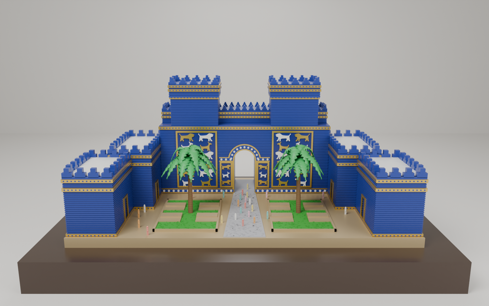
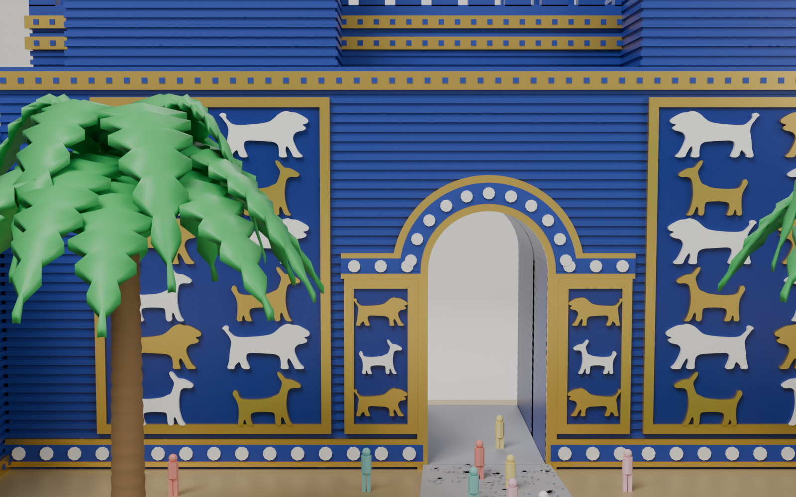
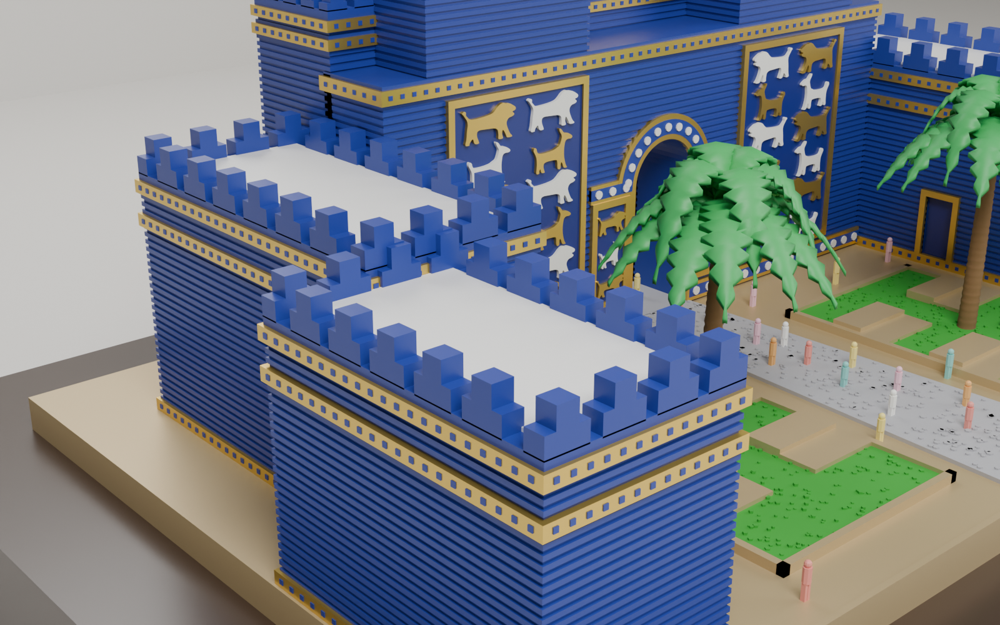
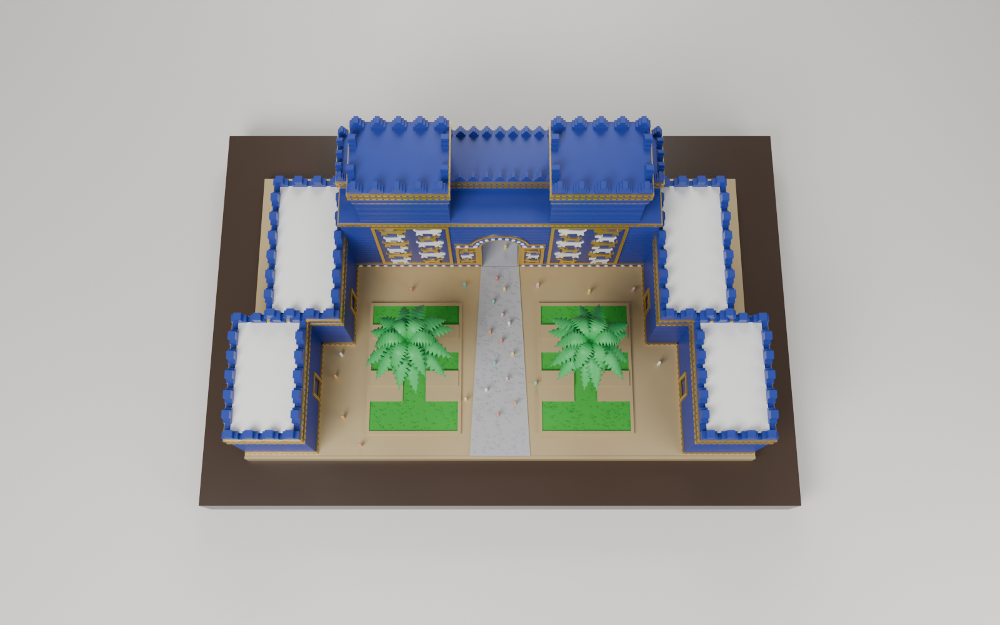

# بوابة عشتار — موديل Blender جاهز للطباعة ثلاثية الأبعاد



| تفاصيل البوابة | الجناح الجانبي | من الأعلى |
|---|---|---|
|  |  |  |

موديل كامل لماكيت بوابة عشتار مطابق لتصميم الصورة: البرجان بالشرفات البابلية
المدرّجة، الواجهة الزرقاء المضلّعة (خطوط الطابوق الأفقية)، لوحات الأسود
والثيران/التنانين البارزة بالذهبي والأبيض، الأشرطة الذهبية المنقّطة، قوس
المدخل بالوردات البيضاء، الجناحان الجانبيان بالأبواب والسطوح البيضاء،
الحديقتان بالتصميم المدرّج، النخلتان، الممر الحجري، والأشخاص الصغار.

## الملفات

| الملف | الاستخدام |
|---|---|
| `ishtar_gate.blend` | المشهد كامل في Blender: مواد ملوّنة، كاميرا بنفس زاوية الصورة، إضاءة، ومجموعات (Gate / Wing_L / Wing_R / Plaza / Palms / People) |
| `stl/ishtar_gate_full.stl` | **للطباعة بلون واحد** — قطعة واحدة مغلقة (watertight) بدون أخطاء |
| `stl/color_*.stl` | **للطباعة متعددة الألوان (AMS / MMU)** — ملف لكل لون، بنفس نقطة الأصل وبدون تداخل |
| `ishtar_gate_multicolor.3mf` | نفس ألوان الملفات السابقة في ملف واحد — افتحه في Bambu Studio / Orca / PrusaSlicer وعيّن خيطًا لكل جزء |
| `stl/part_*.stl` | أجزاء منفصلة لمن يريد الطباعة قطعًا ثم التلوين والتركيب |
| `ishtar_gate.py` | السكربت الذي يبني الموديل (كل الأبعاد قابلة للتعديل) |
| `export_print.py` | يعيد البناء ويصدّر كل الملفات ويعمل الرندر |

## المقاسات

- **220 × 131 × 96 ملم** (العرض × العمق × الارتفاع مع القاعدة) — تدخل على
  طابعات 220×220 (Ender 3، Bambu A1، Prusa MK4...).
- الوحدة: 1 = 1 ملم. لتكبير الماكيت كبّر في السلايسر مباشرة (مثلاً 200% = 44 سم).
- القاعدة 6 ملم، الجدران مصمتة (السلايسر يملؤها بالـ infill).

## إعدادات الطباعة المقترحة

- **الاتجاه:** كما هو، القاعدة على السرير. الشيء الوحيد الذي يحتاج دعامات
  هو **سعف النخيل**: فعّل دعامات Tree وارسمها على السعف فقط (Support painting)،
  أو اطبع ملفات `part_*.stl` (البوابة، الجناحين، الساحة) بدون النخيل، واطبع
  `part_Palms.stl` وحدها ثم ألصقها في مكانها.
- الطبقة 0.12–0.16 ملم لإظهار خطوط الطابوق والحيوانات البارزة (بروز 0.6 ملم).
- نوزل 0.4 كافٍ، 0.2 يعطي تفاصيل أنعم للحيوانات والأشخاص. للرزن (Resin)
  الموديل ممتاز كما هو (فرّغه Hollow بسماكة 2 ملم).
- Infill 10–15%، جداران (walls) 3.

### الألوان (للطباعة متعددة الألوان)

| الملف | اللون |
|---|---|
| `color_BLUE` | أزرق لازوردي — الجدران والشرفات والنقاط الصغيرة على الأشرطة |
| `color_PANEL` | أزرق غامق — خلفية لوحات الحيوانات وأبواب الأجنحة |
| `color_GOLD` | ذهبي — الأشرطة والإطارات والحيوانات الذهبية |
| `color_WHITE` | أبيض — الحيوانات البيضاء والوردات وأسطح الأجنحة |
| `color_SAND` | بيج/ذهبي فاتح — القاعدة وحواف الحدائق والمقاعد |
| `color_GRASS` | أخضر — العشب |
| `color_STONE` | رمادي — الممر |
| `color_TRUNK` | بني — جذوع النخيل |
| `color_LEAF` | أخضر فاتح — سعف النخيل |
| `color_PEOPLE` | أي لون — الأشخاص (أو لوّنهم يدويًا) |

في Bambu Studio / Orca: اسحب كل ملفات `color_*.stl` معًا ← "Load as a single
object with multiple parts" ← **Yes**، ثم عيّن خيطًا لكل جزء.

## التعديل في Blender

افتح `ishtar_gate.blend` مباشرة، أو افتح `ishtar_gate.py` في تبويب Scripting
واضغط Run Script لإعادة البناء من الصفر. الأرقام الرئيسية في أعلى قسم
`Build`:

- `FACADE_H`, `TOWER_H`, `CROWN_H` — ارتفاعات الواجهة والأبراج
- `G_HALF` — نصف عرض البوابة، `ARCH_R` و `ARCH_SPRING` — القوس
- `ribbed_box(... pitch=1.25, depth=0.32)` — كثافة وعمق خطوط الطابوق
- `LION` و `BULL` — نقاط رسم الأسد والثور (عدّلها لتغيير الشكل)

لإعادة تصدير ملفات الطباعة خارج Blender (يحتاج `pip install bpy manifold3d trimesh networkx lxml`
على Python 3.11):

```bash
python export_print.py --render
```
